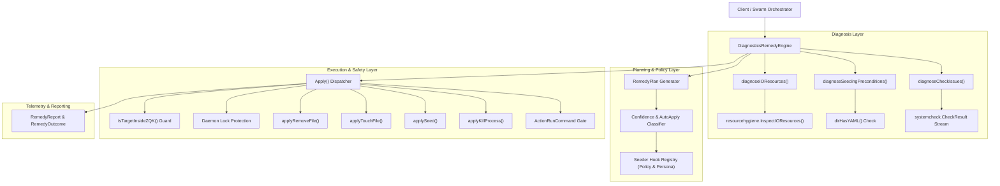
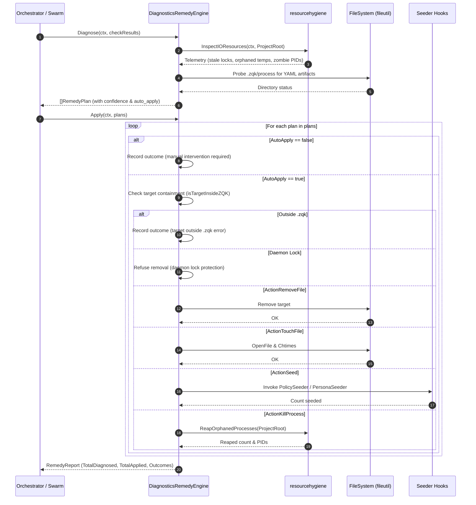
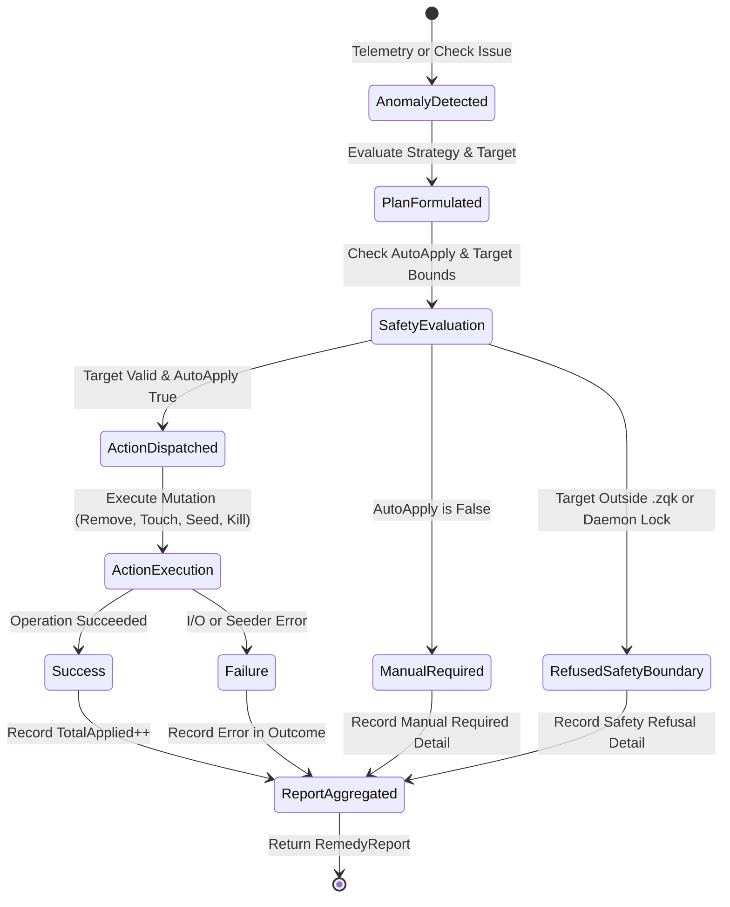

# System Auto-Remedy, Anomaly Healing & Remediation Engine Subsystem Operational Architecture Guide

Comprehensive architectural manual, invariants specification, and operational guide for the **ZQK System Auto-Remedy, Anomaly Healing & Remediation Engine Subsystem** (`pkg/system`).

---

## 1. Executive Summary & Architectural Compass

The System Auto-Remedy, Anomaly Healing & Remediation Engine Subsystem (`pkg/system`) serves as the resilient, self-healing substrate of the ZQK Knowledge Kernel. Governed by policy **POL-DEFAULT-b17f54c251eb3c4d**, the engine protects runtime environments from drift, lock contention, zombie process accumulation, orphaned temporary artefacts, and unseeded core preconditions.

In multi-agent swarm environments, autonomous execution loops frequently encounter transient operational friction: stale process locks remaining after abrupt terminations, orphaned temporary scratch files left behind by interrupted builds, or unseeded policy and persona packs in greenfield workspaces. Rather than aborting execution or requiring human operator intervention, `pkg/system` autonomously diagnoses environmental anomalies, synthesizes deterministic remedy plans, evaluates execution safety boundaries, and dispatches targeted remediation actions.

```
+-------------------------------------------------------------------------+
|                  Agent Swarm / CLI Command Plane                        |
|              (zqk system check --auto-fix / Autonomous Swarm)           |
+-------------------------------------------------------------------------+
                                    │
                                    ▼
+-------------------------------------------------------------------------+
|                 DiagnosticsRemedyEngine (pkg/system)                    |
|                                                                         |
|  [ Anomaly Detection ]  ──► I/O Resources, Stale Locks, Orphan PIDs     |
|  [ Precondition Probes] ──► Policy / Persona Seeding Verification       |
|  [ Check Issue Intake ] ──► System Check Validation Issue Translation   |
|  [ Safety Evaluator ]   ──► Boundary Containment (.zqk) & Lock Guard    |
|  [ Action Dispatcher ]  ──► File Removal, Touch, Seeding, Process Reap  |
+-------------------------------------------------------------------------+
                                    │
                                    ▼
+-------------------------------------------------------------------------+
|                    Self-Healed Workspace Environment                    |
|          (Clean Locks, Purged Temp Buffers, Initialized Seating)        |
+-------------------------------------------------------------------------+
```

### Core Invariants

- **Boundary Containment Invariant**: Destructive remediation actions (such as file removal or modification) are strictly confined to the `.zqk` project data directory. Any target path outside this boundary is rejected immediately with fail-closed safety.
- **Daemon Lock Invariant**: The engine categorically refuses to delete lock files situated under `/state/daemon_locks/`, ensuring that active ambient daemons and supervision singletons are never unseated by automated cleanup routines.
- **Explicit AutoApply Gating**: Remedy plans declare explicit `AutoApply` eligibility and confidence scoring. Non-trivial mutations or commands requiring interactive execution remain unapplied until authorized by the operator or execution runner.
- **Zero Swallowed Failures**: All remediation outcomes produce structured telemetry records (`RemedyOutcome` and `RemedyReport`), explicitly capturing errors, execution details, and diagnostic summaries without unhandled exceptions.
- **Thread-Safe Goroutine Execution**: Background diagnostics, resource scanning, and concurrent remediation cycles utilize labeled goroutine tracking via `goroutinelabels.NewGoroutine` to prevent goroutine leaks and ensure deterministic scheduling.

---

## 2. Component Topology & Subsystem Architecture

The auto-remedy subsystem cleanly separates anomaly diagnosis, policy evaluation, action dispatching, and safety enforcement into decoupled layers.



### Component Descriptions

1. **`DiagnosticsRemedyEngine`**:
   The primary entry point constructing and executing self-healing pipelines. Holds configuration state such as `ProjectRoot`, `PolicySeeder`, and `PersonaSeeder` hooks.

2. **`RemedyPlan` & `RemedyActionType`**:
   Discrete, verifiable remediation contracts specifying the anomaly identifier, descriptive human-readable title, concrete action type (`remove_file`, `touch_file`, `seed`, `kill_process`, `run_command`), target path or entity, execution command, confidence rating (0.0 to 1.0), and auto-apply qualification flag.

3. **`RemedyReport` & `RemedyOutcome`**:
   Structured telemetry results detailing the number of diagnosed plans, the quantity safely applied, and per-plan execution outcomes (applied status, diagnostic error strings, and detailed logs).

4. **Safety & Containment Guards**:
   - `isTargetInsideZQK`: Path prefix validator guaranteeing modifications remain inside `.zqk`.
   - Daemon lock filter: Rejects removal requests matching `/state/daemon_locks/`.
   - YAML presence scanner (`dirHasYAML`): Inspects `.zqk/process/policies` and `.zqk/process/personas` for existing configurations before synthesizing seed operations.

---

## 3. Healing Lifecycle & Sequence Workflows

The auto-remedy lifecycle proceeds through distinct phases: anomaly detection, policy evaluation, action dispatch, verification, and feedback reporting.



### Remediation State Transitions



---

## 4. Safety Invariants & Guardrails

The Auto-Remedy engine adheres to strict runtime guardrails to prevent unintended state corruption:

### 1. Workspace Boundary Validation (`isTargetInsideZQK`)
All file modification operations (`remove_file`, `touch_file`) resolve the absolute normalized target path and compare it against `filepath.Clean(filepath.Join(e.ProjectRoot, paths.ProjectDataDir))`. Any attempt to manipulate paths outside the `.zqk` directory aborts with `errTargetOutsideZQK` (`"target file outside .zqk directory"`).

### 2. Daemon Singleton Lock Protection
Active ambient daemon processes maintain PID singletons in `/state/daemon_locks/`. Even if an ambient daemon process is temporarily paused or quiet, its lock is exempt from automated removal to prevent race conditions during daemon restarts.

### 3. Non-Destructive Command Action Gate
Plans of type `ActionRunCommand` are never executed implicitly by `Apply`. Instead, they return `msgCommandRequires` (`"command action requires runner execution"`), ensuring shell command execution is delegated to verified execution environments with standard error isolation.

### 4. Idempotent File Operations
Removal operations treat `fileutil.IsNotExist(err)` as success, ensuring that concurrent cleanups or pre-cleaned temporary files do not trigger spurious error cascades.

---

## 5. Concurrency & Thread-Safety

`pkg/system` is designed for high-concurrency multi-agent operation:

- **Goroutine Labeling**: When background diagnostic routines or concurrent test harnesses spawn goroutines, they use `goroutinelabels.NewGoroutine("<name>", "<purpose>").StartSimple(...)` to enforce runtime tracing and stack attribution.
- **Hermetic State Isolation**: Each `DiagnosticsRemedyEngine` instance operates independently over its configured `ProjectRoot`. Concurrent diagnosis runs do not share mutable package state.
- **Race-Free Verification**: Concurrency stress testing verifies that multiple goroutines can simultaneously evaluate and apply remedies across distinct or shared project roots without data races or resource deadlocks.

---

## 6. Verification & Test Coverage Invariant

Conforming to system-wide quality standards, `pkg/system` maintains strict test verification rules:

- **Coverage Floor Invariant**: Statement test coverage must meet or exceed **85.0%** (current implementation achieves **94.6%**).
- **Hermetic Test Directories**: All test fixtures must allocate isolated workspaces via `t.TempDir()`, ensuring zero leakage across test suites.
- **Filesystem Abstraction (`pkg/utils/fileutil`)**: Direct calls to `os.*` for filesystem mutations in test and production code are prohibited by pre-commit check valves in favor of `fileutil.*`.
- **Zero Swallowed Errors**: All returned error objects must be asserted or handled explicitly without blank assignments (`_ = ...`).

---

## 7. Operational Recipes & Command Reference

### Diagnosing and Auto-Remediating via CLI
Operators and autonomous agents trigger auto-remedy through standard system commands:

```bash
# Perform system check and apply all safe automated remedies
zqk system check --auto-fix

# Seed default policies when preconditions are missing
zqk system init --force

# Seed agent seating personas
zqk system agent-onboard
```

### Programmatic Integration in Go

```go
package main

import (
	"context"
	"fmt"
	"log"

	"github.com/zqk-os/zqk/pkg/system"
	"github.com/zqk-os/zqk/pkg/systemcheck"
)

func main() {
	engine := system.NewDiagnosticsRemedyEngine("/path/to/project")
	
	// Register domain seeders
	engine.PolicySeeder = func(root string) (int, error) {
		// Custom policy initialization logic
		return 3, nil
	}
	engine.PersonaSeeder = func(root string) (int, error) {
		// Custom persona initialization logic
		return 5, nil
	}

	// Run anomaly diagnostics
	plans, err := engine.Diagnose(context.Background(), nil)
	if err != nil {
		log.Fatalf("failed to diagnose anomalies: %v", err)
	}

	fmt.Printf("Diagnosed %d remedy plans\n", len(plans))

	// Apply safe automated remedies
	report, err := engine.Apply(context.Background(), plans)
	if err != nil {
		log.Fatalf("failed to apply remedies: %v", err)
	}

	fmt.Printf("Successfully applied %d remedies out of %d diagnosed\n", 
		report.TotalApplied, report.TotalDiagnosed)
}
```
