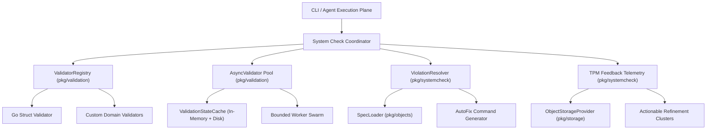
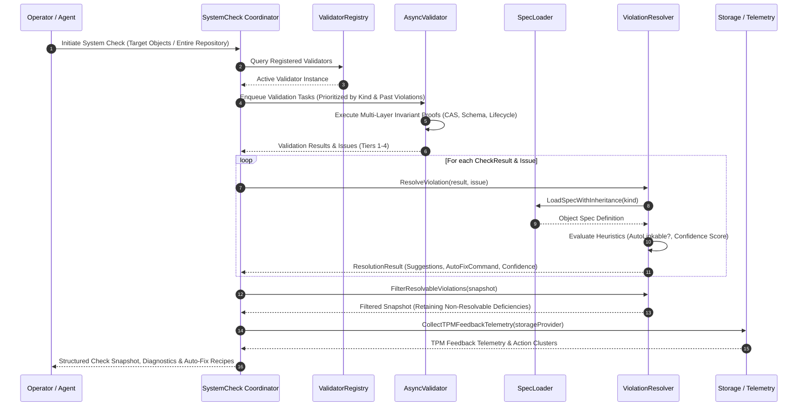
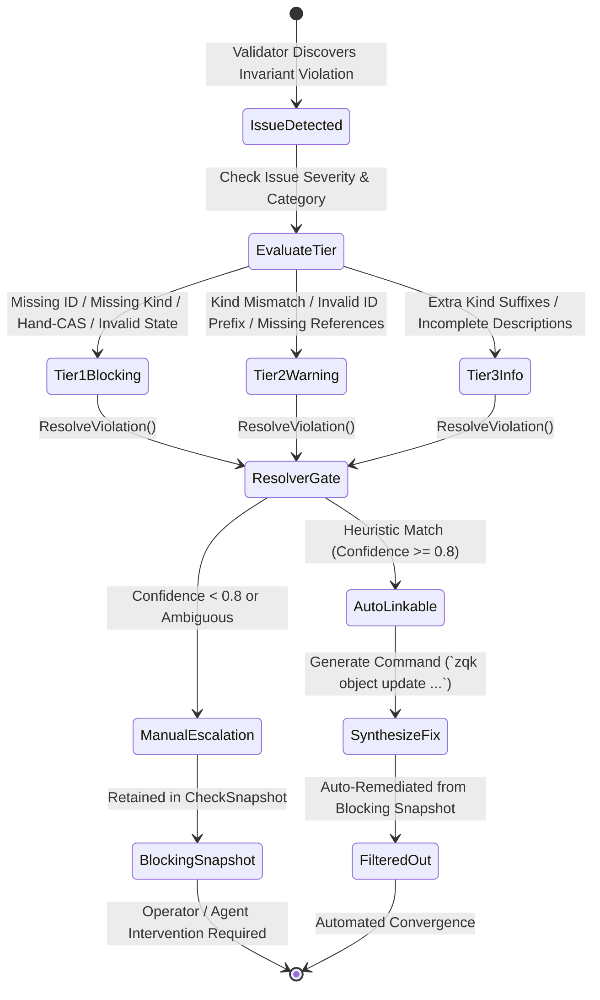
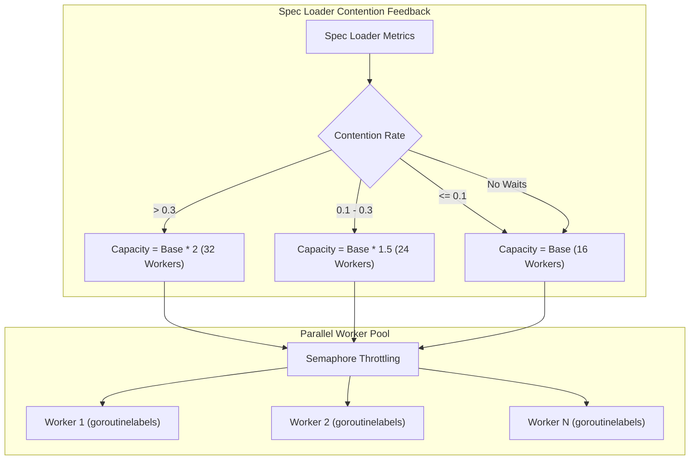

# System Check, Validator Registration & Violation Resolution Subsystem Operational Architecture Guide

Comprehensive architectural manual, invariants specification, and operational guide for the **ZQK System Check and Validation Subsystem** (`pkg/systemcheck`).

---

## 1. Executive Summary & Architectural Compass

The System Check Subsystem (`pkg/systemcheck`) operates as the continuous diagnostic, validation orchestration, and autonomous remediation engine of the ZQK Knowledge Kernel. Working across the Content-Addressed Storage (CAS) layer, relational ontologies, and operational planes, `pkg/systemcheck` coordinates multi-tiered invariant verification, categorizes detected anomalies into deterministic severity tiers, and synthesizes actionable auto-remedy strategies.

```
+-------------------------------------------------------------------------+
|                      Operator / Swarm Command Plane                     |
|                   (zqk system check / Agent Swarm Hooks)                |
+-------------------------------------------------------------------------+
                                    │
                                    ▼
+-------------------------------------------------------------------------+
|                  pkg/systemcheck Orchestration Surface                  |
|                                                                         |
|  [ ValidatorRegistry ] ──► Pluggable Validation Engines (Go, Custom)   |
|  [ AsyncValidator ]    ──► Bounded Concurrency & Semaphore Throttling   |
|  [ ViolationResolver ] ──► Spec-Informed Heuristics & Auto-Linking     |
|  [ LifecycleVerifier ] ──► State Machine Conformance & Fix Synthesis    |
|  [ IntegrityScanner ]  ──► Cryptographic CAS & Hash Drift Detection    |
|  [ TPMTelemetry ]      ──► Operational Gap & Hygiene Aggregation        |
+-------------------------------------------------------------------------+
                                    │
                                    ▼
+-------------------------------------------------------------------------+
|                   Autonomous Remediation & Feedback                     |
|           (Auto-Fix Execution, Clean Snapshots, Refinement Actions)      |
+-------------------------------------------------------------------------+
```

### Core Invariants

- **Fail-Closed Verification**: Any unrecognized object kind, missing canonical identifier, or unverified CAS digest triggers a non-zero diagnostic status.
- **Deterministic Violation Tiers**: Violations are partitioned into four strict tiers (Tier 1 Blocking, Tier 2 Warning, Tier 3 Informational, Tier 4 Recommendation) with guaranteed confidence scoring.
- **Zero Swallowed Failures**: All structural validation errors, spec load anomalies, and disk storage errors are explicitly propagated into diagnostic reports.
- **Bounded Concurrency & Contention Throttling**: Semaphore capacity automatically scales based on spec loader lock contention rates to eliminate CPU starvation and thread thrashing.
- **Automated Remediation Safety**: Auto-fix operations require a confidence threshold strictly >= 0.8 and produce verifiable CAS-compliant mutation commands.

---

## 2. Component Topology & Subsystem Architecture

The system check architecture cleanly isolates registration, validation execution, violation resolution, and telemetry reporting into decoupled components.



### Key Component Descriptions

1. **`ValidatorRegistry` (`pkg/validation/validator_interface.go`)**:
   Maintains thread-safe mappings of named validator implementations (`go`, `default`, custom). Exposes feature query methods (`SupportsFeature("lifecycle")`) and facilitates dynamic injection of domain-specific validation logic.

2. **`AsyncValidator` (`pkg/validation/async_validator.go`)**:
   Provides an asynchronous, non-blocking validation engine driven by a priority task queue and bounded worker routines. Dynamically sizes progress channels and throttles parallel file inspections.

3. **`ViolationResolver` (`pkg/systemcheck/violation_resolver.go`)**:
   Inspects validation results against object specifications (`.zqk/specs/internal/object_specs/`). Employs heuristic rules to determine whether a violation can be auto-linked or remediated, generating executable repair commands and calculating numerical confidence levels.

4. **`CheckRegistration` & Lifecycle Checkers (`pkg/systemcheck/validators_registration.go`)**:
   Lightweight, highly optimized functions that verify identifier format, object kind descriptors, separator suffixes, hand-CAS materialization status, and lifecycle state conformance.

5. **`CollectTPMFeedbackTelemetry` (`pkg/systemcheck/tpm_feedback_telemetry.go`)**:
   Aggregates unverified acceptance criteria, stalled in-progress items, and metadata hygiene defects across persistent storage, producing ranked action clusters for TPM cycle refinement.

---

## 3. System Check Execution Lifecycle

The system check execution pipeline follows a structured, multi-stage lifecycle from initial entity scanning through violation triage and autonomous remediation.



### Lifecycle Stage Breakdown

1. **Initiation & Prioritization**:
   The coordinator receives the check scope. Priority calculation (`DetermineValidationPriority`) evaluates past failure history in the validation cache. Entities with unresolved Tier 1 issues receive priority 1, Tier 2 issues receive priority 2, and critical architectural types (`role`, `policy`, `account`, `scheduler_job`) receive elevated base priority.

2. **Parallel Validation Execution**:
   Workers validate objects against registered schemas, checking canonical identity formatting, property types, and lifecycle state constraints.

3. **Violation Classification & Heuristic Resolution**:
   Each validation issue is categorized (`instance_validation`, `reference`, `lifecycle`, `integrity`). The `ViolationResolver` loads the corresponding spec with inheritance and applies domain heuristics. For example, hash mismatches produce 0.9 confidence recommendations to regenerate digests; missing reference pointers produce 0.6–0.7 confidence linkage suggestions.

4. **Snapshot Filtering & Triage**:
   `FilterResolvableViolations` separates self-healing issues from blocking defects requiring human or specialized agent intervention.

5. **Telemetry Aggregation & Upward Reporting**:
   Telemetry collectors scan criteria and backlog items to compile actionable refinement initiatives.

---

## 4. Violation Tiers & Auto-Remedy Architecture

The subsystem enforces a 4-tier violation taxonomy that dictates system behavior, gate blocking, and remediation strategies.

| Tier | Severity | Definition | Default Action | Auto-Remedy Support |
| :--- | :--- | :--- | :--- | :--- |
| **Tier 1** | **Blocking** | Fatal CAS, provenance, or identity violations (e.g., missing ID, missing kind, hand-CAS materialized without provenance, unparseable lifecycle). | Fails pre-commit check-valves; blocks PR merges; aborts deployment gates. | Only where origin status or deterministic digest recovery is verifiable. |
| **Tier 2** | **Warning** | Ontological schema or structural discrepancies (e.g., kind mismatch with directory, non-conforming ID prefixes, missing status field, dangling foreign references). | Emits non-blocking warnings; surfaces in code review gates. | Yes; auto-links known parent keys and suggests repair commands. |
| **Tier 3** | **Informational** | Cosmetic or lexical anomalies (e.g., extra descriptive suffixes in kind declarations like `policy - extra draft`, minor format deviations). | Normalizes during parsing; logs diagnostic guidance. | Yes; canonical clean-up scripts strip extra text automatically. |
| **Tier 4** | **Recommendation** | Architectural optimization advisories (e.g., index hints, cache tuning suggestions). | Emitted in verbose diagnostic summaries. | Manual review or telemetry aggregation. |



### Auto-Remedy Strategies

- **Invalid Lifecycle Status**:
  When an object carries an unrecognized status, `CheckLifecycleWithLoader` queries the kind's lifecycle definition. If an origin status is declared (e.g., `draft` or `open`), the resolver generates a command:
  ```bash
  zqk object update <OBJECT_ID> --field status=<ORIGIN_STATUS>
  ```
  If no explicit origin status exists, the resolver falls back to the primary entry in the kind's defined status array.

- **Content Digest Drift (Integrity)**:
  When an object file's cryptographic hash diverges from the recorded manifest, `resolveIntegrity` flags the violation with 0.9 confidence and outputs the audit-logged update recipe:
  ```bash
  zqk object update <OBJECT_ID> --force
  ```

- **Missing Strategic References**:
  When requirement or planning contracts omit mandatory upstream links (`priority_plan_ref`, `milestone_ref`, `goal_refs`), the resolver attaches targeted suggestions directing the operator to active parent entities.

---

## 5. Concurrency, Semaphore Throttling & Thread Safety

The subsystem operates in high-throughput environments where concurrent validation tasks must coexist with active graph queries and CAS file updates.



### Concurrency Primitives

1. **Dynamic Semaphore Capacity (`GetRecommendedSemaphoreCapacity`)**:
   Monitors lock wait time and contention rates on the global spec loader:
   - Contention rate > 0.30: Semaphore capacity scales to 200% of base (32 workers) to relieve queue pressure.
   - Contention rate between 0.10 and 0.30: Capacity scales to 150% (24 workers).
   - Contention rate <= 0.10: Operates at base capacity (16 workers, calibrated to `NumCPU * 2`).

2. **Named Goroutines via `goroutinelabels`**:
   All asynchronous validation tasks and background checks launch with explicit diagnostics tracking:
   ```go
   goroutinelabels.NewGoroutine("validation_worker", "per-object validation execution").
       StartSimple(func() {
           // Thread-safe validation logic
       })
   ```

3. **Thread-Safe State Caching**:
   `ValidationStateCache` utilizes `sync.RWMutex` protected access with sub-millisecond read lock operations. Stale cache detection compares `LastValidated` timestamps against configurable maximum age thresholds (default 24 hours).

---

## 6. Verification & Three-Fold Proof Breakdown

The subsystem guarantees absolute functional and structural reliability through the Three-Fold Proof:

```
+──────────────────────────────────────────────────────────────────────────+
|                           THREE-FOLD PROOF                               |
+──────────────────────────────────────────────────────────────────────────+
|  [ Static Floor Invariant ]                                              |
|  - Statement test coverage strictly >= 85.0% across pkg/systemcheck      |
|  - Attained statement coverage: 97.2%                                    |
|  - Zero swallowed errors (_ = ... strictly eradicated)                   |
|  - Functions constrained under 100 lines                                 |
+──────────────────────────────────────────────────────────────────────────+
|  [ Operational Dynamic Proof ]                                           |
|  - Full validation registration cycle via ValidatorRegistry              |
|  - Concurrent validator dispatch with semaphore throttling               |
|  - Invariant rule evaluation across CAS, schema, and lifecycle planes    |
|  - Deterministic violation categorization across Tiers 1 through 4       |
|  - Automated resolution recipe generation with >=0.8 confidence score    |
+──────────────────────────────────────────────────────────────────────────+
|  [ Negative Adversarial Boundary ]                                       |
|  - Tampered, missing, or malformed identifiers fail-closed               |
|  - Missing created_by / updated_by flags hand-CAS materialization        |
|  - Corrupted and unknown lifecycle states rejected                       |
|  - Storage provider failures handled gracefully without panics           |
|  - Documentation payload check: zero literal nanosecond IDs              |
+──────────────────────────────────────────────────────────────────────────+
```

---

## 7. Operational Recipes & Command Reference

### Running Standard System Checks

Execute full repository system checks across all registered objects:

```bash
# Full validation scan across all objects
zqk system check

# Verbose inspection including Tier 3 informational advisories
zqk system check --verbose

# Output structured JSON snapshot for CI/CD pipeline ingestion
zqk system check --format json
```

### Inspecting Object Invariants

Inspect a specific entity for lifecycle and schema compliance:

```bash
# Inspect specific object against its specification
zqk object inspect <OBJECT_ID>

# Validate policy constraints and rule definitions
zqk system validate-agent-rules
```

### Applying Autonomous Fixes

Automatically resolve resolvable violations using synthesized repair recipes:

```bash
# Auto-repair resolvable lifecycle and formatting violations
zqk system check --fix

# Re-hash objects with verified content drifts
zqk object update <OBJECT_ID> --force
```

### Querying TPM Refinement Telemetry

Review aggregated criteria verification gaps and stalled backlog items:

```bash
# Query telemetry and operational gaps
zqk system telemetry

# Check shovel-ready status of active backlog items
zqk workflow whats-next
```
