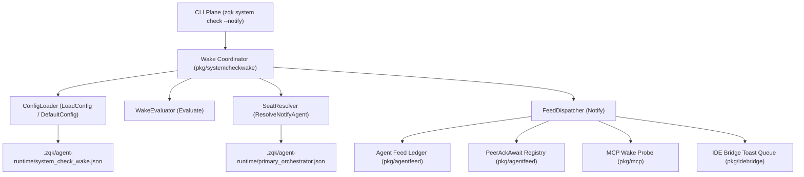
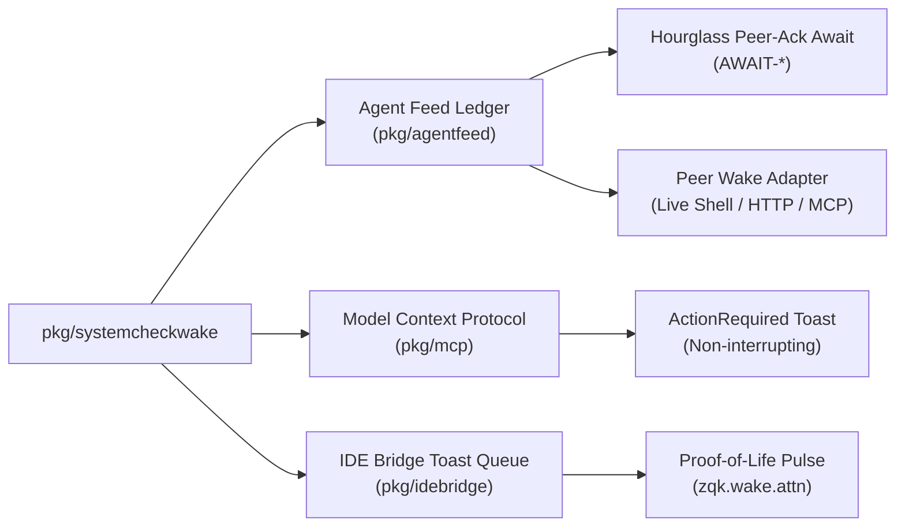

# System Check Wake, Threshold Evaluation & Seat Notification Subsystem Operational Architecture Guide

Comprehensive architectural manual, invariants specification, and operational guide for the **ZQK System Check Wake and Seat Notification Subsystem** (`pkg/systemcheckwake`).

---

## 1. Executive Summary & Architectural Compass

The **System Check Wake and Seat Notification Subsystem** (`pkg/systemcheckwake`) serves as the operational bridge between diagnostic health verification and autonomous mesh agent engagement. While the core diagnostic subsystem (`pkg/systemcheck`) evaluates repository invariants, Content-Addressed Storage (CAS) consistency, and process telemetry, `pkg/systemcheckwake` determines whether detected anomalies warrant waking an autonomous orchestrator or alerting human operators.

In alignment with **POL-DEFAULT-b17f54c251eb3c4d** (Mesh Alerting & Operational Continuity), the subsystem enforces strict opt-in discipline:
- **Zero Background Intrusion**: The subsystem never auto-fires on routine diagnostic checks. Alerts are triggered exclusively when callers provide the `--notify [agent-id]` flag or when an orchestrated workflow explicitly requests notification.
- **Fail-Safe Diagnostics**: Notification failures never fail or invalidate the underlying system check. All wake and dispatch errors are captured in structured result records (`Result.Error`) rather than aborting check completion.
- **Hourglass Directed Notify Protocol**: When wake events are directed to specific seats, the subsystem automatically registers peer acknowledgment awaits (`RegisterPeerAckAwait`) to maintain deterministic inter-agent correspondence.
- **Multi-Modal Alert Escalation**: Supports concurrent dispatch across the append-only Agent Feed ledger (`pkg/agentfeed`), Model Context Protocol (MCP) wake probes (`pkg/mcp`), and IDE Proof-of-Life toast queues (`pkg/idebridge`).

```
+-------------------------------------------------------------------------+
|                  zqk system check --notify [@primary | seat]            |
+-------------------------------------------------------------------------+
                                    │
                                    ▼
+-------------------------------------------------------------------------+
|                   pkg/systemcheck Diagnostic Rollup                     |
|         (DraftPlaneTotal, ErrorStatusObjects, BlockingIssues,           |
|          Warnings, Informational, Recommendations)                      |
+-------------------------------------------------------------------------+
                                    │
                                    ▼
+-------------------------------------------------------------------------+
|                  pkg/systemcheckwake Evaluation Engine                  |
|                                                                         |
|  [ ConfigLoader ]      ──► Reads .zqk/agent-runtime/system_check_wake   |
|  [ WakeEvaluator ]     ──► Compares Summary against Threshold Rules     |
|  [ SeatResolver ]      ──► Resolves Target Seat or @primary Orchestrator|
|  [ FeedDispatcher ]    ──► Appends Agent Feed Event & Registers Await   |
|  [ MCPProbeBridge ]    ──► Probes MCP IPC Subscribers & Transports      |
|  [ ProofOfLifeNotifier]──► Injects IDE Bridge Toast/Status Bar Pulse    |
+-------------------------------------------------------------------------+
                                    │
                                    ▼
+-------------------------------------------------------------------------+
|                       Autonomous Agent / Mesh Seat                      |
|             (Seated Orchestrator, Worker Pod, IDE Front-Channel)        |
+-------------------------------------------------------------------------+
```

---

## 2. Component Topology & Subsystem Architecture

The subsystem is organized into modular functional units that isolate configuration parsing, threshold evaluation, recipient resolution, and multi-channel delivery.



### Component Roles & Responsibilities

1. **`ConfigLoader` (`LoadConfig`, `DefaultConfig`, `ConfigPath`, `WriteExampleConfig`)**:
   - Manages threshold configuration stored in `.zqk/agent-runtime/system_check_wake.json`.
   - Defaults to fail-safe sensitivity (any count $\ge 1$ for draft plane, error status, blocking issues, warnings, or informational issues).
   - Merges custom overrides with fallbacks using pointer dereferencing helpers (`derefMin`, `derefBool`).
   - Supports bootstrapping example configuration via `WriteExampleConfig`.

2. **`WakeEvaluator` (`Evaluate`, `TripReason`)**:
   - Evaluates a populated `Summary` against active `Config` thresholds.
   - Ignores disabled thresholds ($\text{min} \le 0$).
   - Respects opt-in flags for advisory recommendations (`IncludeRecommendations`).
   - Returns a structured slice of `TripReason` elements identifying each breached boundary and its associated count.

3. **`SeatResolver` (`ResolveNotifyAgent`)**:
   - Identifies the target agent seat for wake delivery.
   - When provided with an explicit agent ID, trims and returns the seat identifier.
   - When given empty input or the `@primary` sentinel (`PrimarySentinel`), queries `primaryorch.LoadBinding` to resolve the project's designated primary orchestrator.
   - Enforces fail-closed validation: if the primary binding specifies an empty or blank agent ID, returns a descriptive error.

4. **`FeedDispatcher` (`Notify`, `Result`)**:
   - Executes end-to-end notification dispatch for tripped conditions.
   - If thresholds are clear, records `Skipped = "thresholds_clear"` and returns immediately without touching network or disk state.
   - Formats human-readable and machine-parseable wake messages detailing tripped categories.
   - Dispatches events to the append-only Agent Feed ledger (`agentfeed.AppendEvent`).
   - Registers peer acknowledgment awaits (`agentfeed.RegisterPeerAckAwait`) under the Hourglass Orchestration protocol.
   - Probes Model Context Protocol (MCP) subscribers and invokes the peer wake adapter (`agentfeed.WakePeerOpts`).
   - Dispatches front-channel proof-of-life status notifications (`idebridge.QueueProofOfLife`) when enabled.

---

## 3. System Check Wake & Alert Lifecycle

The following sequence illustrates the complete execution flow from diagnostic check completion through threshold evaluation, seat resolution, and multi-channel delivery.

```mermaid
sequenceDiagram
    autonumber
    participant CLI as Operator / CLI Runner
    participant SC as SystemCheck Engine
    participant W as pkg/systemcheckwake
    participant PO as PrimaryOrchestrator
    participant AF as AgentFeed Ledger
    participant MCP as MCP Wake Bridge
    participant IDE as IDE Bridge Bus

    CLI->>SC: zqk system check --notify [@primary]
    SC->>SC: Run diagnostic validators & compile Summary
    SC->>W: Notify(opts: Summary, Config, ToAgentID)

    W->>W: Evaluate(Summary, Config)
    alt Thresholds Clear (No Trip Reasons)
        W-->>SC: Result{Requested: true, Skipped: "thresholds_clear"}
        SC-->>CLI: Report clean check; no wake dispatched
    else Thresholds Tripped
        W->>PO: ResolveNotifyAgent(root, flagValue)
        PO-->>W: Target Seat ID (e.g. "agent-primary-orch")

        alt FeedWake Enabled
            W->>AF: AppendEvent(Steering, from: "system-check", to: TargetSeat)
            AF-->>W: EventID
            W->>AF: RegisterPeerAckAwait(EventID, TargetSeat)
            AF-->>W: Await registered

            W->>MCP: ProbeFeedSteerMCPWake(EventID)
            MCP-->>W: IPC / Subscriber count

            W->>AF: WakePeerOpts(TargetSeat, EventID, DeliveryModeNotify)
            AF-->>W: PeerWakeResult(Live, Transport)
        end

        alt PulseHuman Enabled AND Toast Not Queued
            W->>IDE: QueueProofOfLife(root, WakeDetailMessage)
            IDE-->>W: Toast queued on zqk.wake.attn
        end

        W-->>SC: Result{Tripped: true, EventID: "...", IdeBridgeQueued: true}
        SC-->>CLI: System check completed; wake dispatched
    end
```

---

## 4. Threshold Rules & Escalation Matrix

The evaluation engine assesses six distinct severity and categorization tiers. Thresholds are configured as minimum integer bounds, where any count meeting or exceeding the minimum trips the alert.

| Metric | Config Key | Default Minimum | Evaluation Behavior |
| :--- | :--- | :--- | :--- |
| **Draft Plane Total** | `min_draft_plane` | `1` | Trips when unpromoted draft objects exist in the workspace draft plane. Setting to `0` disables checks. |
| **Error Status Objects** | `min_error_status` | `1` | Trips when objects in authoritative CAS possess error lifecycle status. Setting to `0` disables checks. |
| **Blocking Issues** | `min_blocking` | `1` | Trips when Tier 1 blocking validation violations or structural breaks are detected. Setting to `0` disables checks. |
| **Warnings** | `min_warnings` | `1` | Trips when Tier 2 warnings or non-blocking specification anomalies occur. Setting to `0` disables checks. |
| **Informational** | `min_informational` | `1` | Trips when Tier 3 informational advisories are emitted. Setting to `0` disables checks. |
| **Recommendations** | `min_recommendations` | Disabled (`nil`) | Opt-in via `include_recommendations: true`. Evaluates Tier 4 best practice recommendations when active. |

### Configuration File Grammar

The configuration file resides at `.zqk/agent-runtime/system_check_wake.json` and uses the standard schema:

```json
{
  "schema_version": "1",
  "pulse_human": true,
  "feed_wake": true,
  "min_draft_plane": 1,
  "min_error_status": 1,
  "min_blocking": 1,
  "min_warnings": 1,
  "min_informational": 1,
  "include_recommendations": false,
  "min_recommendations": 1
}
```

- **`schema_version`**: Schema identifier (defaults to `"1"`).
- **`pulse_human`**: Controls front-channel IDE notifications (`QueueProofOfLife`). Defaults to `true`.
- **`feed_wake`**: Controls back-channel Agent Feed events and peer wakes. Defaults to `true`.
- **`min_*`**: Minimum count threshold to trip alerting. A value of `0` or negative disables the rule.
- **`include_recommendations`**: Explicit boolean toggle to incorporate Tier 4 recommendations into alerting.

---

## 5. Notification Channels & Delivery Modes

Alert notifications traverse three decoupled channels depending on configuration and environment capabilities:



### 1. Agent Feed Ledger (`pkg/agentfeed`)
- Stamped with `FromAgentID = "system-check"` and `Sender = FeedSenderHumanSteer`.
- Event type set to `FeedEventTypeSteering` with `SelfACK = true`.
- Contains summary metrics formatted as:
  `ATTN system-check --notify: thresholds tripped [blocking=1,warnings=3] (draft=0 error_status=0 blocking=1 warnings=3 info=0)`
- Under the Hourglass Orchestration protocol, registers an open await record (`PeerAckAwait`) with `Action = AwaitActionWake`. When the target seat acknowledges the event, the awaiting loop is notified.

### 2. Model Context Protocol Probe (`pkg/mcp`)
- Probes connected MCP clients using `ProbeFeedSteerMCPWake`.
- Evaluates IPC subscriber readiness and routes wake requests through active client sessions without requiring external daemon processes.

### 3. Proof-of-Life IDE Bridge (`pkg/idebridge`)
- Front-channel notification bus writing to `.zqk/agent-runtime/zqk.wake.attn`.
- Formats status strings prefixed with `PROOF-OF-LIFE: ` to reassure human operators that background evaluation and remediation are active.
- Non-intrusive: toast updates update IDE status bars or notifications without hijacking cursor turns or disrupting active edits.

---

## 6. Concurrency, Nil-Safety & Thread Hygiene

The subsystem is engineered for high-concurrency environments where multiple checks, telemetry collectors, and agents evaluate state simultaneously:

1. **Immutable Summaries & Config Structs**:
   - `Summary` and `Config` instances are passed by value across `Evaluate` calls.
   - Pointer values in `Config` are accessed strictly through `derefMin` and `derefBool`, eliminating nil pointer dereference hazards.

2. **Atomic Lite-File Serialization**:
   - Example configuration authoring (`WriteExampleConfig`) relies on `fileutil.WriteSecureJSONIndent` (0600 file permissions with atomic rename).
   - Prevents partial writes or race conditions during rapid configuration updates.

3. **Decoupled Goroutine Execution**:
   - When evaluating concurrent checks in parallel swarms, all background workers are tagged with structured labels via `goroutinelabels.NewGoroutine`.
   - Concurrency tests verify that multiple routines can concurrently load configuration and evaluate summaries without lock contention or data races.

4. **Zero Swallowed Errors Invariant**:
   - All file operations, JSON unmarshaling, and binding lookups verify error returns explicitly.
   - Any failure during `Notify` is recorded on `Result.Error` and logged via structured logging (`logging.Fluent`).

---

## 7. Verification & Coverage Invariants

In accordance with ZQK Core quality policies, `pkg/systemcheckwake` adheres to the following verification floors:

- **Statement Coverage Floor**: Must maintain strictly $\ge 85.0\%$ statement coverage across all test suites, with a targeted achievement of **100.0%**.
- **Three-Fold Proof Conformance**:
  - **Static Floor Invariant**: Complete unit test coverage for default configurations, custom JSON overrides, directory read failures, and missing file fallbacks (`TestDefaultConfig_Values`, `TestLoadConfig_ComprehensiveOverrides`, `TestWriteExampleConfig_EmptySchemaVersionAndError`).
  - **Operational Dynamic Proof**: Validates end-to-end threshold evaluation, primary orchestrator binding resolution, Agent Feed event appending, Hourglass await registration, and IDE toast queuing (`TestNotify_Tripped_FeedWake`, `TestNotify_FeedWakeSuccessAndLoggerNil`, `TestResolveNotifyAgent_AllBranches`).
  - **Negative Adversarial Boundary**: Exercises error propagation for corrupted JSON configs, empty target seats, uncreatable directories, failing wake adapters, and corrupted await files (`TestLoadConfig_InvalidJSON`, `TestNotify_Tripped_EmptyAgentID`, `TestNotify_PeerAckAwaitFailureBranch`, `TestNotify_WakeAdapterErrorBranch`).
- **Test Scoping Discipline**: Tests run hermetically with temporary directories (`t.TempDir()`), isolated `fileutil` operations, and explicit 30-second timeouts:
  ```bash
  ZQK_ALLOW_FOREGROUND_GO_TEST=1 go test -v -timeout 30s -cover ./pkg/systemcheckwake
  ```
