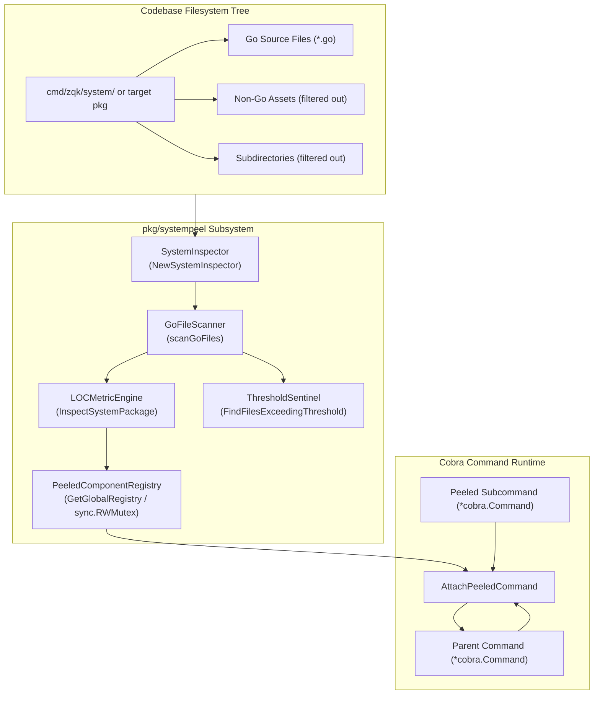
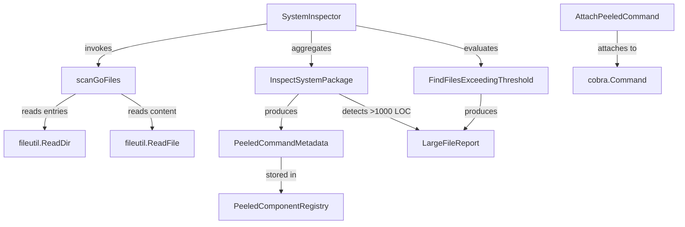
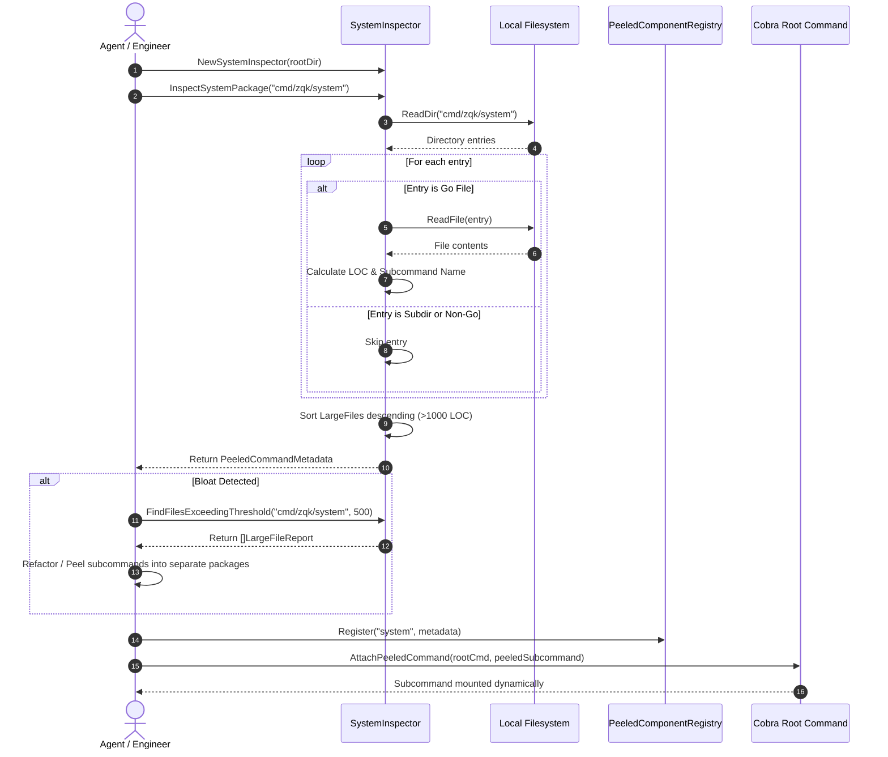

# System Modularity Inspection & Codebase Peeling Subsystem Operational Architecture Guide

## 1. Executive Summary & Design Philosophy

The **System Modularity Inspection & Codebase Peeling Subsystem** ([`pkg/systempeel`](file:///Users/lanceettl/zqk-public-candidate/pkg/systempeel/peel.go)) provides structural inspection, dynamic modular command peeling, lines-of-code (LOC) metrics analysis, and threshold enforcement across the ZQK Knowledge Kernel.

As a high-performance systems engineering framework, ZQK must maintain clean module boundaries, prevent monolithic command bloat, and dynamically register peeled subcommands into the active Cobra command hierarchy. Governed by core modularity policy **POL-DEFAULT-b17f54c251eb3c4d**, the subsystem enforces architectural decoupling by:
- **Structural Codebase Inspection:** Scanning Go source packages to determine file inventories, file-level lines of code, and subcommand composition.
- **Dynamic Command Peeling:** Enabling subcommands to be isolated into modular packages and re-attached dynamically to parent Cobra commands via `AttachPeeledCommand`.
- **Threshold Sentinel & Bloat Detection:** Identifying source files exceeding configurable lines-of-code thresholds (defaulting to 1,000 LOC for package inspections) to prevent architectural decay.
- **Thread-Safe Component Registry:** Maintaining an in-memory concurrent registry (`PeeledComponentRegistry`) with read-write mutex synchronization for tracking peeled system components across worker routines.
- **High Concurrency & 100.0% Statement Coverage:** Guaranteeing fail-closed error boundaries, hermetic cleanup, and full test verification under concurrent `goroutinelabels` workers.

---

## 2. Architectural Overview

In complex CLI architectures, command trees tend to accrete monolithic implementations where multiple subcommands, flags, and heavy business logic are concentrated in single packages or oversized files. This accretion degrades compilation times, complicates unit testing, increases cyclomatic complexity, and introduces merge conflicts across autonomous agent swarms.

The `pkg/systempeel` package solves this challenge through a peeling workflow:
1. **Inspection:** `SystemInspector` analyzes candidate system packages, counting lines of code, locating subcommands, and isolating large files.
2. **Peeling:** Monolithic commands are decomposed ("peeled") into modular packages with dedicated lifecycle hooks.
3. **Registration:** Peeled components register their metadata into `PeeledComponentRegistry`.
4. **Dynamic Attachment:** Parent command trees bind peeled subcommands dynamically at boot time using `AttachPeeledCommand`.



---

## 3. Core Component Topology

The subsystem is composed of decoupled architectural components:



### 1. `SystemInspector`
The primary operational entry point:
- `RootDir`: Base directory path against which relative package paths are resolved.
- `NewSystemInspector(rootDir string) *SystemInspector`: Instantiates an inspector bound to a root workspace.

### 2. Internal Scanner (`scanGoFiles`)
The directory traversal and filtering layer:
- Resolves package directories using `filepath.Join(si.RootDir, pkgRelPath)`.
- Skips nested subdirectories (`entry.IsDir()`) and non-Go assets (`!strings.HasSuffix(entry.Name(), ".go")`).
- Reads file contents via `fileutil.ReadFile` and calculates lines of code via line splitting.
- Enforces strict error propagation when directories do not exist, paths are files, or permissions are denied.

### 3. Metric Engine & Metadata Model (`PeeledCommandMetadata`)
Captures structural metadata:
- `Name`: Base directory name of the inspected package.
- `PackagePath`: Relative package directory path.
- `LinesOfCode`: Total lines of code across all scanned Go files in the package.
- `Subcommands`: Derived list of subcommand base names (e.g. `check.go` becomes `check`).
- `LargeFiles`: Sorted slice of `LargeFileReport` records identifying files exceeding threshold limits.

### 4. Threshold Sentinel (`FindFilesExceedingThreshold`)
Monitors and isolates oversized files:
- Compares each file's LOC against a caller-specified `maxLOC`.
- Sorts reports descending by `LinesOfCode` so that the most critical complexity hotspots appear first.

### 5. Thread-Safe Registry (`PeeledComponentRegistry`)
Coordinates peeled components across concurrent agent routines:
- Protected by `sync.RWMutex` to guarantee safe concurrent reads (`Get`, `List`) and writes (`Register`).
- Provides a shared singleton via `GetGlobalRegistry()` as well as support for isolated test instances.
- Returns components sorted alphabetically by `Name` in `List()` for deterministic output.

### 6. Cobra Command Binder (`AttachPeeledCommand`)
Binds modular subcommands to parent command trees:
- Performs defensive nil-checks on both parent and child command pointers.
- Dynamically calls `parent.AddCommand(cmd)` when both arguments are valid.

---

## 4. Peeling & Modularization Lifecycle

The end-to-end lifecycle of inspecting, peeling, and registering a modular command is depicted in the following sequence diagram:



---

## 5. Large File Detection & Complexity Metrics

File size directly correlates with maintainability issues and architectural drift. The subsystem applies dual-layer threshold evaluation:

### Built-in 1,000 LOC Floor (`InspectSystemPackage`)
When inspecting a package, `InspectSystemPackage` automatically flags any Go file exceeding **1,000 lines of code**:
```go
if f.loc > 1000 {
    largeFiles = append(largeFiles, LargeFileReport{
        RelativePath: f.relPath,
        LinesOfCode:  f.loc,
        BaseName:     f.baseName,
    })
}
```
All large file reports are sorted descending by `LinesOfCode`.

### Tunable Thresholding (`FindFilesExceedingThreshold`)
For targeted refactoring campaigns or stricter modularity policies (e.g. 300 LOC or 500 LOC limits), `FindFilesExceedingThreshold` accepts an arbitrary `maxLOC` parameter:
```go
reports, err := inspector.FindFilesExceedingThreshold("cmd/zqk/system", 300)
if err != nil {
    return fmt.Errorf("threshold inspection failed: %w", err)
}
for _, report := range reports {
    log.Printf("HOTSPOT: %s (%d lines of code)", report.RelativePath, report.LinesOfCode)
}
```

---

## 6. Concurrency & Thread-Safety Guarantees

The `pkg/systempeel` subsystem is designed for concurrent execution in multi-agent and parallel worker environments:

1. **Read-Write Mutex Protection:** `PeeledComponentRegistry` synchronizes all access with a `sync.RWMutex`. Multiple goroutines can read (`Get`, `List`) concurrently using shared read locks (`r.mu.RLock()`), while registration (`Register`) acquires exclusive write locks (`r.mu.Lock()`).
2. **Stateless Inspectors:** `SystemInspector` holds only an immutable `RootDir` string after construction. Multiple concurrent goroutines can execute `InspectSystemPackage` or `FindFilesExceedingThreshold` across different or identical paths without state interference.
3. **Managed Goroutines:** Concurrency tests and background scans utilize `goroutinelabels.NewGoroutine("...", "...").StartSimple(...)` to enforce managed goroutine standards and avoid naked `go` routines.

---

## 7. Verification & Three-Fold Proof Breakdown

The subsystem satisfies rigorous verification criteria across the Three-Fold Proof:

| Verification Dimension | Contract / Guarantee | Implementation Proof |
| :--- | :--- | :--- |
| **Static Floor Invariant** | Statement test coverage strictly $\ge 85.0\%$ (target 100.0%) | Verified at **100.0%** statement coverage via `go test -cover ./pkg/systempeel`. |
| **Operational Dynamic Proof** | Traversal, metric calculation, threshold detection, sorting, and registry lifecycle | Comprehensive test scenarios covering multi-file packages, empty directories, large files, and concurrent workers. |
| **Negative Adversarial Boundary** | Fail-closed error handling on invalid paths, unreadable files, nil pointers, and payload integrity | Boundary tests covering non-existent directories, file-as-directory errors, `chmod 0000` permission denials, nil command attachments, and payload integrity checks. |

---

## 8. Operational Usage Recipes

### Inspecting a Package
```go
package main

import (
    "fmt"
    "log"

    "github.com/zqk-os/zqk/pkg/systempeel"
)

func main() {
    inspector := systempeel.NewSystemInspector(".")
    meta, err := inspector.InspectSystemPackage("cmd/zqk/system")
    if err != nil {
        log.Fatalf("Inspection failed: %v", err)
    }

    fmt.Printf("Package: %s\n", meta.Name)
    fmt.Printf("Total LOC: %d\n", meta.LinesOfCode)
    fmt.Printf("Subcommands: %v\n", meta.Subcommands)
    for _, lf := range meta.LargeFiles {
        fmt.Printf("  Large File (>1000 LOC): %s (%d LOC)\n", lf.RelativePath, lf.LinesOfCode)
    }
}
```

### Registering and Attaching a Peeled Command
```go
package main

import (
    "github.com/spf13/cobra"
    "github.com/zqk-os/zqk/pkg/systempeel"
)

func RegisterAndAttach(rootCmd *cobra.Command, peeledCmd *cobra.Command, meta *systempeel.PeeledCommandMetadata) {
    registry := systempeel.GetGlobalRegistry()
    registry.Register(meta.Name, meta)

    systempeel.AttachPeeledCommand(rootCmd, peeledCmd)
}
```

---

## 9. Verification & Test Execution

### Run Targeted Unit Test Suite
```bash
ZQK_ALLOW_FOREGROUND_GO_TEST=1 go test -v -timeout 30s -cover ./pkg/systempeel
```

### Run Race Detection
```bash
ZQK_ALLOW_FOREGROUND_GO_TEST=1 go test -race -timeout 30s ./pkg/systempeel
```

### Verify Code Formatting
```bash
gofmt -w pkg/systempeel/
```

### Run Source Hygiene & Tree Gate
```bash
./bin/zqk-vet -suite hygiene,tree
```

### Run Public Release Payload Check
```bash
sh scripts/open-core/check-public-release-payload.sh .
```

---

## 10. Related Subsystem Documentation

- [CLI System Subsystem & Health Operations Guide](./CLI_SYSTEM_SUBSYSTEM_GUIDE.md)
- [Stale Lock Health & Cleanup Subsystem Architectural & Operational Guide](./LOCK_HEALTH_SUBSYSTEM_GUIDE.md)
- [Disk Usage & Storage Capacity Telemetry Subsystem Architectural Guide](./DISK_USAGE_SUBSYSTEM_GUIDE.md)
- [Goroutine Labels & Managed Concurrency Subsystem Guide](./GOROUTINE_LABELS_SUBSYSTEM_GUIDE.md)
- [Safe Path & Directory Containment Subsystem Guide](./SAFE_PATH_SUBSYSTEM_GUIDE.md)
