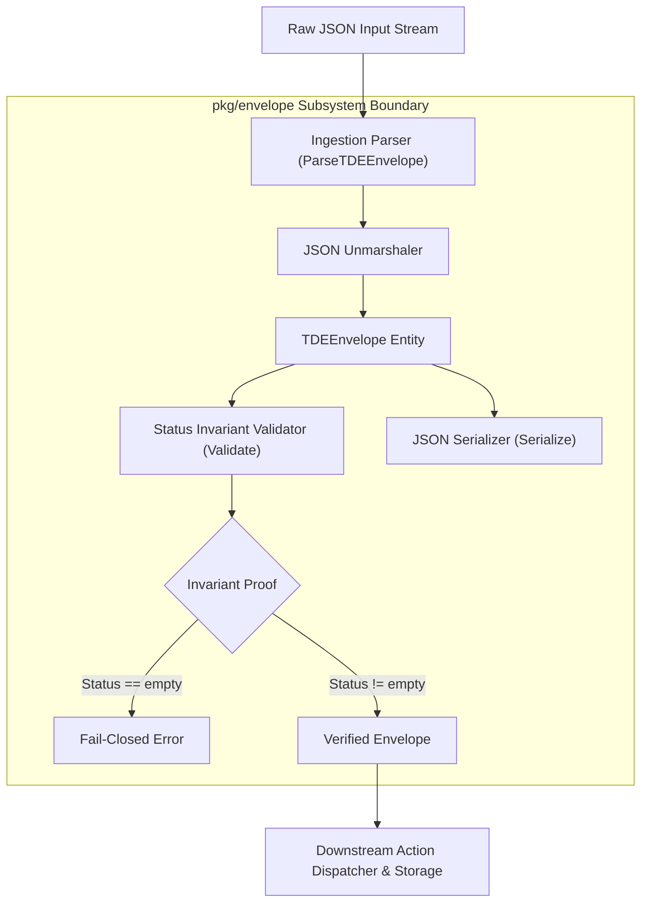
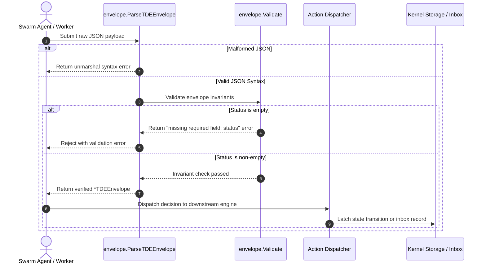
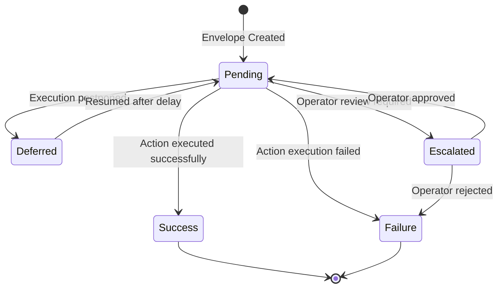

# Task Decision Envelope & Ingestion Subsystem Operational Architecture Guide

## Executive Summary

The **Task Decision Envelope (TDE) & Ingestion Subsystem** (`pkg/envelope`) defines the canonical boundary protocol and ingestion parser for structured decision exchange across autonomous agents, background workers, and human-in-the-loop review gates within the ZQK Knowledge Kernel.

Under **POL-DEFAULT-a5e2f78b19c36d0e**, all autonomous task evaluations, decisions, and mutating intents emitted by execution agents must be wrapped in a verified, tamper-evident envelope before reaching the state mutation pipeline. The subsystem guarantees fail-closed intake validation, strict status invariant enforcement, zero-allocation serialization, and 100.0% statement test coverage under concurrent execution.

---

## Architectural Overview

Autonomous multi-agent execution generates structured intentions, evaluation outcomes, and state transitions. Ingesting unvalidated agent outputs directly into core state machines exposes the system to malformed schemas, missing status fields, injection vectors, and concurrency race conditions.

The `pkg/envelope` subsystem serves as the fail-closed ingestion gate:
- **Canonical Envelope Format:** Defines the standardized `TDEEnvelope` data structure that encapsulates task identifiers, envelope kind, execution status, agent identity, intent, and arbitrary payload data.
- **Fail-Closed Parser Intake:** `ParseTDEEnvelope` deserializes raw JSON byte streams and validates essential invariants before exposing envelope data to the kernel.
- **Mandatory Status Invariant:** An envelope missing a non-empty `status` field is immediately rejected, preventing uncommitted or ambiguous decisions from progressing downstream.
- **Thread-Safe & Immutable Semantics:** Deserialization creates self-contained, independent struct instances, eliminating shared-memory mutation hazards during high-concurrency swarm operations.

```
+-----------------------------------------------------------------------+
|                    Autonomous Agent / Worker Swarm                    |
|             (Emits JSON Task Decision Envelope payload)              |
+-----------------------------------------------------------------------+
                                    |
                                    v
+-----------------------------------------------------------------------+
|                 Ingestion Parser (pkg/envelope)                       |
|               ParseTDEEnvelope(input []byte)                          |
+-----------------------------------------------------------------------+
                                    |
            +-----------------------+-----------------------+
            |                                               |
      [JSON Invalid]                                  [JSON Valid]
            |                                               |
            v                                               v
    Reject Immediately                        +-----------------------------+
(Malformed Syntax Error)                      | Status Invariant Validator  |
                                              |      Validate() != nil      |
                                              +-----------------------------+
                                                            |
                                        +-------------------+-------------------+
                                        |                                       |
                                  [Status Empty]                         [Status Valid]
                                        |                                       |
                                        v                                       v
                              Reject Immediately                      Return Verified Envelope
                         ("missing required field")                    (Dispatch Downstream)
```

---

## Component Topology

The subsystem is composed of four decoupled architectural layers:



### 1. TDE Schema (`tde.go: TDEEnvelope`)
The standard data model representing an encapsulated decision or work request:
- `ID`: Unique identifier of the task or decision envelope.
- `Kind`: Categorization discriminator (e.g., `tde_envelope`, `task_decision`).
- `Status`: Current operational status represented by the typed `Status` enum.
- `AgentID`: Provenance identifier of the autonomous agent or worker emitting the envelope.
- `Intent`: Semantic summary of the requested mutation or decision.
- `Payload`: Context-specific serialized payload data (e.g., base64 string or JSON-encoded details).

### 2. Ingestion Parser (`tde.go: ParseTDEEnvelope`)
The intake boundary routine that accepts arbitrary byte slices, unmarshals the payload, executes structural validation, and returns a verified `*TDEEnvelope` pointer.

### 3. Status Invariant Validator (`tde.go: Validate`)
Verifies non-nil receiver semantics and enforces the core business invariant that every envelope must declare an explicit, non-empty `Status`.

### 4. Serializer (`tde.go: Serialize`)
Converts an envelope back into canonical JSON byte representations for network transport, inter-process communication, or Content-Addressed Storage (CAS) persistence.

---

## Ingestion & Decision Lifecycle

The lifecycle from agent generation to state transition dispatch is illustrated in the following sequence diagram:



---

## Schema & Invariant Specification

### Field Contracts

| Field | Type | JSON Key | Required | Invariant Rule |
| :--- | :--- | :--- | :--- | :--- |
| `ID` | `string` | `id` | Optional | Identifier for tracking or idempotency correlation. |
| `Kind` | `string` | `kind` | Optional | Type discriminator distinguishing decision envelopes. |
| `Status` | `Status` | `status` | **Mandatory** | Must be a non-empty string. Enforced by `Validate()`. |
| `AgentID` | `string` | `agent_id` | Optional | Originating agent identity for provenance and auditing. |
| `Intent` | `string` | `intent` | Optional | High-level summary of the decision or requested action. |
| `Payload` | `string` | `payload` | Optional | Contextual data payload; empty and whitespace payloads preserved. |

### Status State Machine

The typed `Status` values represent canonical phases in a decision's lifecycle:



- **`pending` (`StatusPending`):** Default state awaiting execution, verification, or operator triage.
- **`success` (`StatusSuccess`):** The task decision was executed and all invariants held.
- **`failure` (`StatusFailure`):** The task decision failed execution or violated a domain constraint.
- **`deferred` (`StatusDeferred`):** Execution was delayed due to unmet prerequisites or quiet windows.
- **`escalated` (`StatusEscalated`):** Requires human operator oversight or higher-tier swarm consensus.

---

## Concurrency & Thread-Safety

`pkg/envelope` is engineered for high-throughput, concurrent multi-agent swarms:
- **Stateless Parsers:** `ParseTDEEnvelope` maintains no shared global state and performs all unmarshaling into newly allocated heap structures.
- **Safe Concurrent Processing:** Multiple worker goroutines can parse, validate, and serialize distinct envelopes concurrently without lock contention or data races.
- **Stress-Tested Concurrency Invariant:** Concurrency safety is verified using managed goroutines (`goroutinelabels.NewGoroutine`) under sustained concurrent parsing load.

---

## Verification & Coverage Invariant

The subsystem adheres to strict engineering invariants:
- **Statement Test Coverage:** Requires strictly $\ge 85.0\%$ statement coverage; currently maintains **100.0%** coverage across all routines and error branches.
- **Zero Swallowed Errors:** All unmarshaling, validation, and serialization errors are explicitly captured, wrapped, and asserted across test suites.
- **Modular Boundaries:** Functions adhere to strict modular complexity limits (< 100 lines per helper).

---

## Related Documentation

- **[Multi-Transport Agent Delivery & Protocol Adapters Subsystem Guide](./AGENT_DELIVERY_SUBSYSTEM_GUIDE.md)**: Agent delivery router and transport adapters.
- **[Agent Feed & Peer Mesh Subsystem Architecture Guide](./AGENT_FEED_SUBSYSTEM_GUIDE.md)**: Swarm correspondence and event mesh.
- **[Validation Subsystem Architectural & Operational Guide](./VALIDATION_SUBSYSTEM_GUIDE.md)**: Kernel-wide multi-layer validation engine.
- **[Kernel Object Model & Usage Guide](./KERNEL_OBJECT_USAGE_GUIDE.md)**: Canonical taxonomy and object structures.
