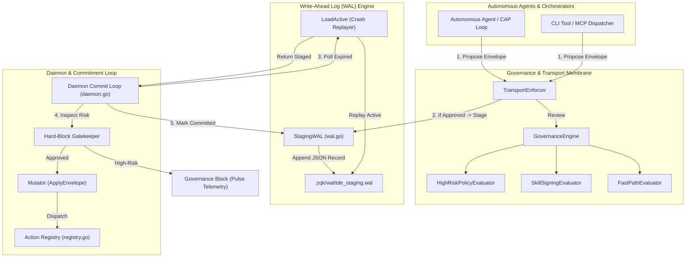
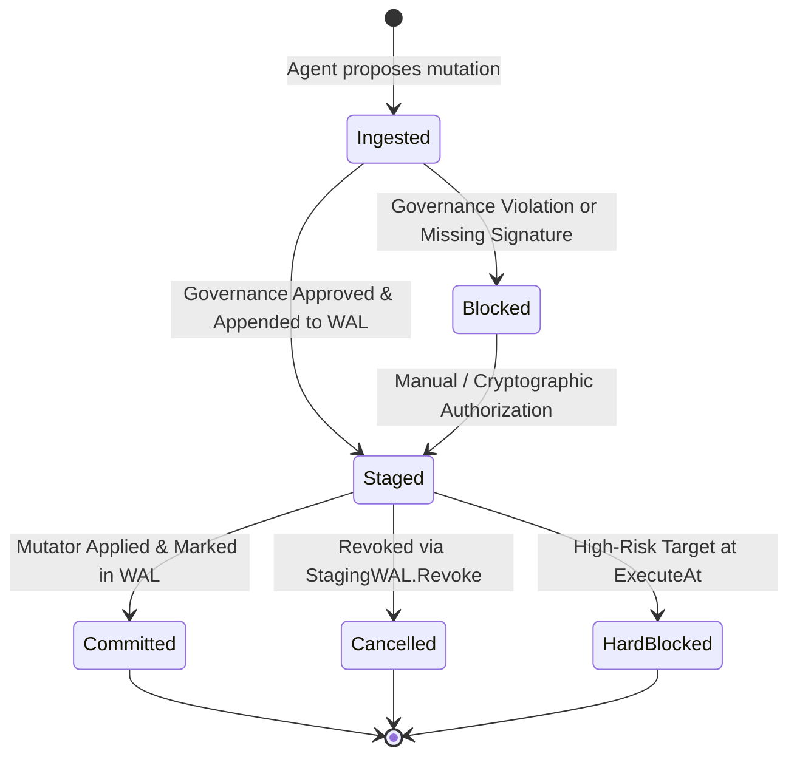
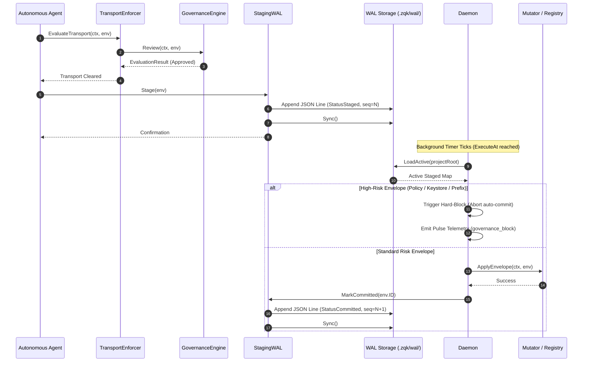

# Task Decision Envelope, Decision Log & WAL Subsystem Guide

Comprehensive architectural, operational, and protocol reference for the `pkg/tde` subsystem in ZQK Core.

---

## 1. Architectural Overview

In the ZQK autonomous agent architecture, mutations to repository state, system policies, security keys, and task assignments cannot be executed spontaneously or unchecked. Spontaneous agent mutations introduce non-deterministic race conditions, risk policy violations, and jeopardize repository stability.

The **Task Decision Envelope, Decision Log & Write-Ahead Log (WAL) Subsystem** (`pkg/tde`) provides the architectural boundary and staging membrane that governs how autonomous actions transition from proposed intents into verified, durable, and executed mutations. It formalizes Time-Delayed Execution (TDE), neurological governance checkpoints, write-ahead logging, and automated execution loops.

### Core Subsystem Invariants

1. **Two-Phase Staging & Verification**:
   No high-impact mutation is applied directly to the Knowledge Kernel or physical file tree. Every proposed mutation must first be wrapped in an `Envelope`, validated against cognitive governance rules, and appended to the write-ahead log in `staged` status before downstream execution occurs.

2. **Neurological Governance Checkpoints**:
   Every envelope is subjected to cognitive policy inspection (`GovernanceEngine`, `TransportEnforcer`) before dispatch. Evaluators inspect payload integrity, cryptographic skill signatures, performance latency ceilings (<3.0s fast-path), and high-risk target classifications.

3. **Crystalline Fortress Hard-Block Governance**:
   High-risk mutations—specifically those targeting policies, keystores, requirements, reputation ledgers, or containing critical ID prefixes (`POL-`, `REQ-`, `GOAL-`, `KEY-`, `REP-`)—are strictly blocked from autonomous commit by the background daemon. These mutations require explicit human or operator authorization.

4. **Append-Only WAL Durability & Crash Recovery**:
   All envelope state changes (`staged`, `committed`, `cancelled`) are written to an append-only JSON-lines write-ahead log (`.zqk/wal/tde_staging.wal`). Upon daemon restart or crash recovery, `LoadActive` replays the log stream to reconstruct the in-memory active staged set with zero loss or duplication.

5. **Hermetic Action Dispatch**:
   Execution handlers are registered modularly via `RegisterAction` and dispatched safely using `ExecuteAction`. Decoupled mutators ensure that system components execute approved envelopes without circular dependencies.

---

## 2. Component Topology

The subsystem is modularized into five core operational components:



### Component Roles & Responsibilities

| Component | Source File | Primary Responsibility |
| :--- | :--- | :--- |
| **`Envelope`** | `envelope.go` | Canonical data contract wrapping mutations for Time-Delayed Execution, including sequencing, dependencies, cryptographic signatures, and status. |
| **`StagingWAL`** | `wal.go` | Durable write-ahead log managing atomic appends of staged, committed, and revoked envelope records to `.zqk/wal/tde_staging.wal`. |
| **`GovernanceEngine`** | `governance.go` | Policy evaluation engine aggregating cognitive evaluators and determining whether envelopes are approved, blocked, or rejected. |
| **`TransportEnforcer`** | `governance.go` | Wire-level transport gatekeeper inspecting envelopes before network dispatch or queue ingestion. |
| **`Daemon`** | `daemon.go` | Background commit loop polling active envelopes whose `ExecuteAt` timestamp has elapsed, enforcing Crystalline Fortress blocks, and applying mutations. |
| **`Action Registry`** | `registry.go` | Thread-safe operational dispatch table mapping envelope operation strings to modular execution handlers (`ActionHandler`). |

---

## 3. Decision Lifecycle & Sequence Diagram

Every task decision progresses through five distinct lifecycle states:



### Operational Execution Sequence



---

## 4. WAL Format & Crash Recovery Specification

### On-Disk Framing & Schema

The Staging WAL is stored at `.zqk/wal/tde_staging.wal` using newline-delimited JSON lines (`walutil.JSONLineWAL`). Each record corresponds to a serialized `Envelope` object:

```json
{"id":"ENV-2026-001","seq":1,"kind":"task","target_id":"TASK-1001","operation":"create","payload_b64":"eyJkZXNjIjoicnVuIGFuYWx5c2lzIn0=","execute_at":"2026-10-25T20:00:00Z","created_at":"2026-10-25T19:00:00Z","status":"staged"}
{"id":"ENV-2026-002","seq":2,"kind":"policy","target_id":"POL-SECURITY-001","operation":"update","payload_b64":"e30=","execute_at":"2026-10-25T20:05:00Z","created_at":"2026-10-25T19:05:00Z","status":"staged"}
{"id":"ENV-2026-001","seq":3,"kind":"","target_id":"","operation":"","payload_b64":"","execute_at":"0001-01-01T00:00:00Z","created_at":"0001-01-01T00:00:00Z","status":"committed"}
```

### Deterministic State Reconstruction (`LoadActive`)

When rebuilding system state upon startup or prior to commit evaluation:
1. `LoadActive` opens the WAL stream from sequence 0.
2. For every record encountering `StatusStaged`, the envelope is inserted into the active memory table (`active[id] = env`).
3. For records with `StatusCommitted` or `StatusCancelled`, the envelope is evicted from the active map (`delete(active, id)`).
4. Corrupted lines are quarantined without halting recovery, ensuring fault-tolerant crash replay.
5. Upon stream completion, only uncommitted, non-cancelled envelopes remain in the active set.

---

## 5. Concurrency, Thread-Safety & Hard-Block Governance

### Thread-Safe Concurrency Architecture

- **WAL Append Safety**: `StagingWAL` delegates file serialization and disk flushing to `walutil.JSONLineWAL`, which guards write operations with an internal `sync.Mutex`. Multiple agent goroutines can safely invoke `Stage`, `Revoke`, and `MarkCommitted` concurrently.
- **Action Registry Locking**: `RegisterAction` and `ExecuteAction` synchronize handler registration and invocation via `sync.RWMutex`, allowing concurrent action executions without data races.
- **Goroutine Attribution**: Background daemon loops and worker goroutines are registered with explicit labels via `goroutinelabels.NewGoroutine`, ensuring complete visibility in telemetry and runtime dumps.

### Crystalline Fortress Invariant

The daemon enforces automated hard-blocking for sensitive system objects:

> [!CAUTION]
> Any envelope targeting the following categories is permanently barred from auto-commit:
> - Kinds: `policy`, `keystore`, `requirement`, `reputation`
> - Target ID Prefixes: `POL-`, `REQ-`, `GOAL-`, `KEY-`, `REP-`
>
> When encountered, the daemon halts execution for that envelope, logs a security warning, emits a Hive Pulse telemetry signal, and leaves the envelope staged for manual operator inspection.

---

## 6. Developer & Agent Recipes

### Recipe 1: Staging a Governed Envelope

```go
package main

import (
	"context"
	"fmt"
	"time"

	"github.com/zqk-os/zqk/pkg/tde"
)

func StageAutonomousTask(projectRoot string, taskID string, payload []byte) error {
	ctx := context.Background()

	// 1. Initialize transport governance
	enforcer := tde.DefaultTransportEnforcer()

	now := time.Now().UTC()
	env := &tde.Envelope{
		ID:         fmt.Sprintf("ENV-%d", now.UnixNano()),
		Kind:       "task",
		TargetID:   taskID,
		Operation:  "execute",
		ExecuteAt:  now.Add(5 * time.Minute),
		CreatedAt:  now,
	}

	// 2. Evaluate transport policies
	evalResult, err := enforcer.EvaluateTransport(ctx, env)
	if err != nil {
		return fmt.Errorf("governance check failed: %w", err)
	}
	if evalResult.Status != tde.GovernanceApproved {
		return fmt.Errorf("envelope blocked by governance: %s", evalResult.Reason)
	}

	// 3. Append to Staging WAL
	wal, err := tde.NewStagingWAL(projectRoot)
	if err != nil {
		return fmt.Errorf("open staging wal: %w", err)
	}
	defer wal.Close()

	if err := wal.Stage(*env); err != nil {
		return fmt.Errorf("stage envelope: %w", err)
	}

	return wal.Sync()
}
```

### Recipe 2: Registering a Modular Action Handler

```go
package main

import (
	"context"
	"fmt"

	"github.com/zqk-os/zqk/pkg/tde"
)

func RegisterCustomHandlers() {
	tde.RegisterAction("code_deploy", func(ctx context.Context, env tde.Envelope) error {
		fmt.Printf("Deploying target: %s (payload bytes: %d)\n", env.TargetID, len(env.PayloadB64))
		return nil
	})
}
```

### Recipe 3: Running the Background Daemon

```go
package main

import (
	"context"
	"time"

	"github.com/zqk-os/zqk/pkg/tde"
)

type ExecutionMutator struct{}

func (m *ExecutionMutator) ApplyEnvelope(ctx context.Context, env tde.Envelope) error {
	return tde.ExecuteAction(ctx, env)
}

func RunDaemon(projectRoot string) (*tde.Daemon, error) {
	wal, err := tde.NewStagingWAL(projectRoot)
	if err != nil {
		return nil, err
	}

	daemon := tde.NewDaemon(projectRoot, wal, &ExecutionMutator{}, 10*time.Second)
	daemon.Start()
	return daemon, nil
}
```

---

## 7. Verification & Coverage Invariant

The `pkg/tde` subsystem enforces a rigorous continuous testing policy:

- **Statement Coverage Floor**: Strict requirement of statement coverage $\ge 85.0\%$, with full $100.0\%$ achieved across all routines.
- **Hermetic Testing Invariant**: All test cases must isolate filesystem operations within `t.TempDir()`, using `fileutil.*` abstractions to eliminate repository contamination.
- **Clean Code Standard**: Zero swallowed errors (`_ = ...` prohibited). All error paths, boundary limits, and corrupted WAL lines are verified.

```bash
# Verify unit tests and check statement coverage
ZQK_ALLOW_FOREGROUND_GO_TEST=1 go test -v -timeout 30s -cover ./pkg/tde
```
