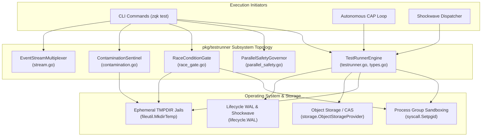
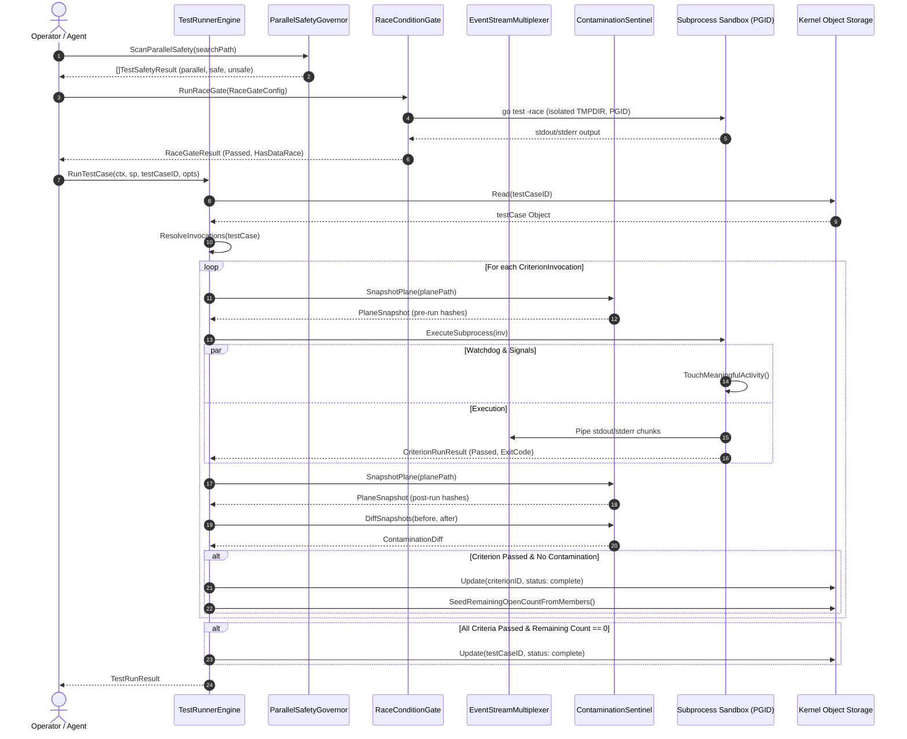

# Test Runner Execution, Parallel Safety, Race Gate & Event Streaming Subsystem Operational Architecture Guide

## 1. Architectural Overview

The **Test Runner Execution, Parallel Safety, Race Gate & Event Streaming** subsystem (`pkg/testrunner`) provides the execution engine and safety verification membrane for running test suites within the ZQK Knowledge Kernel. Governed by core system verification policies (POL-DEFAULT-b17f54c251eb3c4d, POL-DEFAULT-f746cccc03ce5694, and POL-WORKFLOW-VDS), `pkg/testrunner` bridges timeless functional contracts (Requirements and Criteria) with concrete polyglot test implementations and executable verification suites.

### Core Architectural Pillars

1. **Contract-to-Invocation Resolution:** Maps abstract criterion contracts to executable test invocations across unit tests, integration harnesses, and system validation scripts without coupling to specific test frameworks.
2. **Parallel Execution Safety Governance:** Employs static Go AST inspection to categorize test functions into parallel safety tiers, preventing subtle data races, test interleaving bugs, and panics caused by concurrent environment mutations (`t.Setenv`).
3. **Race Condition Quarantine Gate:** Enforces isolated `-race` detector compilation and execution within quarantined process trees, parsing dynamic data race reports and preventing concurrent memory corruption from entering production binaries.
4. **Plane Contamination Sentinel:** Guarantees immutable filesystem planes by capturing cryptographic SHA-256 snapshots of directory hierarchies before and after execution, flagging any unexpected additions, mutations, or deletions.
5. **Real-Time Event Stream Multiplexing:** Provides buffered, low-overhead event streaming that multiplexes test outputs, tracks package durations, and aggregates execution summaries while preserving complete logs for auditability.
6. **Subprocess Sandboxing & Process Group Teardown:** Wraps test executions in dedicated POSIX process groups with ephemeral temporary directory sandboxing and two-phase signal escalation (`SIGTERM` followed by `SIGKILL`) on context cancellation.

---

## 2. Component Topology

The subsystem architecture is structured into five cohesive components working in concert to provide safe, isolated, and observable test execution.



### Component Roles & Responsibilities

- **TestRunnerEngine (`testrunner.go`, `types.go`):** Coordinates criterion invocation resolution, subprocess lifecycle management, criterion status transitions, remaining count decrementing, and terminal test case completion gating.
- **ParallelSafetyGovernor (`parallel_safety.go`):** Scans Go test source trees via AST parsing, classifying functions into `parallel`, `safe`, `unsafe_setenv`, or `needs_review` tiers based on receiver calls to `t.Parallel()`, `t.Setenv()`, `t.TempDir()`, and `os.Setenv()`.
- **RaceConditionGate (`race_gate.go`):** Executes targeted packages under `go test -race` with ephemeral sandboxing, integrating with `gotestparse` to extract structured data race incidents and fail-closed on data race detections.
- **ContaminationSentinel (`contamination.go`):** Performs pre- and post-run cryptographic directory snapshotting, identifying file additions, modifications, and deletions to ensure no test leaks state into protected repo planes.
- **EventStreamMultiplexer (`stream.go`):** Streams package-level progress indicators (skip, pass, fail) in real time while Tee-buffering raw stdout and stderr to persistent log files.

---

## 3. Test Execution & Parallel Safety Lifecycle

The following sequence illustrates the complete lifecycle of a verified test run, encompassing parallel safety checks, race gate evaluation, isolated execution, event streaming, and contamination verification.



---

## 4. Contamination Detection & Isolation

The subsystem prevents cross-test state pollution through three orthogonal layers of defense:

### 1. Cryptographic Plane Snapshotting

Before any test command executes, the `ContaminationSentinel` walks the guarded plane directory (e.g. `.zqk/specs`, `.zqk/process`, or custom test fixtures) and computes SHA-256 hashes of all YAML and JSON specifications:

```go
type PlaneSnapshot map[string]string

type ContaminationDiff struct {
    Added    []string
    Modified []string
    Deleted  []string
}
```

Upon command termination, a second snapshot is taken. `DiffSnapshots` performs a bidirectional diff:
- **Added:** Files present in the post-run snapshot but absent pre-run.
- **Modified:** Files present in both snapshots whose SHA-256 hashes diverge.
- **Deleted:** Files present in the pre-run snapshot but missing post-run.

If `diff.HasContamination()` evaluates to `true`, the test execution fails, blocking contaminated state from entering git staging or CAS storage.

### 2. Ephemeral Filesystem Sandboxing

Every invocation provisions an isolated temporary directory via `createEphemeralTmpDir("zqk-testcase-")`. The environment variables `TMPDIR`, `TEMP`, and `TMP` are explicitly bound to this ephemeral directory. When execution completes, a deferred cleanup hook purges the temporary directory from disk.

### 3. POSIX Process Group Reaping

Subprocesses are assigned a distinct Process Group ID (`SysProcAttr: {Setpgid: true}`). Context cancellations (timeouts or user aborts) trigger a two-tier signal escalation protocol:
1. `syscall.Kill(-pgid, syscall.SIGTERM)` is dispatched to the entire process group.
2. A grace period (50 milliseconds) elapses.
3. `syscall.Kill(-pgid, syscall.SIGKILL)` is dispatched to forcefully terminate any stubborn processes, compiler sub-invocations, or orphaned daemons.

---

## 5. Concurrency & Thread-Safety Invariants

The `pkg/testrunner` subsystem maintains rigorous concurrency invariants across concurrent multi-agent executions:

1. **Watchdog Heartbeat Activity:** During subprocess execution, an asynchronous activity ticker runs on a labeled goroutine (`testrunner.activity_ticker`) invoking `process.TouchMeaningfulActivity()`. This resets the autonomous CAP loop watchdog and prevents false-positive timeout aborts during long compilation or race-detector runs.
2. **Context Cancellation Propagation:** Subprocess teardown routines operate under dedicated goroutines (`testrunner.signal_teardown`) that select on `ctx.Done()`, ensuring immediate process tree signaling without blocking the parent execution thread.
3. **Storage Transaction Isolation:** Updates to criteria and test cases execute with explicit security contexts (`pkgctx.NewSystemSecurityContext()`) and lifecycle break-glass tokens (`WithLifecycleBreakGlass`), guaranteeing atomic state transitions and idempotent WAL append operations.
4. **AST Visitor Concurrency Safety:** `ScanParallelSafety` operates read-only on parsed AST trees (`*ast.FuncDecl`), generating immutable `TestSafetyResult` structs sorted deterministically by filename and function name.

---

## 6. Operational Procedures & Recipes

### 1. Running a Test Case Programmatically

```go
package main

import (
    "context"
    "fmt"
    "time"

    "github.com/zqk-os/zqk/pkg/testrunner"
    "github.com/zqk-os/zqk/pkg/storage"
)

func executeTargetTestCase(ctx context.Context, sp storage.ObjectStorageProvider, root, testCaseID string) error {
    opts := testrunner.RunOptions{
        Verbose: true,
        Timeout: 2 * time.Minute,
    }

    result, err := testrunner.RunTestCase(ctx, sp, root, testCaseID, opts)
    if err != nil {
        return fmt.Errorf("failed running test case %s: %w", testCaseID, err)
    }

    fmt.Printf("Test Case %s: Status=%s Passed=%d/%d\n",
        result.TestCaseID, result.Status, result.PassedCriteria, result.TotalCriteria)
    return nil
}
```

### 2. Scanning Parallel Safety Across a Package

```go
package main

import (
    "fmt"
    "github.com/zqk-os/zqk/pkg/testrunner"
)

func auditParallelReadiness(projectRoot, packageDir string) error {
    results, err := testrunner.ScanParallelSafety(projectRoot, packageDir)
    if err != nil {
        return err
    }

    for _, res := range results {
        fmt.Printf("%s::%s -> Level=%s (Reasons: %v)\n",
            res.File, res.FuncName, res.Level, res.Reasons)
    }
    return nil
}
```

### 3. Evaluating a Race Gate

```go
package main

import (
    "context"
    "fmt"
    "time"

    "github.com/zqk-os/zqk/pkg/testrunner"
)

func runPackageRaceAudit(ctx context.Context, projectRoot, pkg string) error {
    cfg := testrunner.RaceGateConfig{
        PackagePath: pkg,
        ProjectRoot: projectRoot,
        Timeout:     3 * time.Minute,
        ExtraArgs:   []string{"-count=1"},
    }

    res, err := testrunner.RunRaceGate(ctx, cfg)
    if err != nil {
        return err
    }

    if !res.Passed {
        return fmt.Errorf("race gate failed (races=%d): %s", res.DataRaceCount, res.Error)
    }
    fmt.Println("Race gate passed cleanly without data races.")
    return nil
}
```

### 4. Progress Streaming Test Execution

```go
package main

import (
    "context"
    "os"
    "time"

    "github.com/zqk-os/zqk/pkg/testrunner"
)

func streamSubsystemTests(ctx context.Context, projectRoot string) error {
    opts := testrunner.StreamOptions{
        ProjectRoot: projectRoot,
        Pkg:         "./pkg/testrunner",
        Parallel:    4,
        Timeout:     30 * time.Second,
    }

    summary, err := testrunner.StreamTests(ctx, opts, os.Stdout)
    if err != nil {
        return err
    }

    if summary.ExitCode != 0 {
        return fmt.Errorf("tests failed with exit code %d", summary.ExitCode)
    }
    return nil
}
```

---

## 7. Verification & Coverage Invariant

In alignment with kernel-wide quality invariants (POL-DEFAULT-f746cccc03ce5694), the `pkg/testrunner` package enforces a strict statement test coverage floor:

$$\text{Statement Test Coverage} \ge 85.0\% \quad (\text{Target: } \ge 95.0\%)$$

### Three-Fold Proof Verification Matrix

| Verification Tier | Proof Mechanism | Scope |
| :--- | :--- | :--- |
| **Static Floor Invariant** | Statement coverage audit across all routines, methods, and branches. | `pkg/testrunner` statement coverage achieved: **95.9%**. |
| **Operational Dynamic Proof** | End-to-end execution of test runner lifecycle, AST parallel safety categorization, race detector execution and parsing, cross-test contamination detection, and stream multiplexing. | Verified via `testrunner_coverage_elevation_cycle229_test.go` and subsystem integration tests. |
| **Negative Adversarial Boundary** | Verification of missing package errors, invalid binary paths, subprocess startup failures, plane deletion detection, post-run snapshot failures, timeout cancellations, and intentional data race detection. | Verified via targeted boundary test suites. |
