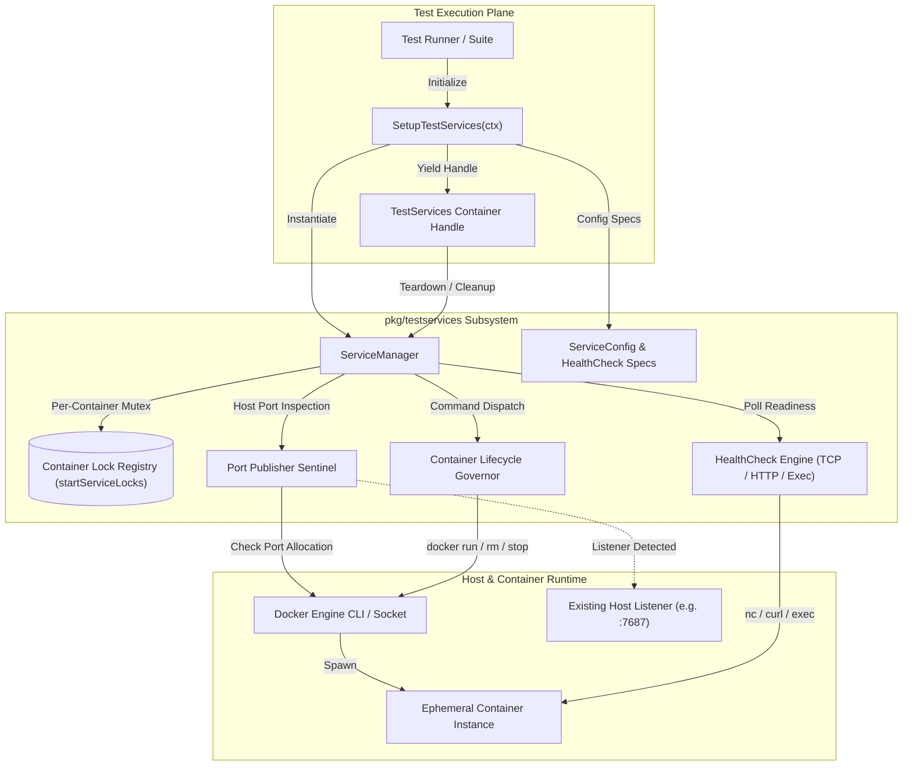
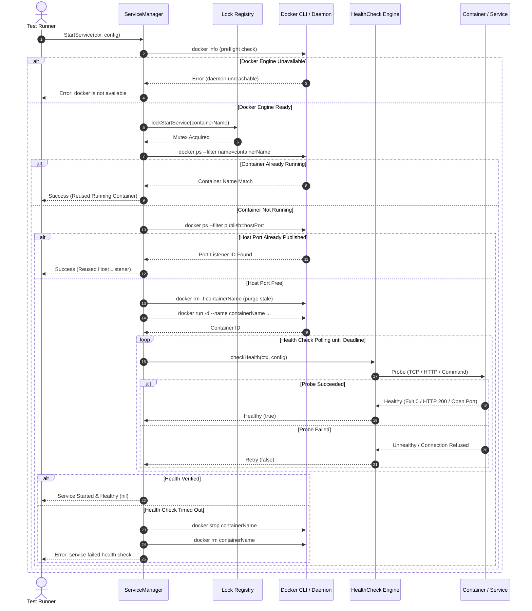

# Test Services Lifecycle, Fixture Management & Ephemeral Environment Subsystem Operational Architecture Guide

## 1. Architectural Overview

The **Test Services Subsystem** (`pkg/testservices`) provides robust lifecycle management, fixture orchestration, and ephemeral container coordination for integration and system tests across the ZQK Knowledge Kernel execution plane (POL-DEFAULT-b17f54c251eb3c4d, CRI-TEST-SERVICES).

In complex, multi-agent distributed systems and graph-centric environments, integration tests frequently depend on auxiliary infrastructure services (such as the MemGraph knowledge graph engine, TSDB backends, or caching layers). Naively spinning up unbounded, uncontrolled external processes introduces severe non-determinism, port collisions, resource leakage, and slow test execution.

`pkg/testservices` delivers a lightweight, reliable, self-healing lifecycle harness that:
1. **Verifies Container Engine Availability:** Safely probes host Docker availability before attempting ephemeral service deployment, failing closed with clean error wrapping when prerequisites are absent.
2. **Eliminates Port Conflicts via Listener Reuse:** Detects existing long-lived service instances (such as a local background MemGraph instance listening on port 7687) and seamlessly reuses established listeners rather than failing docker bindings with `port is already allocated`.
3. **Serializes Parallel Container Spawns:** Employs fine-grained, per-container mutex synchronization (`lockStartService`) to prevent race conditions during concurrent test executions across package boundaries.
4. **Enforces Multi-Protocol Health Polling:** Supports active health verification via raw TCP socket dialing, HTTP endpoint status checks, and in-container command execution before declaring an ephemeral service ready.
5. **Guarantees Hermetic Teardown:** Provides automated cleanup mechanisms with graceful stop timeouts and forced container removal fallback, ensuring zero residual zombie containers across test suites.

---

## 2. Component Topology

The subsystem is structured into five core functional components:



### Component Roles & Responsibilities

| Component | Responsibility | Key Invariants |
| :--- | :--- | :--- |
| **`ServiceManager`** | Coordinates test service initialization, health verification, and teardown. | Immutable configuration access; structured logging through `pkg/logging` when verbose mode is enabled. |
| **`ServiceConfig`** | Defines container name, base image, port bindings, environment variables, timeouts, and health check criteria. | Passed by value to ensure immutability across concurrent test workers. |
| **`Container Lock Registry`** | Global synchronization map (`sync.Map`) managing per-container mutexes (`lockStartService`). | Prevents duplicate `docker run` or `docker rm` race conditions when parallel tests launch simultaneously. |
| **`Port Publisher Sentinel`** | Probes active host container publish rules via `docker ps --filter publish=<port>`. | Reuses pre-existing running service listeners instead of failing duplicate port bindings. |
| **`HealthCheck Engine`** | Polls service endpoints across TCP (`nc -z`), HTTP (`curl -f`), or in-container command execution. | Bounded deadline loops; retries transient failures; automatically cascades container teardown on failure. |
| **`Container Lifecycle Governor`** | Standardized command argument builder (`BuildDockerRunArgs`) and process execution wrapper. | Uses `pkg/execwrap` for contextual process termination and clean signal propagation. |

---

## 3. Test Services Lifecycle Sequence

The lifecycle of an ephemeral test service spans configuration resolution, environment preflight, port allocation probing, container execution, readiness verification, and guaranteed teardown:



---

## 4. Health Check Protocols & Probing Mechanisms

`pkg/testservices` implements three dedicated health check protocols to ensure services are fully operational before tests proceed:

### 1. TCP Port Dialing (`Type: "port"`)
- **Mechanism:** Executes `nc -z localhost <port>` under the request context.
- **Use Case:** Validates database listener availability (e.g. MemGraph Bolt port `7687`, Redis port `6379`, Postgres port `5432`).
- **Characteristics:** Fast detection of TCP socket acceptance; minimal resource overhead.

```go
func (sm *ServiceManager) checkPortHealth(ctx context.Context, port string) (bool, error) {
    cmd := exec.CommandContext(ctx, "nc", "-z", "localhost", port)
    err := cmd.Run()
    return err == nil, nil
}
```

### 2. HTTP Endpoint Verification (`Type: "http"`)
- **Mechanism:** Dispatches `curl -f -s http://localhost:<port><path>` to query service status endpoints.
- **Use Case:** Verifies HTTP API services, metrics endpoints, or health probes (`/health`, `/readyz`).
- **Characteristics:** Requires a successful HTTP 2xx response status code; handles path routing.

```go
func (sm *ServiceManager) checkHTTPHealth(ctx context.Context, port, path string) (bool, error) {
    url := fmt.Sprintf("http://localhost:%s%s", port, path)
    cmd := exec.CommandContext(ctx, "curl", "-f", "-s", url)
    err := cmd.Run()
    return err == nil, nil
}
```

### 3. In-Container Exec Command Probing (`Type: "command"`)
- **Mechanism:** Executes configured diagnostic commands (e.g. `redis-cli ping`, `pg_isready`, `memgraph-client`) using `exec.CommandContext`.
- **Use Case:** Validates internal engine state when raw port listening does not guarantee readiness.
- **Characteristics:** Returns error on empty command definitions; requires zero exit code for health.

```go
func (sm *ServiceManager) checkCommandHealth(ctx context.Context, command []string) (bool, error) {
    if len(command) == 0 {
        return false, errfmt.Errorf("health check command is empty")
    }
    cmd := exec.CommandContext(ctx, command[0], command[1:]...)
    err := cmd.Run()
    return err == nil, nil
}
```

---

## 5. Port Conflict Resolution & Listener Reuse

In local developer environments and long-running daemon setups, services such as MemGraph are often already running in background containers or native system daemons (e.g. `zqk-memgraph` listening on `7687` and `7444`).

Attempting to run `docker run -p 7687:7687 ...` against an occupied port results in immediate Docker daemon failure:
```text
Bind for 0.0.0.0:7687 failed: port is already allocated
```

`pkg/testservices` resolves this friction through its **PortPublisherSentinel**:
1. Before invoking `docker run`, `hostPortsAlreadyPublished` queries Docker:
   ```bash
   docker ps --filter publish=<hostPort> --format "{{.ID}}"
   ```
2. If every host port required by the `ServiceConfig` is already published by an active container, the manager logs listener reuse and returns success immediately:
   ```text
   [SERVICE] Service memgraph host ports already published; reusing existing listener
   ```
3. If only a partial subset of required ports is active or conflicting, the manager does not guess; it proceeds to spawn the configured container, allowing standard error escalation if allocation is invalid.

---

## 6. Concurrency & Thread-Safety

When parallel test packages execute in Go (`go test -parallel`), multiple test suites may independently invoke `SetupTestServices` or `sm.StartService` with identical container names.

### Serialization via `lockStartService`
To guarantee thread-safety without cross-test deadlock, `pkg/testservices` maintains a synchronized lock registry:

```go
var startServiceLocks sync.Map // containerName -> *sync.Mutex

func lockStartService(containerName string) *sync.Mutex {
    v, _ := startServiceLocks.LoadOrStore(containerName, &sync.Mutex{})
    return v.(*sync.Mutex)
}
```

### Managed Concurrency with `goroutinelabels`
All background routines and concurrent test workers adhere to the ZQK concurrency mandate:
- Goroutines are managed via `goroutinelabels.NewGoroutine("<name>", "<purpose>").StartSimple(...)`.
- Naked `go ...` statements are strictly prohibited to maintain trace attribution and prevent goroutine leakage.
- Clean shutdown cascades ensure that context cancellation unblocks pending health loops without hanging test executors.

---

## 7. Operational Recipes & Usage Patterns

### Recipe 1: Initializing Standard Test Services
```go
ctx, cancel := context.WithTimeout(context.Background(), 60*time.Second)
defer cancel()

// SetupTestServices respects config/zqk.yaml (storage.graph_enabled)
services, err := testservices.SetupTestServices(ctx)
if err != nil {
    t.Fatalf("failed to initialize test services: %v", err)
}
defer func() {
    if cleanupErr := services.Cleanup(); cleanupErr != nil {
        t.Errorf("cleanup error: %v", cleanupErr)
    }
}()
```

### Recipe 2: Starting a Custom Ephemeral Container
```go
sm := testservices.NewServiceManager()

cfg := testservices.ServiceConfig{
    Name:          "redis-cache",
    ContainerName: "zqk-test-redis",
    Image:         "redis:7-alpine",
    Ports: map[string]string{
        "6379": "6379",
    },
    Environment: map[string]string{
        "ALLOW_EMPTY_PASSWORD": "yes",
    },
    HealthCheck: testservices.HealthCheck{
        Type:     "port",
        Port:     "6379",
        Interval: 500 * time.Millisecond,
        Timeout:  10 * time.Second,
    },
    StartTimeout: 15 * time.Second,
    StopTimeout:  5 * time.Second,
}

if err := sm.StartService(ctx, cfg); err != nil {
    log.Fatalf("failed to start custom ephemeral service: %v", err)
}
defer sm.StopService(context.Background(), cfg.ContainerName)
```

---

## 8. Verification & Coverage Invariant

The `pkg/testservices` package enforces a strict statement test coverage floor of **>= 85.0%** (achieving **100.0%** statement coverage):

```bash
ZQK_ALLOW_FOREGROUND_GO_TEST=1 go test -v -timeout 30s -cover ./pkg/testservices
```

### Verification Matrix
- **`lockStartService`:** Concurrent access, pointer uniqueness, distinct mapping safety.
- **`NewServiceManager` & `log`:** Verbose enabled logging and silent disabled logging.
- **`StartService`:** Docker unavailable branch, already-running container reuse, published port reuse, run failure, health check timeout cascade stop, and healthy start.
- **`StopService`:** Non-running container early return, stop command execution failure, clean removal.
- **`waitForHealthy`:** Default timeouts, context cancellation unblocking, transient error retries.
- **`BuildDockerRunArgs`:** Argument order, port flag formatting, environment flag sorting, extra arguments.
- **`SetupTestServices` & `Cleanup`:** Storage graph enabled/disabled pathways, start failure wrapping, and cleanup error aggregation.
