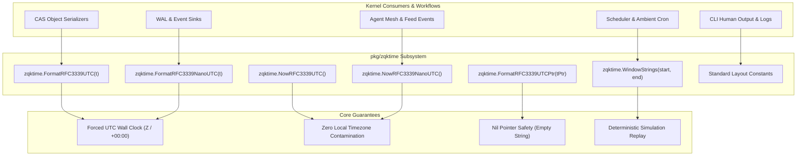
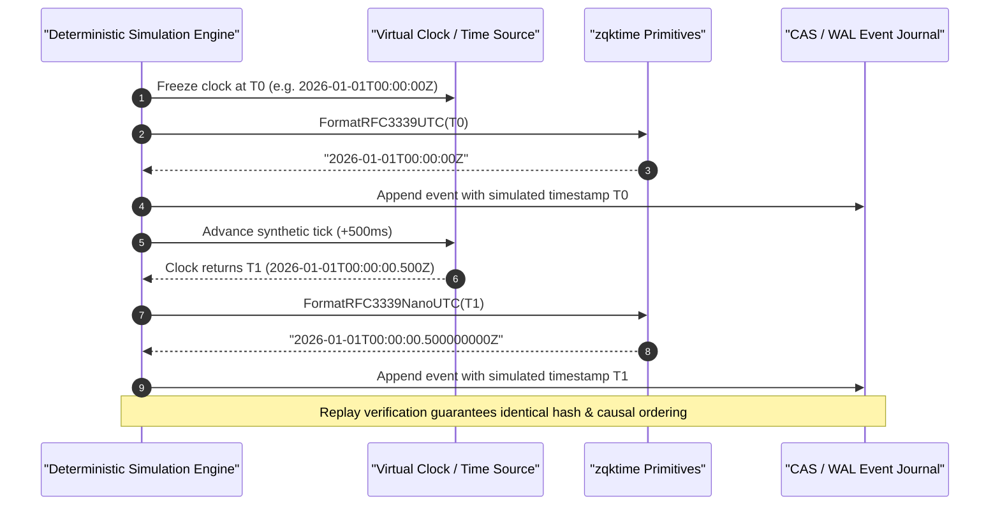

# Time Standardization & Deterministic Simulation Subsystem Guide

## 1. Executive Architectural Summary

The **Time Standardization & Deterministic Simulation Subsystem** ([`pkg/zqktime`](file:///Users/lanceettl/zqk-public-candidate/pkg/zqktime/zqktime.go)) provides universal, allocation-conscious, UTC-enforced timestamp formatting and deterministic temporal simulation for the ZQK Knowledge Kernel.

In distributed, multi-agent systems and content-addressed storage (CAS) engines, non-deterministic timestamps and uncoordinated local time zones introduce critical failure modes:
1. **Cryptographic Hash Drift:** In content-addressed storage, timestamps embedded in YAML/JSON documents alter cryptographic hashes (`sha256`), causing spurious version splits and invalidating Merkle trees if local time zone offsets (e.g., `-05:00` vs `+09:00`) leak into serialized manifests.
2. **Non-Deterministic WAL Replay:** Event-sourced ledgers, write-ahead logs (WAL), and agent feed streams require monotonic temporal ordering. Inconsistent clock skew or variable timezone representations corrupt replay cursors and causality proofs.
3. **Flaky Race Conditions in Test Simulations:** Tests relying on live wall-clock delays or unpinned intervals fail nondeterministically in CI runners under CPU throttling.

`pkg/zqktime` addresses these failure modes by providing zero-allocation UTC formatting primitives, standard layout constants, nil-safe pointer formatters, time window boundaries, and conventions for deterministic replay simulation.

---

## 2. Kernel Invariant: Strict UTC Standardization

Across all kernel packages, autonomous agents, and CLI routines, ad hoc invocation of:
```go
// VIOLATION: Leaks local system timezone into serialized structures
time.Now().Format(time.RFC3339) 
```
is strictly prohibited. All timestamps written to persisted state, WAL logs, CAS objects, or operator-visible output MUST utilize `zqktime` primitives or explicit `t.UTC()` conversion.



---

## 3. Subsystem Architecture & Component Topology

The subsystem is implemented in [`zqktime.go`](file:///Users/lanceettl/zqk-public-candidate/pkg/zqktime/zqktime.go) as a foundational zero-dependency package. To avoid circular dependencies, `pkg/zqktime` imports exclusively Go standard library packages (`time`).

### 3.1 Standard Layout Constants

`pkg/zqktime` provides canonical layout constants for all operational, logging, and object storage serialization needs:

| Constant | Format String | Purpose | Example Output |
| :--- | :--- | :--- | :--- |
| `LayoutDateTimeSpace` | `"2006-01-02 15:04:05"` | Human-readable wall clock for titles, console headers, and summaries | `2026-04-04 12:30:45` |
| `LayoutDateTimeMinute` | `"2006-01-02 15:04"` | Minute-level precision for Gantt schedules and roadmap buckets | `2026-04-04 12:30` |
| `LayoutDateTimeMillis` | `"2006-01-02 15:04:05.000"` | Sub-second trace and log lines requiring millisecond precision | `2026-04-04 12:30:45.123` |
| `LayoutObjectDateTimeZ` | `"2006-01-02T15:04:05Z"` | ISO-8601/RFC3339 representation for object metadata YAML headers | `2026-04-04T12:30:45Z` |
| `LayoutDate` | `"2006-01-02"` | Calendar date partition for directory bucketing and daily keys | `2026-04-04` |
| `LayoutMonth` | `"2006-01"` | Year-month partition for metrics retention and log rollover | `2026-04` |
| `LayoutLogRotateStamp` | `"20060102-150405"` | Compact file-safe timestamp for rotated log files | `20260404-123045` |
| `LayoutCompactStampZ` | `"20060102T150405Z"` | Compact timestamp with UTC `Z` marker for checkpoint snapshots | `20260404T123045Z` |
| `LayoutCompactHour` | `"20060102T1504"` | Compact hourly partition key | `20260404T1230` |
| `LayoutCompactDate` | `"20060102"` | Compact date partition key | `20260404` |

---

## 4. Operational API & Behavioral Contracts

### 4.1 RFC3339 & High-Precision Nano Formatting

```go
// FormatRFC3339UTC renders t as RFC3339 in UTC (ending with Z or +00:00).
func FormatRFC3339UTC(t time.Time) string

// NowRFC3339UTC returns current wall-clock time formatted in UTC RFC3339.
func NowRFC3339UTC() string

// FormatRFC3339NanoUTC renders t as RFC3339Nano in UTC, preserving nanosecond precision.
func FormatRFC3339NanoUTC(t time.Time) string

// NowRFC3339NanoUTC returns current wall-clock time formatted in UTC RFC3339Nano.
func NowRFC3339NanoUTC() string
```

**Key Behavioral Contracts:**
- **Local Timezone Normalization:** Regardless of whether the input `time.Time` carries an offset (such as `America/New_York` or `+05:30`), `FormatRFC3339UTC` and `FormatRFC3339NanoUTC` invoke `.UTC()` prior to layout execution, guaranteeing that serialized text always terminates in `Z` or `+00:00`.
- **Submillisecond Precision Preservation:** `FormatRFC3339NanoUTC` preserves fractional seconds up to 9 decimal places (nanosecond resolution) without truncation, vital for high-throughput concurrency tracing and WAL indexing.

### 4.2 Nil-Safe Pointer Formatting

In schema-driven object models, optional or uninitialized timestamp fields are frequently modeled as pointer types (`*time.Time`):

```go
// FormatRFC3339UTCPtr formats *t in UTC; returns empty string if t is nil.
func FormatRFC3339UTCPtr(t *time.Time) string
```

**Key Behavioral Contract:**
- If `t == nil`, `FormatRFC3339UTCPtr` immediately returns empty string `""` without panicking or creating garbage heap allocations.
- If `t != nil`, it dereferences and delegates to `FormatRFC3339UTC(*t)`.

### 4.3 Time Window Triplet Extraction

For scheduler windows, SLA budgets, and execution intervals:

```go
// WindowStrings returns current UTC time along with start and end formatted in RFC3339 UTC.
func WindowStrings(start, end time.Time) (time.Time, string, string)
```

**Key Behavioral Contract:**
- Returns `(nowUTC, startRFC3339UTC, endRFC3339UTC)`.
- `nowUTC` is guaranteed to be in `time.UTC` location.
- Both `start` and `end` instants are strictly normalized to UTC strings.

---

## 5. Deterministic Simulation & Hermetic Replay

In distributed multi-agent systems, deterministic execution is required to guarantee reproducibility of test cases, WAL replays, and CAS reconciliation cycles.



### 5.1 Principles of Deterministic Time in ZQK

1. **Explicit Instant Injection:** Functions operating over time intervals should accept `time.Time` or an abstraction rather than directly invoking `time.Now()`. When wall-clock strings are required, use `FormatRFC3339UTC(t)` with the injected instant.
2. **Monotonic Progression:** Synthetic clocks advance through discrete tick steps, ensuring strict monotonicity (`t_next.After(t_prev) == true`).
3. **Idempotent String Serialization:** Bitwise identical `time.Time` instances yield bitwise identical strings across any host architecture, OS, or local environment timezone.

---

## 6. Concurrency & Thread-Safety

`pkg/zqktime` functions are entirely stateless and pure. Because `time.Time` is a value type in Go and formatting routines allocate temporary byte buffers via the standard library formatting engine, all functions in `pkg/zqktime` are **concurrently safe without locks or synchronization overhead**.

In high-concurrency environments, tests and worker routines spawn concurrent goroutines using `goroutinelabels.NewGoroutine`:

```go
goroutinelabels.NewGoroutine("time_worker", "concurrent formatting").
    StartSimple(func() {
        stamp := zqktime.FormatRFC3339UTC(instant)
        // thread-safe processing
    })
```

---

## 7. Verification & Coverage Invariant

`pkg/zqktime` is subject to the Kernel Core Quality Gates:
- **Statement Test Coverage Floor:** Minimum 85.0% statement test coverage required (target: 100.0%).
- **Zero Swallowed Errors:** All error paths and format parsers must be checked explicitly.
- **Pure Zero-Cycle Constraint:** `pkg/zqktime` must not import other internal ZQK packages, preserving its place at the base of the kernel dependency tree.

To verify coverage locally:
```bash
ZQK_ALLOW_FOREGROUND_GO_TEST=1 go test -v -timeout 30s -cover ./pkg/zqktime
```
