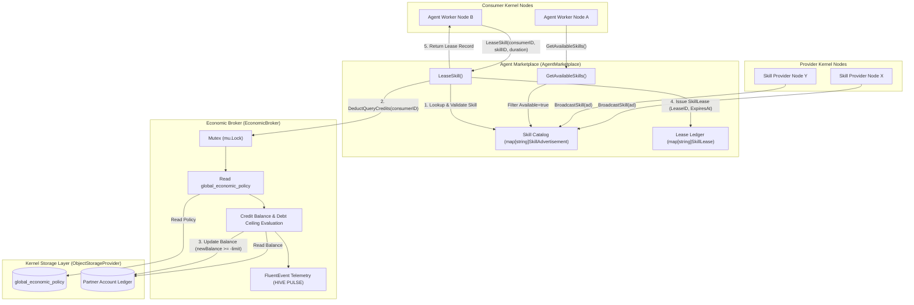

# Token Broker, Agent Resource Marketplace & Economic Exchange Subsystem Guide

Comprehensive architectural, operational, and protocol reference for the `pkg/economy` subsystem in ZQK Core.

---

## 1. System Architecture

In a multi-agent autonomous mesh, sovereign kernel nodes collaborate, share compute capabilities, and invoke specialized AI reasoning skills across organizational boundaries. Without decentralized economic governance, peer nodes face resource exhaustion, tragedy-of-the-commons query spam, and uncoordinated capacity bottlenecks.

The **Token Broker, Agent Resource Marketplace, and Economic Exchange Subsystem** (`pkg/economy`) provides microeconomic accounting, skill directory discovery, and policy-driven credit enforcement for kernel-to-kernel interactions.

### Core Architectural Pillars

1. **Policy-Driven Credit Accounting (`EconomicBroker`)**:
   Enforces economic constraints defined in global configuration policies. Tracks account balances, applies dynamic per-query fees, and bounds partner debt through configurable credit limits.
2. **Dynamic Skill Discovery & Advertisement (`AgentMarketplace`)**:
   Enables provider nodes to broadcast specialized capabilities into a shared directory with explicit metadata regarding availability, costs, and node provenance.
3. **Atomic Skill Leasing with Upfront Settlement (`LeaseSkill`)**:
   Facilitates time-bounded resource leases where consumer nodes acquire execution rights from providers. Settles access charges through the `EconomicBroker` prior to issuing valid lease tokens.
4. **Thread-Safe In-Memory State & Storage Integration**:
   Utilizes fine-grained read-write locks (`sync.RWMutex`, `sync.Mutex`) to prevent double-spending or stale read anomalies during concurrent transactions while persisting ledger balance mutations into the kernel's Content-Addressed Storage (CAS) layer.

---

## 2. Mermaid Topology Diagram

---

## 3. Token Ledger & Allocation Protocols

The economic engine maintains two primary data structures: the **Global Economic Policy** and the **Partner Account Ledger**.

### Global Economic Policy Schema

The broker inspects the singleton object `global_economic_policy` in kernel storage.

| Field Name | Type | Description | Default / Fallback |
| :--- | :--- | :--- | :--- |
| `cost_per_query` | `int` | Number of credits deducted per query or skill lease invocation. | `1` if unspecified or zero. |
| `max_credit_limit` | `int` | Maximum negative balance allowed before a partner is halted. | `0` (debt ceiling enforced strictly at zero). |

### Partner Account Ledger Schema

Each partner kernel or consumer identity is tracked via an account object in kernel storage:

| Field Name | Type | Description |
| :--- | :--- | :--- |
| `credit_balance` | `int` | Current net credit balance. May be negative down to `-max_credit_limit`. |

### Deduction Protocol Workflow

When `DeductQueryCredits(ctx, partnerID)` is invoked:
1. **Mutex Acquisition**: The broker acquires `b.mu.Lock()` to serialize account ledger operations.
2. **Policy Resolution**: Loads `global_economic_policy`. Returns an error if the policy object is missing or unreadable.
3. **Cost Evaluation**: Extracts `cost_per_query`. If zero or unconfigured, defaults to `1`.
4. **Account Lookup**: Loads the partner account record by `partnerID`. Returns an error if not found.
5. **Debt Check**: Computes `newBalance = balance - cost`. If `newBalance < -limit`, rejects the transaction.
6. **Ledger Update**: Writes back `{"credit_balance": newBalance}` to storage.
7. **Telemetry Emission**: Dispatches a structured `FluentEvent` log indicating deducted amount and remaining balance.

---

## 4. Quota Enforcement & Rate Limiting

The economic exchange prevents unbounded consumption using credit thresholds and lease duration boundaries:

### Debt Ceiling Enforcement

The broker implements a hard floor on negative account balances:
$$\text{Allow Deduction} \iff \text{balance} - \text{cost} \ge -\text{limit}$$

- **Positive Balance**: Allowed. Balance decreases toward zero.
- **Zero Balance**: Allowed as long as $\text{cost} \le \text{limit}$. Partner enters credit debt.
- **Exact Boundary**: If $\text{balance} - \text{cost} == -\text{limit}$, deduction succeeds and the account sits at maximum debt.
- **Ceiling Breach**: If $\text{balance} - \text{cost} < -\text{limit}$, the operation fails immediately with an `insufficient credits` error, halting upstream lease workflows.

### Marketplace Lease Lifecycles

Skill leases are issued with explicit timestamps:
- **`LeaseID` Generation**: Deterministic prefix pattern `lease-<consumerID>-<skillID>-<unix_nanos>` guaranteeing collision-free tracking.
- **Expiration Stamping**: `ExpiresAt = time.Now().Add(duration)`. Consumer nodes must renew or re-acquire leases upon expiration.
- **Decoupled Verification**: If an `AgentMarketplace` is instantiated without a broker (`broker == nil`), leasing functions in permissive open-community mode without credit deduction.

---

## 5. Failure Modes & Edge Cases

| Failure Mode | Trigger Condition | System Behavior | Recovery / Mitigation |
| :--- | :--- | :--- | :--- |
| **Missing Global Policy** | Storage provider returns an error when reading `global_economic_policy`. | Returns `no active economic policy found`. All deductions and broker-backed leases are blocked fail-closed. | Bootstrap initial `global_economic_policy` object in storage. |
| **Missing Partner Account** | Consumer or partner ID not found in storage. | Returns `partner account <id> not found`. Deduction aborts without modifying policy or other balances. | Provision partner account with initial `credit_balance` before leasing. |
| **Debt Limit Exceeded** | `newBalance < -limit`. | Deduction fails with `insufficient credits: partner <id> reached credit limit`. No storage mutation occurs. | Partner must replenish credits or operator must adjust `max_credit_limit`. |
| **Storage Write Failure** | `store.Update` returns error on balance persist. | Error propagated to caller. Mutex unlocks cleanly; in-memory state remains consistent. | Underlying storage retry or disk space recovery. |
| **Invalid Skill Advertisement** | Broadcast payload missing `SkillID` or `KernelID`. | Rejected synchronously with `skill ID is required` or `kernel ID is required`. | Caller must populate required identification attributes. |
| **Unavailable Skill Lease** | Consumer requests lease for skill with `Available == false`. | Fails immediately with `skill <id> is not currently available`. No credits are deducted. | Provider updates advertisement availability status. |
| **Unregistered Skill Lease** | Consumer requests lease for non-existent `skillID`. | Fails immediately with `skill <id> not found`. No credits are deducted. | Query available skills via `GetAvailableSkills` prior to leasing. |

---

## 6. Verifiable Invariants

1. **Non-Negative Cost Invariant**: If `cost_per_query` in policy is `0` or absent, the broker must default cost to `1`, preventing zero-cost depletion loops.
2. **Fail-Closed Credit Check Invariant**: A lease request under an active `EconomicBroker` MUST NOT succeed if credit deduction fails for any reason (policy failure, missing partner, or limit breach).
3. **Zero Balance Leak Invariant**: The balance update is strictly atomic under the broker's mutex; concurrent callers cannot race to overdraw partner credit limits.
4. **Availability Filtering Invariant**: `GetAvailableSkills` must never return advertisements where `Available == false`.
5. **Coverage Floor Invariant**: The `pkg/economy` package maintains a strict statement test coverage floor of $\ge 85.0\%$ (target $100.0\%$), verified by continuous CI gates.
