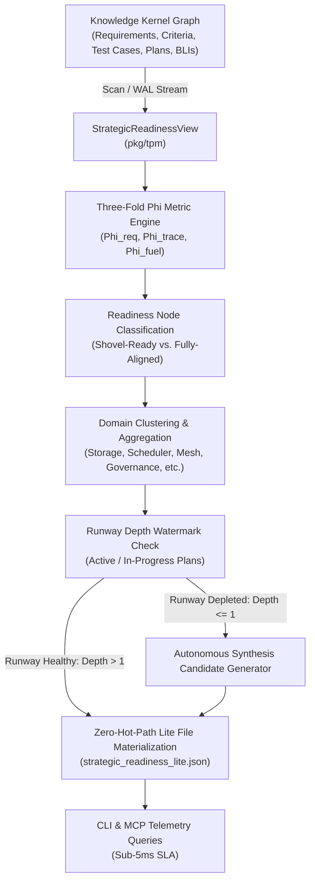
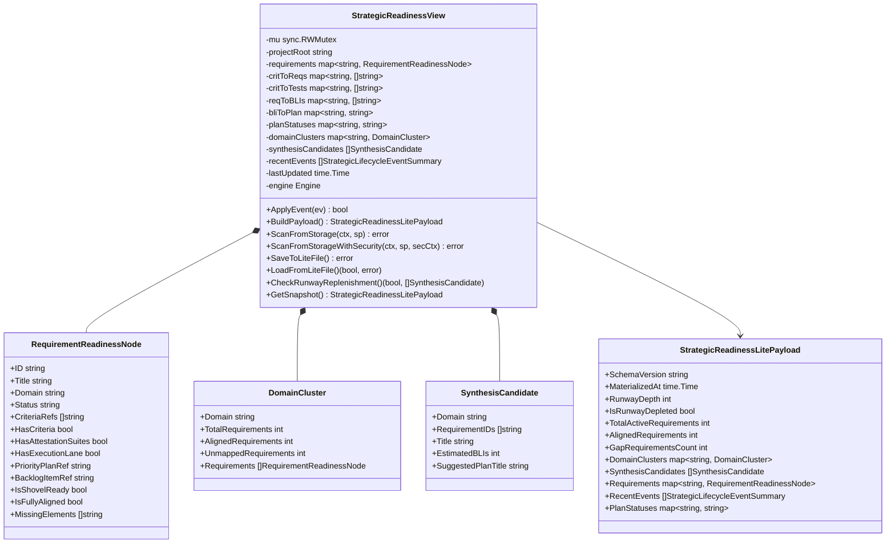
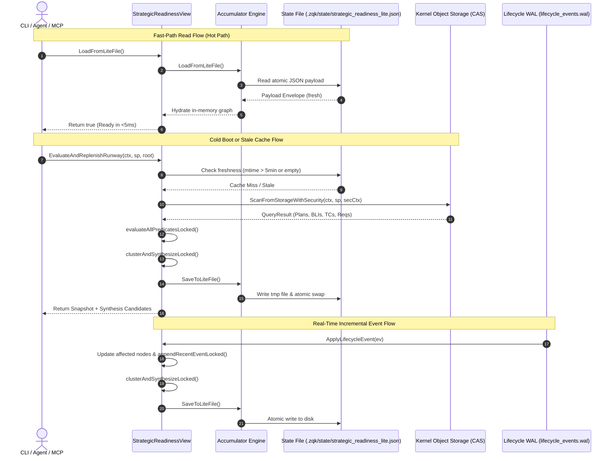
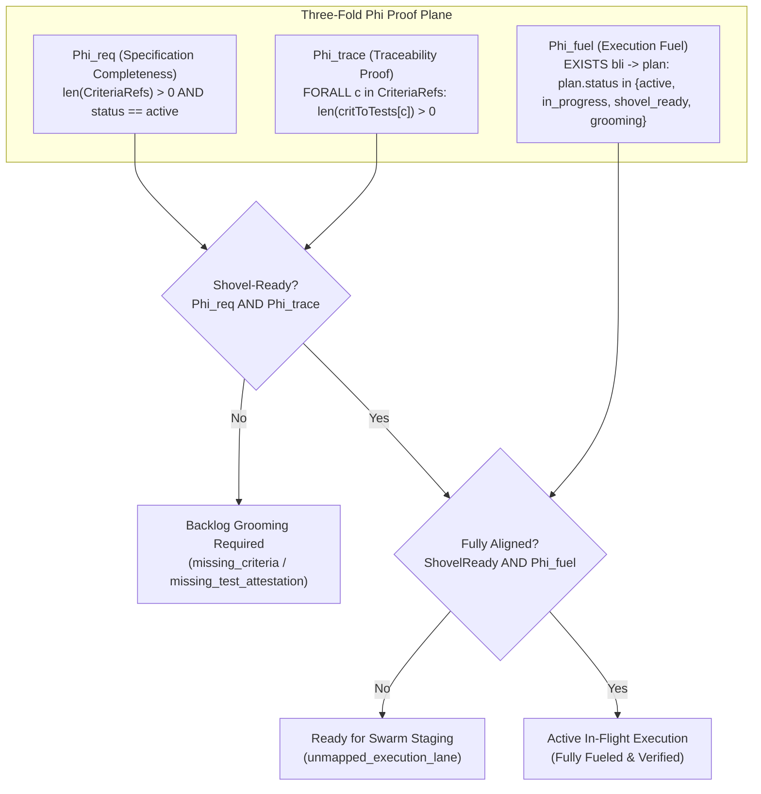

# TPM Strategic Readiness, Three-Fold Phi Metrics & Gantt Matrix View Subsystem Operational Architecture Guide (`pkg/tpm`)

## 1. Architectural Overview & Design Philosophy

The **TPM Strategic Readiness, Three-Fold Phi Metrics & Gantt Matrix View Subsystem** (`pkg/tpm`) provides the core strategic intelligence and telemetry engine governing technical program execution within the ZQK Knowledge Kernel.

Governed by core platform policies (`POL-DEFAULT-142277d3` for strategic alignment invariants and `POL-AGENT-TPM-TRACE-PIPELINE-001` for continuous traceability verification), the subsystem bridges high-level requirements with real-time runtime execution. In high-velocity autonomous swarm environments, engineering backlogs frequently suffer from three classic failure modes:
1. **Unspecified Requirements**: Requirements exist without formal acceptance criteria, leading to hallucinated or divergent implementations.
2. **Untested Assertions**: Requirements declare criteria but lack automated test cases, creating phantom progress without empirical verification.
3. **Unfueled Initiatives**: Fully specified and tested requirements languish because they have not been attached to active execution lanes or discrete backlog items in the active priority plan.

To eliminate these vulnerabilities, `pkg/tpm` implements a real-time reactive graph accumulator that continuously evaluates the **Three-Fold Phi Metrics** ($\Phi_{\text{req}}$, $\Phi_{\text{trace}}$, $\Phi_{\text{fuel}}$), groups requirements into architectural domain clusters, computes execution runway depth, and triggers autonomous runway replenishment when active execution capacity drops below minimum thresholds.

---

## 2. Component Topology

The subsystem is organized around a set of cooperating structures maintaining in-memory graph state, persisting serialized snapshots, and reacting to Write-Ahead Log (WAL) lifecycle transitions:

### Key Topology Elements:
- **`StrategicReadinessView`**: Central coordinator that satisfies the generic `accumulator.Accumulator[*StrategicReadinessLitePayload]` interface. It encapsulates an adjacency index between requirements, criteria, test cases, backlog items, and priority plans.
- **`RequirementReadinessNode`**: Normalized graph node tracking the static completeness, traceability state, execution fuel status, and missing element diagnostics for an individual requirement.
- **`DomainCluster`**: Subsystem partition aggregating requirements by domain (e.g., `storage`, `scheduler`, `mesh_agent`, `tpm_orchestration`, `governance`, `performance`, `qa_traceability`, and fallback `core_kernel`).
- **`SynthesisCandidate`**: High-value autonomous planning bundle derived when execution runway is depleted, clustering unmapped requirements in a domain to seed the next priority plan cycle.
- **`StrategicReadinessLitePayload`**: The zero-cost materialized state persisted to disk at `.zqk/state/strategic_readiness_lite.json`.

---

## 3. Strategic Readiness & Materialization Lifecycle

The subsystem operates under the **Zero Hot-Path Scan Invariant**: read queries must resolve in sub-5ms from disk without querying the storage layer. Background synchronization occurs incrementally through Write-Ahead Log (WAL) events and periodic reconciliation.

---

## 4. Three-Fold Phi Metrics Formulation

The mathematical and operational foundation of the subsystem rests on the **Three-Fold Phi Metrics**, evaluating requirement readiness across static, dynamic, and execution planes:

### Formal Metric Definitions:

1. **Specification Completeness ($\Phi_{\text{req}}$)**:
   $$\Phi_{\text{req}}(r) = (\text{status}(r) = \text{active}) \land (|C_r| > 0)$$
   where $C_r$ is the set of criterion references attached to requirement $r$. An active requirement without defined criteria fails $\Phi_{\text{req}}$ and is tagged with `missing_criteria`.

2. **Traceability Proof ($\Phi_{\text{trace}}$)**:
   $$\Phi_{\text{trace}}(r) = (|C_r| > 0) \land \left(\forall c \in C_r, \; |T_c| > 0\right)$$
   where $T_c$ is the set of test cases verifying criterion $c$. If even a single criterion lacks automated verification, the requirement fails $\Phi_{\text{trace}}$ and is tagged with `missing_test_attestation`.

3. **Execution Fuel ($\Phi_{\text{fuel}}$)**:
   $$\Phi_{\text{fuel}}(r) = \exists b \in B_r, \; \exists p = \text{plan}(b) \;\text{s.t.}\; \text{status}(p) \in \{\text{active}, \text{in\_progress}, \text{shovel\_ready}, \text{grooming}\}$$
   where $B_r$ are backlog items referencing requirement $r$. Requirements with complete specs and tests but without an active execution container fail $\Phi_{\text{fuel}}$ and are tagged with `unmapped_execution_lane`.

### Compound States:
- **Shovel-Ready**: Requirement satisfies both $\Phi_{\text{req}}$ and $\Phi_{\text{trace}}$. It is fully specified and attested, ready to be scheduled.
- **Fully-Aligned**: Requirement satisfies all three: $\Phi_{\text{req}} \land \Phi_{\text{trace}} \land \Phi_{\text{fuel}}$. It is actively moving forward in an execution cycle.

---

## 5. Runway Depth & Autonomous Replenishment

Execution capacity is quantified by **Runway Depth** ($D_{\text{runway}}$):
$$D_{\text{runway}} = \sum_{p \in P} \mathbb{I}(\text{status}(p) \in \{\text{active}, \text{in\_progress}, \text{shovel\_ready}, \text{grooming}\})$$

### The Replenishment Threshold:
A system is in **Runway Depletion** when:
$$D_{\text{runway}} \le 1$$

When depletion occurs:
1. The subsystem scans all active requirements where $\neg \Phi_{\text{fuel}}(r)$.
2. Requirements are partitioned by their detected domain ($dom(r)$).
3. Domains are sorted deterministically and bundled into `SynthesisCandidate` objects:
   - Each candidate proposes a focused 1-cycle priority plan (estimating 2 to 5 backlog items).
   - Autonomous swarms (`zqk do`, `zqk agent orchestrate`) receive these candidates to stage the next execution cycle without human prompting.

---

## 6. Concurrency & Thread-Safety Invariants

The subsystem guarantees absolute safety under concurrent multi-goroutine access:

1. **Reader-Writer Locking (`sync.RWMutex`)**:
   - In-memory graph state is guarded by `v.mu`. Read operations (`GetSnapshot`, `CheckRunwayReplenishment`) acquire read locks (`RLock`/`RUnlock`), enabling high-throughput concurrent reads.
   - Mutations (`ApplyLifecycleEvent`, `ScanFromStorageWithSecurity`) acquire exclusive write locks (`Lock`/`Unlock`).
2. **Atomic Disk Materialization**:
   - File persistence (`SaveToLiteFile`) writes payloads to a temporary file (`<targetPath>.tmp.<timestamp>`) before executing an atomic filesystem rename (`fileutil.Rename`).
   - Disk writes never expose partial or corrupted JSON streams to concurrent reader processes.
3. **Named Goroutines**:
   - Asynchronous WAL subscribers and background reindexers must be launched using `goroutinelabels.NewGoroutine` to ensure tracking, profiling, and leak detection under the runtime supervision tree.

---

## 7. Verification & Coverage Invariant

To ensure platform reliability, the TPM subsystem is governed by a strict statement coverage floor:

- **Static Floor Invariant**: Statement test coverage for `pkg/tpm` must remain strictly $\ge 85.0\%$ (targeting $\ge 95\%$).
- **Test Scope**: All tests reside under `pkg/tpm` and are verified with `ZQK_ALLOW_FOREGROUND_GO_TEST=1 go test -v -timeout 30s -cover ./pkg/tpm`.
- **Pre-commit Check-Valves**: Pre-commit hygiene checks enforce zero swallowed errors (`_ = ...`), functions under 100 lines, hermetic cleanup with `t.TempDir()`, and exclusive use of `fileutil.*` for filesystem operations.
