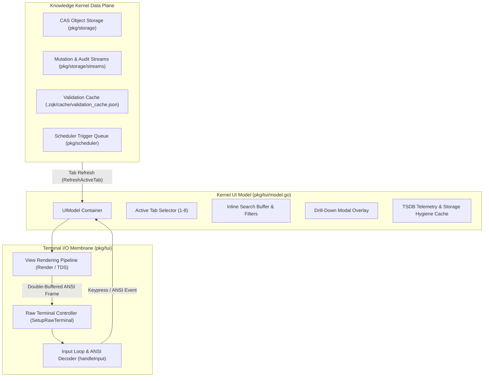

# TUI Engine & Terminal Interface Subsystem Architectural & Operational Guide

## Overview

The **TUI Subsystem** (`pkg/tui`) implements the high-performance terminal user interface and visual mission control engine for the **ZQK Knowledge Kernel**. It translates real-time kernel telemetry, write-ahead log (WAL) mutations, audit events, multi-agent swarm status, program management cascades, and system validation checks into a unified, responsive console experience.

Engineered around a decoupled terminal state machine, the subsystem supports two primary operational modalities:
1. **Interactive Full-Screen Mission Control Console**: An alternate-buffer, raw-terminal interface providing sub-millisecond keyboard navigation, real-time event streaming, drill-down modal inspection, and quick-action triggering.
2. **Headless Single-Shot Rendering**: A non-blocking fallback rendering a deterministic single-frame snapshot to standard output when running in non-TTY environments (such as CI/CD runners, background daemons, or autonomous AI agent harnesses).

---

## Subsystem Architecture: Model-Update-View (MUV)

The subsystem is architected following the **Elm Architecture** (Model-Update-View pattern in idiomatic Go):



### Architectural Separation of Concerns

1. **`pkg/tui/model.go` (The Model)**:
   - Encapsulates the entire mutable state of the user interface (`UIModel`).
   - Implements tab-specific refresh routines (`RefreshActiveTab`, `RefreshMutations`, `RefreshAuditEvents`, `RefreshPM`, `RefreshQA`, `RefreshHealth`, `RefreshMetrics`, `RefreshScheduler`).
   - Manages drill-down modal models (`ItemDetailModel`), search buffers, cursor positions, and auto-scroll flags.
   - Decoupled from terminal I/O to ensure fast, deterministic unit testability.

2. **`pkg/tui/tui.go` (The Controller / Update Dispatcher)**:
   - Manages raw terminal mode transitions (`SetupRawTerminal`) and signal traps.
   - Dispatches keyboard inputs and ANSI CSI escape sequences via `handleInput`.
   - Coordinates periodic background refresh ticks (refreshing only the active tab to prevent unnecessary I/O thrashing).
   - Writes rendered string buffers to standard output using atomic screen clearing (`writeScreen`).

3. **`pkg/tui/views.go` (The View Pipeline)**:
   - Pure functional rendering pipeline converting `UIModel` into styled ANSI strings.
   - Composes UI components using the **Terminal Design System (TDS)** (`pkg/tui/tds`), ensuring line uniformity, fixed column widths, and non-bleeding grid alignment.
   - Supports 3 operator editor profiles: `newb` (full visual aids), `pro` (compact single-line navigation), and `jedi` (zen mode maximizing data canvas).

4. **`pkg/tui/ansi_constants.go` (Terminal Constants)**:
   - Declares standard VT100/ANSI terminal control sequences (alternate screen buffer enter/exit, clear to EOL, cursor visibility, CSI escape codes).

---

## The 8 Mission Control Operating Modalities

The TUI provides 8 specialized operational tabs, selectable via hotkeys `1` through `8` or `Tab` / `Shift+Tab`:

| Tab # | Identifier | Domain Focus | Primary Data Source |
| :---: | :--- | :--- | :--- |
| **1** | `TabState` | Real-time mutation journal (WAL) | `.zqk/data/streams/change_journal_entry` |
| **2** | `TabAudit` | High-volume operational audit events | `.zqk/data/streams/audit_event` |
| **3** | `TabSwarm` | Agent tasks, throughput, and inbox | `pkg/swarm`, `pkg/agentfeed`, `pkg/tde` |
| **4** | `TabPM` | Strategic cascade (Mission, Goals, Plans, BLIs) | CAS Object Storage (`pkg/storage`) |
| **5** | `TabMetrics` | System vitals, command velocity & TSDB | TSDB Telemetry & Storage Hygiene |
| **6** | `TabScheduler` | Autonomous background jobs & daemons | `pkg/scheduler` & Daemon Overseer |
| **7** | `TabQA` | Traceability, test suites & DoD gate | `cmd/zqk/test` & Lineage Accumulator |
| **8** | `TabHealth` | Multi-layer validation & Action Center | `.zqk/cache/validation_cache.json` |

---

## Terminal Design System (TDS) & Styling Invariants

To eliminate visual artifacts common in terminal applications, the TUI adheres to strict styling invariants:

1. **Line Uniformity**: Every rendered line within panels and tables is padded or truncated to exactly match the terminal width (`m.Width`). This prevents involuntary line wrapping that corrupts vertical grid alignment.
2. **Embedded Newline Sanitization**: All object titles, diff summaries, and table cells strip carriage returns (`\r`) and convert newlines (`\n`) to whitespace before rendering, preventing row cascading.
3. **ANSI Decoupling**: Visual string measurement (`tds.VisibleWidth`) measures printable rune columns, ignoring non-printing ANSI color codes. This ensures padding calculations remain accurate regardless of color formatting.
4. **Scrollback Safety**: When entering raw mode, the terminal issues `\033[?1049h` to enter the private alternate screen buffer, preserving the user's existing terminal scrollback buffer upon exit.

---

## Modal Overlays & Interactive Search

### Drill-Down Modal Overlays

Pressing `Enter` on any selected row across all 8 tabs summons a modal overlay (`ItemDetailModel`):
- **Tab 1 (State) & Tab 2 (Audit)**: Full event timestamp, actor, operation, and complete mutation diff.
- **Tab 3 (Swarm)**: Inbox message body with quick acknowledge (`[a]`) and reply (`[r]`) actions.
- **Tab 4 (PM)**: Priority plan workstreams, risk blockers, and backlog unit lineage.
- **Tab 5 (Metrics)**: Command latency distributions, execution counts, and status badges.
- **Tab 6 (Scheduler)**: Complete cron schedules, command arguments, last error log, and execution triggers (`[t]` immediate, `[d]` delayed).
- **Tab 7 (QA)**: Full downward traceability chain (Root Object ➔ Requirement ➔ Backlog Item), test suite paths, and individual criterion pass/fail timestamps.
- **Tab 8 (Health)**: Violation tier classification, CAS file paths, and automated remediation triggers (`[a]`).

### Inline Search & Live Filtering

Pressing `/` opens the interactive search bar. As the operator types:
- Matches are computed in real time across ID, title, status, actor, and summary fields.
- Non-matching rows are filtered from view.
- Match counts are reflected in the search bar (e.g., `(3 matches)`).
- `n` and `N` cycle forward and backward through filtered matches.
- `Esc` cancels search input or clears an active filter.

---

## Headless Execution & Graceful Fallback

When executed in non-interactive environments (where `term.IsTerminal` returns false for stdin or stdout):
- `RunTUI` detects the non-interactive context.
- Configures default 100x30 viewport dimensions.
- Executes a single-shot refresh cycle pulling authoritative kernel data.
- Emits a clean, non-interactive ANSI frame to `stdout` and returns `nil`.
- Guarantees zero blocking and zero process leakage in automated test harnesses and CI pipelines.

---

## Verification & Statement Coverage Invariant

The TUI subsystem is governed by continuous verification with a strict statement coverage gate:

> **Subsystem Statement Coverage Invariant**:
> Statement test coverage across `pkg/tui` must remain **>= 85.0%** at all times. Any regression below this threshold fails continuous integration gates.

### Running Test Verification

To execute the full TUI test suite with statement coverage profiling:

```bash
ZQK_ALLOW_FOREGROUND_GO_TEST=1 go test -v -timeout 30s -cover ./pkg/tui
```

### Coverage Architecture

The test suite (`ui_test.go` and `tui_coverage_elevation_cycle133_test.go`) exercises:
1. **Helper Invariants**: Type conversions (`getIntVal`), timestamp formatting (`formatTimeVal`), duration formatting (`formatDurationMs`), sparkline generators, and boolean ternaries.
2. **Terminal Controller**: Raw terminal initialization failure handling, screen clearing sequences, and non-interactive execution paths.
3. **Model Refresh Cycles**: Storage-backed and in-memory refreshes across all 8 tabs, handling nil providers, empty project roots, and populated CAS fixtures.
4. **View Rendering Boundaries**: Profile switching (`newb`, `pro`, `jedi`), viewport width edge cases (60–140 columns), scroll offset boundary clamping, and empty state banners.
5. **Input State Machine**: Key dispatching across normal navigation, search mode, modal overlay interaction, and ANSI multi-byte CSI sequences.
