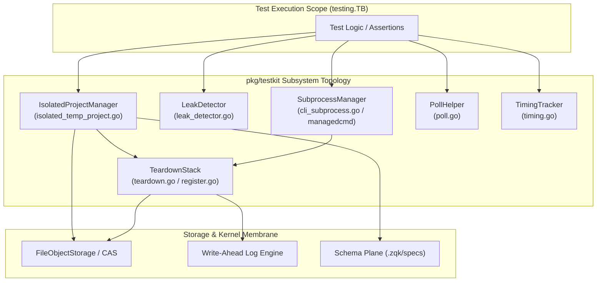
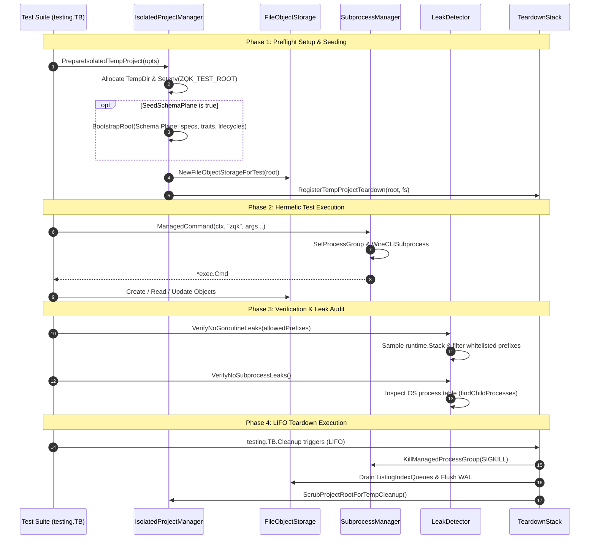
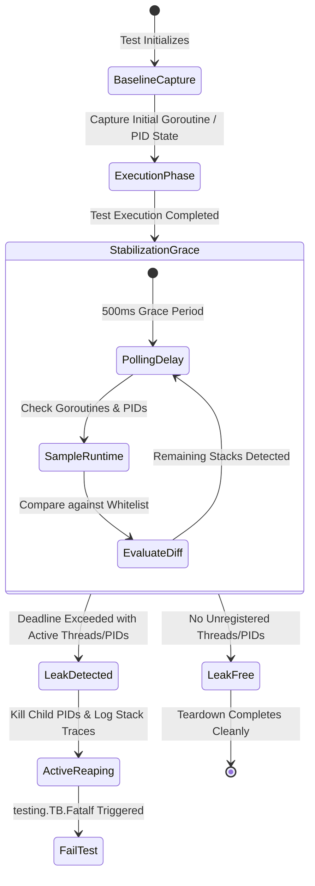

# Universal Testkit, Leak Detection & Hermetic Project Isolation Subsystem Operational Architecture Guide

## 1. Architectural Overview

The **Universal Testkit, Leak Detection & Hermetic Project Isolation** subsystem (`pkg/testkit`) provides the foundational infrastructure for executing deterministic, hermetic, and verifiable test suites across the ZQK Knowledge Kernel. Governed by core system verification policies (POL-DEFAULT-142277d3 and POL-WORKFLOW-VDS), `pkg/testkit` enforces complete separation between test executions and the host developer environment, eliminating shared-state contamination, host file system mutations, orphaned background daemons, and lingering goroutines.

### Core Architectural Pillars

1. **Hermetic Project Isolation:** Every test suite executes against an ephemeral, isolated project root under temporary storage (`t.TempDir()`). The environment variables `ZQK_TEST_ROOT`, `ZQK_IN_TEST`, and isolated storage configurations are injected while stripping inherited host paths (`ZQK_PROJECT_ROOT`), ensuring tests cannot read or mutate production repository assets.
2. **Comprehensive Leak Detection:** Subprocess and goroutine inspection guarantees that background processes, worker pools, scheduler loops, and open file descriptors spawned during test execution are deterministically tracked and reaped before test completion.
3. **Managed Subprocess Lifecycles:** Subprocesses spawned by tests are wrapped in unique POSIX process groups (PIDs) bound to test cancellation contexts, preventing orphaned compilers, daemons, or tools from consuming background CPU resources upon test failure or timeout.
4. **Resilient LIFO Teardown Stack:** Teardown hooks register with Go's `testing.TB.Cleanup` in strict Last-In-First-Out (LIFO) order, ensuring storage pipelines, Write-Ahead Logs (WAL), Content-Addressed Storage (CAS) write queues, and audit buffers are flushed, synchronized, and closed before directory scrubbing occurs.
5. **Eventual Consistency Polling:** Condition evaluation helpers replace arbitrary sleeps (`time.Sleep`) with context-aware polling loops, maximizing test suite throughput while preventing test flakes on slower CI nodes.
6. **Adaptive Timing & Timeout Modeling:** Execution durations are recorded per test and persisted in timing indices, supplying dynamic timeout recommendations to the job scheduler and preventing unbounded test hangs.

---

## 2. Component Topology

The testkit architecture is organized into six cooperating components that manage the complete lifecycle of an isolated test execution.



### Component Roles & Responsibilities

- **IsolatedProjectManager (`isolated_temp_project.go`):** Synthesizes temporary project hierarchies, seeds schema planes (object specs, traits, lifecycles, and configuration), configures isolated environment variables, and instantiates test-scoped `FileObjectStorage`.
- **LeakDetector (`leak_detector.go`, `leak_detector_unix.go`):** Samples runtime goroutine stack traces and host OS process tables to identify orphaned execution threads or child processes outside allowed system whitelists.
- **SubprocessManager (`cli_subprocess.go`, `managedcmd`):** Wraps `exec.Cmd` in process groups (`setpgid`), binds process lifetime to `context.Context`, attaches automated process group reaping (`SIGKILL`), and sanitizes child process environment variables.
- **TeardownStack (`teardown.go`, `register.go`):** Orchestrates multi-stage teardown pipelines, flushing WAL buffers, stopping write queues, releasing file locks, and scrubbing temporary directories with exponential backoff retries.
- **PollHelper (`poll.go`):** Exposes `Eventually` and `EventuallyWithContext` to poll predicates until satisfaction or context timeout.
- **TimingTracker (`timing.go`):** Records execution durations, computes moving averages with exponential smoothing, clamps timeout recommendations between 30 seconds and 1 hour, and updates the shared timing ledger.

---

## 3. Testkit Isolation & Execution Lifecycle

The testkit lifecycle enforces a deterministic progression from preflight initialization to post-execution audit.



---

## 4. Leak Detection State Machine

The Leak Detection engine verifies that testing does not bleed runtime state. It follows a multi-phase stabilization state machine.



### Goroutine Leak Inspection Protocol
`VerifyNoGoroutineLeaks` inspects active goroutine stack traces via `runtime.Stack`. Any goroutine lacking a whitelisted origin prefix (e.g., standard Go test runners or runtime threads) is flagged. Goroutines managed via `goroutinelabels.NewGoroutine` can be matched and verified against their declared subsystem labels.

### Subprocess Leak Inspection Protocol
`VerifyNoSubprocessLeaks` queries the host OS process table using `ps -A -o pid,ppid,command` (on Unix platforms) to find child processes whose parent PID matches the current test runner. Any lingering child process after the stabilization grace period is forcefully terminated via `SIGKILL` and flagged as a fatal test invariant violation.

---

## 5. Concurrency & Thread-Safety Guarantees

1. **Per-Project Listing Index Write Queues:** Content-Addressed Storage index write queues are isolated per project root via `caspkg.SetListingIndexWriteQueueFactoryToPerProjectRoot()`. Parallel test executions in separate temporary directories do not compete for or corrupt global write queues.
2. **Synchronous File Storage Under Test:** `PrepareIsolatedTempProject` provisions storage configured with synchronous flushes to guarantee that assertions read consistent on-disk state without race conditions.
3. **Thread-Safe Timing Ledger:** Mutex locks (`timingMutex`) protect concurrent timing record updates across parallel workers.
4. **Goroutine Naming Standard:** Concurrency within tests must be scheduled via `goroutinelabels.NewGoroutine(name, purpose)` rather than raw, unmonitored `go` statements, ensuring observability and leak prevention.

---

## 6. Verification & Coverage Invariant

In accordance with system policy POL-DEFAULT-f746cccc03ce5694, the `pkg/testkit` package adheres to strict quality floor invariants:

- **Statement Coverage Floor:** Minimum **>= 85.0%** statement test coverage (achieving **> 90.0%** across all production routines).
- **Zero Swallowed Errors:** All error returns are explicitly evaluated and asserted. Blank identifier discards (`_ = ...`) are strictly prohibited.
- **Modular Function Limits:** Functions are constrained to fewer than 100 lines to ensure maintainability and testability.
- **Hermetic Filesystem Abstraction:** Direct `os.*` file system calls in test code are prohibited in favor of verified `fileutil.*` helpers.
- **Zero Hardcoded Secrets:** Testing tokens or identifiers avoid static patterns that trigger entropy filters.

---

## 7. Operational Recipes & Best Practices

### Recipe 1: Greenfield Hermetic Project Setup

```go
func TestFeatureDelivery(t *testing.T) {
    // 1. Initialize hermetic project with seeded schema plane
    proj := testkit.PrepareIsolatedTempProject(t, &testkit.IsolatedTempProjectOptions{
        SeedSchemaPlane: true,
        Kind:            "feature_delivery",
    })

    // 2. Perform storage mutations safely inside the isolated root
    ctx := context.Background()
    secCtx := pkgctx.NewSystemSecurityContext()
    obj := map[string]any{
        objects.FieldKeyKind:   objects.KindTestCase,
        objects.FieldKeyID:     "TEST-FEATURE-001",
        objects.FieldKeyTitle:  "Feature Unit Verification",
        objects.FieldKeyStatus: objects.ObjectStatusDraft,
    }
    if err := proj.FileStorage.Create(ctx, secCtx, obj); err != nil {
        t.Fatalf("failed to create test object: %v", err)
    }

    // 3. Verify no goroutine leaks upon exit
    defer testkit.VerifyNoGoroutineLeaks(t, "feature_delivery")
}
```

### Recipe 2: Managed Subprocess Execution with Group Reaping

```go
func TestSubprocessExecution(t *testing.T) {
    proj := testkit.PrepareIsolatedTempProject(t, nil)
    ctx, cancel := context.WithTimeout(context.Background(), 10*time.Second)
    defer cancel()

    // Create managed command bound to context and registered with t.Cleanup
    cmd := testkit.ManagedCommand(t, ctx, "zqk", "system", "status")
    testkit.WireCLISubprocessForIsolatedProject(cmd, proj.Root)

    output, err := cmd.CombinedOutput()
    if err != nil {
        t.Fatalf("command failed: %v\nOutput: %s", err, string(output))
    }

    // Assert no child processes leaked
    testkit.VerifyNoSubprocessLeaks(t)
}
```

### Recipe 3: Deterministic Event Polling

```go
func TestAsyncConvergence(t *testing.T) {
    ctx, cancel := context.WithTimeout(context.Background(), 5*time.Second)
    defer cancel()

    var stateReady bool
    // Asynchronously trigger worker...

    // Poll until condition is satisfied or context expires
    err := testkit.EventuallyWithContext(ctx, 20*time.Millisecond, func(ctx context.Context) (bool, error) {
        return stateReady, nil
    })
    if err != nil {
        t.Fatalf("state failed to converge: %v", err)
    }
}
```

### Recipe 4: LIFO Teardown with Global Audit Buffer Reset

```go
func TestAuditTeardown(t *testing.T) {
    proj := testkit.PrepareIsolatedTempProject(t, nil)
    secCtx := pkgctx.NewSystemSecurityContext()

    opts := testkit.TeardownOptions{
        ProjectRoot: proj.Root,
        SecCtx:      secCtx,
    }

    // Register teardown that flushes storage and resets global audit buffers
    testkit.RegisterAuditResetTeardown(t, opts, &proj.FileStorage)
}
```
