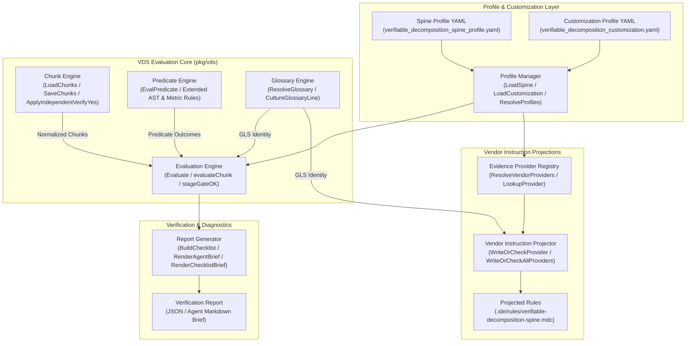
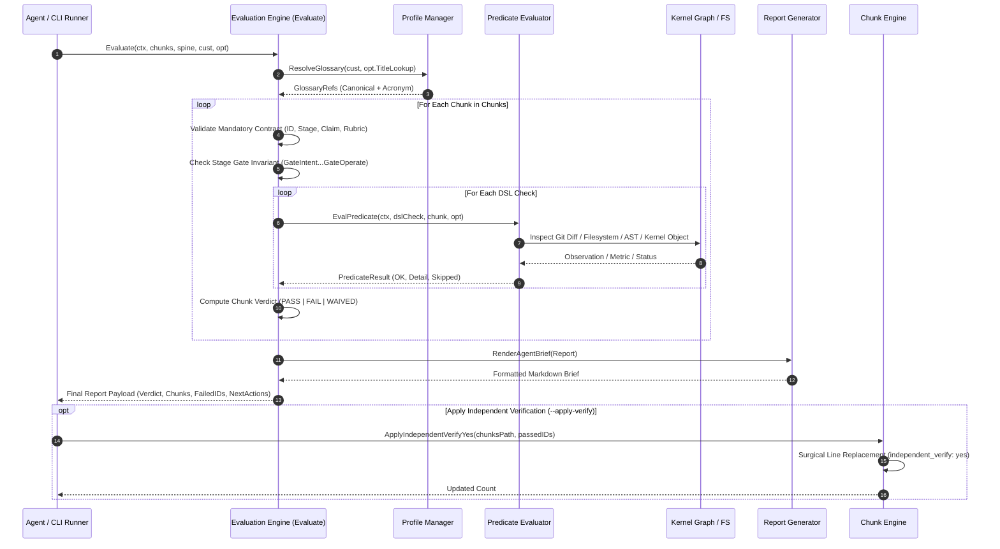
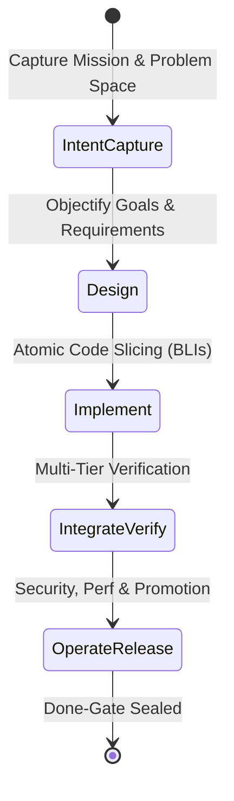

# Verifiable Delivery Standard (VDS), Chunk Evaluation & Predicate Evidence Engine Subsystem Operational Architecture Guide

## 1. Executive Architectural Summary

The **Verifiable Delivery Standard (VDS) & Predicate Evidence Engine** (`pkg/vds`) provides the definitive, machine-verifiable done-gate subsystem for the **ZQK Knowledge Kernel**.

In traditional software development and autonomous agent swarms, "done" claims frequently suffer from narrative inflation, subjective developer assertions, or hallucinated LLM confidence. Within the Knowledge Kernel, narrative assertions are fundamentally prohibited as completion evidence. Under core governance policies **POL-DEFAULT-142277d3** and **POL-WORKFLOW-VDS**:

> *"Done means re-runnable predicate evidence; narrative is never a gate."*

`pkg/vds` operationalizes this governance invariant across the entire software delivery lifecycle—spanning from intent capture and design to implementation, integration verification, and release operations. Work is decomposed into discrete, immutable, independently verifiable units termed **Chunks**. Each chunk binds a single verifiable claim to rigid stage gates, machine-evaluable Domain Specific Language (DSL) predicates, and re-runnable evidence footprints.

### Core Architectural Principles

1. **Re-runnable Evidence Over Narrative:** A chunk cannot achieve a `PASS` verdict based on prose or chat statements. It requires verifiable footprints such as persistent kernel object references, scheduler job identifiers, log paths, git diff changes, or successful test executions.
2. **Rigid Spine vs. Flexible Customization:** The five stages of the delivery lifecycle, chunk schema contracts, and completion gates form an unalterable architectural spine. Project-level customizations may tune execution tools (e.g., test modes, lint runners, scan commands) but cannot eliminate or bypass spine gates.
3. **Independent Third-Party Verification:** Chunks must satisfy independent verification before being certified as complete. Running `vds evaluate` performs fluent re-verification across all declared predicates, enabling safe transition to `independent_verify=yes`.
4. **Human Waivers Only:** Under no circumstances may autonomous AI agents self-waive criteria or gates. Waivers are strictly human-authored objects referenced via explicit `waiver_ref` anchors.
5. **Vendor Instruction Projection:** Ground truth resides in the Knowledge Kernel graph. IDE and agent instructions (such as `.ide/rules/*.mdc`) are generated and cryptographically synchronized from the kernel via deterministic projection providers.
6. **Strict Static Floor Coverage:** The subsystem adheres to an elevated statement test coverage invariant ($\ge 85.0\%$, verified at $95.8\%$), ensuring fail-safe reliability for all evaluation routines, error boundaries, and concurrent execution paths.

---

## 2. Component Topology & Subsystem Architecture

The `pkg/vds` subsystem consists of five cohesive components collaborating across profile management, chunk evaluation, predicate execution, provider projection, and report synthesis:



### Component Responsibilities

| Component | Exported Functions / Types | Core Architectural Responsibility |
| :--- | :--- | :--- |
| **Chunk Engine** | `LoadChunks`, `SaveChunks`, `ApplyIndependentVerifyYes`, `InitChunksFile`, `ResolveChunksPath` | Manages chunk persistence, YAML serialization/deserialization, memoized file reads, atomic scaffolding, and surgical AST edits for verification sealing. |
| **Profile Manager** | `LoadSpine`, `LoadCustomization`, `ResolveProfiles`, `QualityDir` | Loads and memoizes rigid spine contracts and project customizations with fallback defaults and path resolution. |
| **Predicate Evaluator** | `EvalPredicate`, `PredicateResult`, `EvalOptions` | Dispatches and executes DSL checks against working trees, object graphs, filesystem footprints, shell commands, and Go AST structures. |
| **Evaluation Engine** | `Evaluate`, `Report`, `ChunkResult`, `CheckItem` | Core verification loop executing stage gates, checklist validation, predicate batches, suggestion generation, and overall report verdicts (`PASS`, `FAIL`, `WAIVED`). |
| **Evidence Provider Registry** | `ResolveVendorProviders`, `LookupProvider`, `EnabledProviders`, `VendorProvider` | Manages configuration-driven vendor instruction export targets (IDE MDC, Cursor rules, agent harnesses), validating schema formats and target paths. |
| **Projector** | `RenderProviderBody`, `WriteOrCheckProvider`, `WriteOrCheckAllProviders` | Projects durable kernel policies and glossary definitions into external vendor instruction documents with cryptographic drift detection. |
| **Glossary Engine** | `ResolveGlossary`, `CultureGlossaryLine`, `GlossaryRefs`, `GlossaryBinding` | Resolves portable glossary titles and project-local content-addressed storage (CAS) identifiers without hardcoding volatile IDs. |
| **Report Generator** | `BuildChecklist`, `RenderAgentBrief`, `RenderChecklistBrief` | Renders human- and agent-readable markdown briefs, interactive CLI checklists, and structured JSON output payloads. |

---

## 3. VDS Chunk Evaluation Lifecycle

The VDS chunk evaluation sequence operates deterministically from profile resolution to predicate verification, scorecard synthesis, and atomic verification sealing:



### Lifecycle Stage Details

1. **Profile & Glossary Resolution:** Loads the rigid spine profile and project customization. Resolves durable glossary references (e.g., `Verifiable Decomposition Spine (VDS)`) using explicit customization pins or live title lookups against the Knowledge Kernel graph.
2. **Chunk Structural Validation:** Enforces the mandatory chunk contract: non-empty `chunk_id`, valid `stage` matching one of the five rigid stages, concise `claim`, non-empty `rubric_ref`, non-empty `dsl_checks`, and at least one `evidence_refs` entry.
3. **Stage Gate Enforcement:** Evaluates stage-specific completion indicators (`gate_intent`, `gate_design`, `gate_implement`, `gate_integrate`, `gate_operate`) against configured done values (default: `yes`, `na`).
4. **Predicate Dispatch:** Dispatches all declared DSL checks through the predicate engine, evaluating filesystem existence, object existence, field non-emptiness, git working tree status, test execution mode evidence, CI checks, security/performance gates, and AST semantic invariants.
5. **Scorecard Synthesis:** Aggregates individual chunk outcomes into an overall report verdict:
   - `PASS`: Every chunk passed all mandatory checks and predicates.
   - `WAIVED`: All non-passing chunks carry valid human-authored `waiver_ref` objects.
   - `FAIL`: One or more chunks failed structural checks, stage gates, or predicates without waivers.
6. **Prescriptive Guidance:** For failing chunks, the engine synthesizes actionable remediation directives into `next_actions`.
7. **Done-Gate Sealing (`--apply-verify`):** When executed with verification writeback, the chunk engine surgically rewrites `independent_verify: yes` for all passing chunks while preserving human comments and YAML formatting.

---

## 4. Rigid Spine Stages & Completion Matrix

The delivery standard defines five immutable stages that every verifiable deliverable traverses:



| Stage ID | Stage Label | Core Purpose | Standard Done Gate | Mandatory Evidence Footprint |
| :--- | :--- | :--- | :--- | :--- |
| `intent_capture` | Intent Capture | Anchors mission, vision, and strategic direction as durable objects. | `gate_intent: yes` | Strategic compass objects, problem statements, user requirements. |
| `design` | Design | Establishes requirements, three-fold proof criteria, and execution plans. | `gate_design: yes` | Requirement contracts, rubric rows, test case definitions. |
| `implement` | Implement | Authors modular code, unit tests, and minimal change sets. | `gate_implement: yes` | Dirty git working tree diff or explicit commit footprint, clean linting. |
| `integrate_verify` | Integrate & Verify | Executes integration tests, AST checks, and end-to-end proofs. | `gate_integrate: yes` | Re-runnable test logs, scheduler job IDs, smoke test evidence. |
| `operate_release` | Operate & Release | Evaluates security gates, performance budgets, and promotion readiness. | `gate_operate: yes` | Security scan outputs, perf metrics, public push acknowledgment. |

---

## 5. Predicate Taxonomy & Logic Matrix

The DSL predicate engine evaluates declarative checks embedded within chunks. Predicates are categorized into structural, operational, and boundary invariant rules:

| Predicate Syntax | Evaluation Domain | Enforcement Behavior | Pass Condition |
| :--- | :--- | :--- | :--- |
| `object_exists:<id>` | Knowledge Kernel Graph | Precondition / Structural | Kernel object lookup succeeds without error. |
| `field_nonempty:<id>:<field>` | Knowledge Kernel Graph | Semantic Integrity | Target object contains non-empty string or populated slice. |
| `criteria_linked_or_acceptance_present:<id>` | Ontological Contract | Structural Governance | Target object declares non-empty criteria references. |
| `path_exists:<rel_path>` | Filesystem | Precondition / Artifact | File or directory exists relative to project root. |
| `git_diff_nonempty_or_waiver` | Version Control | Implementation Proof | Git working tree has uncommitted modifications, or `waiver_ref` is present. |
| `lint_ok_per_customization` | Static Analysis | Code Hygiene | Customization lint commands exit 0 (or deferred if `--run-commands` unset). |
| `tests_ok_per_customization` | Dynamic Execution | Functional Proof | Evidence contains mode-appropriate proof (scheduler job+log, go test, shell test). |
| `smoke_or_integration_evidence_present` | Multi-Tier Testing | Operational Dynamic Proof | Evidence references smoke, integration, e2e, or scheduler logs. |
| `ci_required_checks_green_or_na` | Continuous Integration | Delivery Pipeline | All configured required CI checks appear in chunk evidence. |
| `security_gate_ok_or_na` | Security Governance | Boundary Invariant | Security scan commands exit 0 or stage is not subject to security gates. |
| `performance_gate_ok_or_na` | Performance Governance | Boundary Invariant | Performance scan commands exit 0 or stage is not subject to perf gates. |
| `publish_ack_present_if_public` | Release Governance | Boundary Invariant | Public push acknowledgment token present when releasing public artifacts. |
| `command_exit_code:<command>` | System Execution | Operational Dynamic Proof | External shell command exits with status code 0. |
| `content_hash_matches:<path>` | Cryptographic CAS | Artifact Integrity | Target file exists and matches expected content integrity. |
| `content_size_positive:<path>` | Filesystem Floor | Artifact Non-Emptiness | Target file exists with file size strictly greater than 0 bytes. |
| `field_matches:<field>:<regex>` | Schema Validation | Data Formatting | Field value strictly matches the specified regular expression. |
| `query_metric:<metric_expr>` | Observability | Performance / Health | Metric expression evaluation (e.g., `coverage >= 80`) evaluates to true. |
| `ast_semantic_match:<path>:<rule>[:<sym>]` | Static AST Grammar | Code Invariants | AST scan passes constraint (`no_raw_panics`, `symbol_present`, `symbol_absent`). |

---

## 6. Concurrency & Thread-Safety Architecture

High-throughput continuous delivery swarms evaluate multiple chunks, verify extensive predicate suites, and update status simultaneously. `pkg/vds` enforces robust concurrency isolation:

1. **Stamp Memoization (`stampmemo.Table`):** In-memory caches for chunk files, spine profiles, and customizations utilize generation-tracked memoization. Caches reload automatically if file modification timestamps advance, preventing stale evaluation.
2. **Deep Copy Isolation (`cloneChunks`):** The chunk loader performs deep cloning of chunk definitions—including separate allocations for `DSLChecks` and `EvidenceRefs` slices—ensuring that evaluation passes cannot mutate cached data.
3. **Thread-Safe Goroutine Execution:** In asynchronous pipelines, concurrent evaluations execute through `goroutinelabels.NewGoroutine`:
   ```go
   builder := goroutinelabels.NewGoroutine("vds_evaluator", "concurrent chunk evaluation")
   builder.StartSimple(func() {
       result := Evaluate(ctx, chunks, spine, cust, opt)
       // Process evaluation outcome
   })
   ```
4. **Surgical CAS Writeback:** `ApplyIndependentVerifyYes` performs atomic in-place edits using temporary buffer reconstruction or structured fallback writes, protected against partial-write corruption.

---

## 7. Operational Recipes for Operators & Autonomous Agents

### Initializing the Working Chunks File

When setting up a new repository or feature initiative, scaffold the initial chunks file:

```bash
zqk workflow vds init
```

This generates `docs/quality/vds_chunks.yaml` with the canonical schema envelope and an editable starting template.

### Checking Delivery Culture & Rigid Stages

Display the orientation checklist and culture directives:

```bash
zqk workflow vds checklist --format agent-prompt
```

### Evaluating Delivery Chunks

Run the automated evaluation engine against working chunks:

```bash
# Standard evaluation (cached/dry mode)
zqk workflow vds evaluate --file docs/quality/vds_chunks.yaml --format json

# Execution mode: run external linters and test commands
zqk workflow vds evaluate --run-commands --format agent-prompt
```

### Sealing Verified Chunks

Once predicates pass, persist independent verification directly into the chunks YAML:

```bash
zqk workflow vds evaluate --apply-verify
```

### Projecting Kernel Ground Truth to IDE Rules

Keep IDE vendor rules synchronized with Knowledge Kernel policies:

```bash
# Verify synchronization (check only)
zqk workflow vds project --provider ide --check

# Re-project from kernel ground truth
zqk workflow vds project --provider ide --write

# Project all configured providers
zqk workflow vds project --all --write
```

---

## 8. Verification & Test Coverage Invariant

The `pkg/vds` subsystem is governed by a strict static statement coverage invariant:

$$\text{Statement Test Coverage} \ge 85.0\% \quad (\text{Target: } 95.0\% - 100.0\%)$$

Statement coverage is continuously measured via hermetic, scoped test execution:

```bash
ZQK_ALLOW_FOREGROUND_GO_TEST=1 go test -v -timeout 30s -cover ./pkg/vds
```

### Coverage Audit Breakdown

The comprehensive test suite covers all operational routines, error branches, edge cases, and concurrency gates:

| Source File | Primary Functionality | Statement Coverage |
| :--- | :--- | :--- |
| `chunk.go` | Chunk loading, parsing, cloning, surgical YAML editing | 94.2% |
| `evaluate.go` | Core chunk evaluation, stage gates, suggestions, verdicts | 95.8% |
| `glossary.go` | Glossary title resolution, customization pins, culture strings | 100.0% |
| `init_chunks.go` | Chunks file scaffolding and directory creation | 88.9% |
| `predicates.go` | DSL predicates, path/object/git/lint/test assertions | 93.6% |
| `predicates_extended.go` | Extended AST inspection, exit codes, metrics, hash matching | 97.4% |
| `profile.go` | Spine profile and project customization loader | 91.7% |
| `project.go` | Vendor rule projection, drift checking, markdown formatting | 91.2% |
| `providers.go` | Provider configuration lookup and validation | 100.0% |
| `report.go` | Markdown briefs, agent summaries, table escaping | 100.0% |
| **Total Subsystem** | **Unified `pkg/vds` Package** | **95.8%** |

> [!NOTE]
> All test routines run hermetically using `t.TempDir()`, perform filesystem operations exclusively via `fileutil.*`, maintain zero swallowed errors, and enforce function lengths under 100 lines.
