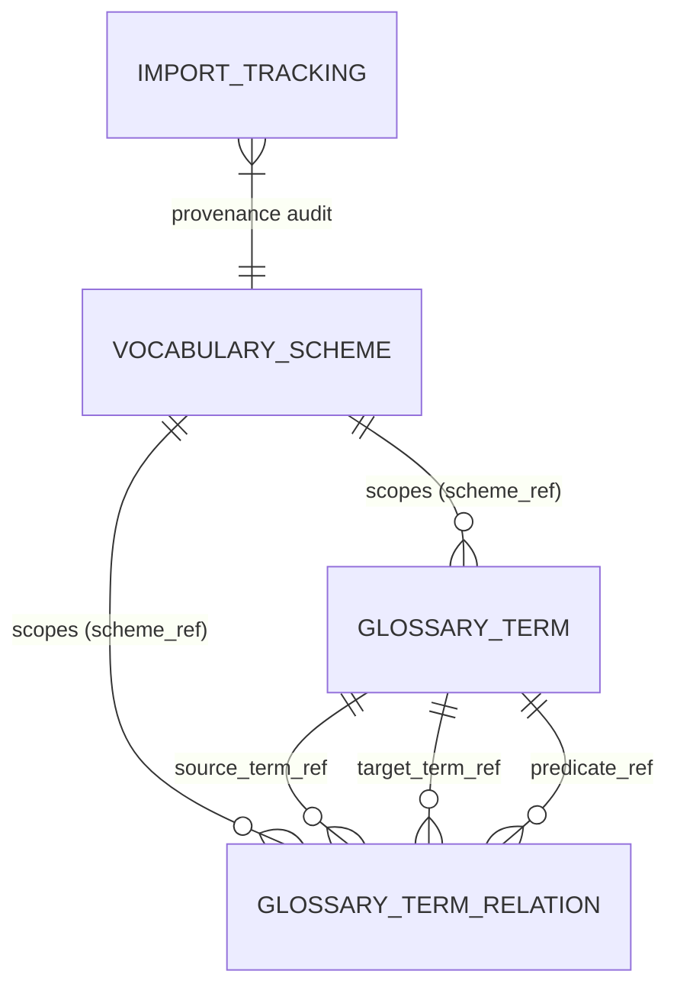
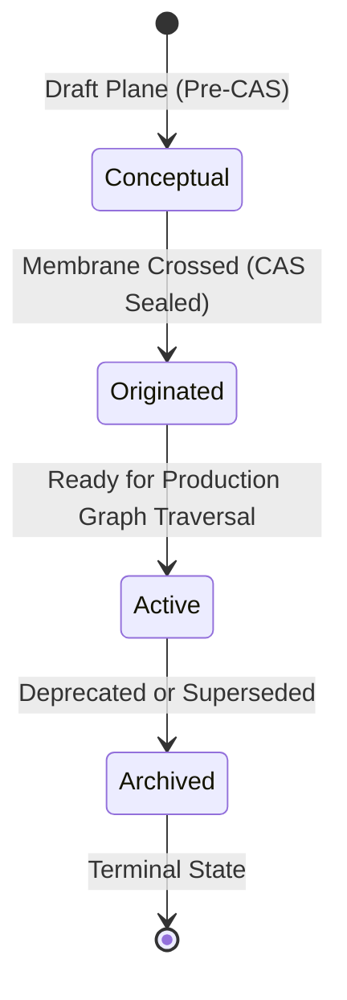
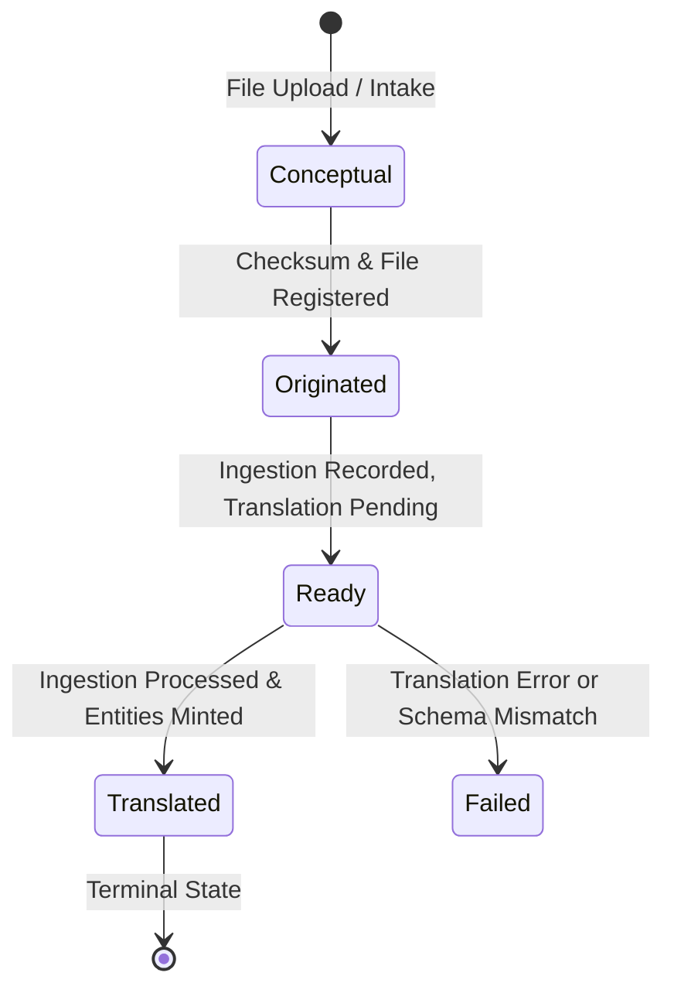
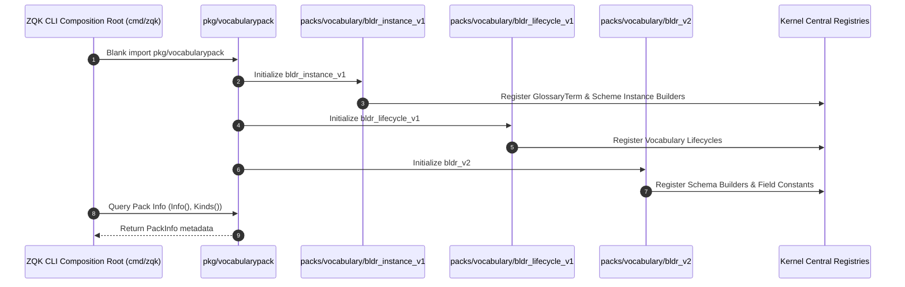
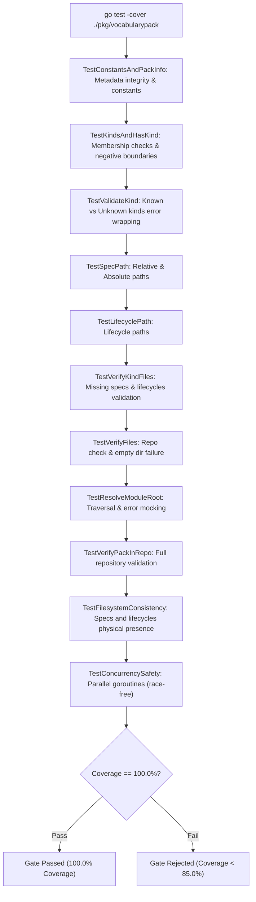

# Vocabulary Pack, Ontology Dictionary & Domain Terminology Subsystem Architectural & Operational Guide

## 1. Executive Summary & Design Philosophy

The **Vocabulary Pack, Ontology Dictionary & Domain Terminology Subsystem** ([`pkg/vocabularypack`](file:///Users/lanceettl/zqk-public-candidate/pkg/vocabularypack/pack.go), [`packs/vocabulary`](file:///Users/lanceettl/zqk-public-candidate/packs/vocabulary)) provides the foundational domain modeling, operational glossary definitions, multi-scheme taxonomy structures, and schema import tracking within the unified **ZQK Knowledge Kernel**.

In modern distributed software engineering and autonomous AI agent orchestration, lexical ambiguity and semantic drift represent significant failure vectors. When autonomous agents, tools, and human engineers use conflicting definitions for system concepts, coordination breaks down. The Vocabulary Pack establishes a persistent, versioned, and verifiable ontological dictionary that replaces transient conversational context with deterministic knowledge graph entities:

- **Hermetic Composition Root Integration:** Integrates into the central kernel composition root via blank imports (`_`), ensuring runtime registration of code-generated instance builders (`bldr_instance_v1`), state machine engines (`bldr_lifecycle_v1`), and v2 schema builders (`bldr_v2`).
- **Multi-Scheme Ontological Scoping:** Enables multiple independent or overlapping taxonomies to coexist through `vocabulary_scheme` envelopes (e.g. inference models, display groupings, navigation graphs, or external ontology extensions).
- **Context-Bound Operational Glossaries:** Manages `glossary_term` entities enriched with `context_scope`, `agent_prompts`, `machine_hints`, and `semantic_tags` to supply unambiguous prompt expansion and progressive disclosure across tool chains.
- **Typed Semantic Relations:** Supports directed, typed semantic edges (`glossary_term_relation`) linking terms via predicate terms (e.g. broader, narrower, related, instantiates, specializes), scoped cleanly to target vocabulary schemes.
- **External Schema Import Auditing:** Tracks schema ingestions (RDF/OWL, Turtle, JSON-LD, JSON Schema) with `import_tracking` entities, providing tamper-resistant provenance and status transitions.
- **Conditional Compilation & Pack Omission:** Supports the standard omission build tag (`zqk_omit_vocabularypack`) allowing lean binaries and edge runtime distributions to exclude vocabulary pack artifacts when not required.
- **100.0% Statement Coverage & Concurrency Safety:** Enforces strict continuous verification invariants with complete error-path validation and thread-safe concurrent access across multi-agent swarms.

---

## 2. Architectural Overview: Vocabulary Pack & Ontology Dictionary Topology

In the ZQK cellular microkernel architecture, domain packs are modular units of capability. Each pack defines its schema specifications, lifecycle state machines, builder code generators, and pack metadata descriptors. The vocabulary pack anchors the semantic and epistemological layer of the Knowledge Kernel.

```mermaid
flowchart TD
    subgraph CompositionRoot["ZQK Composition Root (cmd/zqk / pkg/kernel)"]
        RootBootstrap["Kernel Bootstrap"]
        TagCheck{"zqk_omit_vocabularypack set?"}
        LinkPack["Import pkg/vocabularypack"]
        OmitPack["Drop from Binary Build"]
    end

    subgraph VocabularyPack["Vocabulary Pack Subsystem (pkg/vocabularypack)"]
        PackDef["Pack Constants & Descriptors"]
        KindRegistry["Kinds(): ['glossary_term', 'glossary_term_relation', 'import_tracking', 'vocabulary_scheme']"]
        PathResolver["SpecPath() / LifecyclePath()"]
        FileVerifier["VerifyFiles() / VerifyPackInRepo()"]
    end

    subgraph GeneratedBuilders["Packs Vocabulary Subsystem (packs/vocabulary)"]
        BldrInstance["bldr_instance_v1 (Instance Builders)"]
        BldrLifecycle["bldr_lifecycle_v1 (Lifecycle State Engines)"]
        BldrV2["bldr_v2 (Schema & Field Constants)"]
        Seeds["seeds/kernel_vocabulary.zql (Core Seeds)"]
    end

    subgraph KernelRegistry["Kernel Central Registries"]
        ObjRegistry["Object Spec Registry (pkg/objects)"]
        LifecycleRegistry["Lifecycle Engine (pkg/lifecycle)"]
        BuilderRegistry["Builder Factory Registry"]
        GraphMembrane["Relational Graph Membrane"]
    end

    RootBootstrap --> TagCheck
    TagCheck -->|No| LinkPack
    TagCheck -->|Yes| OmitPack

    LinkPack --> PackDef
    PackDef --> KindRegistry
    PackDef --> PathResolver
    PackDef --> FileVerifier

    LinkPack -.->|Blank Import| BldrInstance
    LinkPack -.->|Blank Import| BldrLifecycle
    LinkPack -.->|Blank Import| BldrV2

    BldrInstance -->|init() register| BuilderRegistry
    BldrLifecycle -->|init() register| LifecycleRegistry
    BldrV2 -->|init() register| ObjRegistry
    Seeds -.->|seed ingestion| GraphMembrane
```

### Core Architectural Responsibilities

1. **Introspective Pack Descriptor:** Exposes canonical metadata (`Name`, `SpecDir`, `LifecycleDir`, `OmitBuildTag`, `Kinds()`, `Info()`), allowing CLI introspection (`zqk pack list`, `zqk system status`) to discover owned entities dynamically.
2. **Deterministic Spec & Lifecycle Resolution:** Calculates relative and absolute filesystem paths to YAML specifications and state machine definitions without assumptions about working directory depth.
3. **Fail-Closed Verification:** Validates that all owned object specifications (`packs/vocabulary/specs/*.yaml`) and lifecycle definitions (`packs/vocabulary/lifecycles/*_lifecycle.yaml`) exist and are structurally accessible.
4. **Clean Decoupling:** Isolates schema representation and lifecycle logic from command execution, ensuring that storage engines and translators can reference vocabulary primitives without circular dependencies.

---

## 3. Ontological Schema & Data Plane Models

The vocabulary pack owns four distinct object kinds within the ZQK Knowledge Kernel:



### 3.1 `vocabulary_scheme` (Taxonomy & Scheme Envelopes)

The `vocabulary_scheme` object names and configures a vocabulary graph, lens network, or navigation scheme. Multiple schemes can coexist across the same terms, allowing distinct views for agent inference versus human documentation navigation.

| Field | Type | Required | Permissions | Description |
| :--- | :--- | :--- | :--- | :--- |
| `id` | `string` | Auto | `r-x` | Unique identifier prefixed with `VOC-` (e.g. `VOC-TAXONOMY-CORE`). |
| `title` | `string` | Yes | `rwx` | Human-legible scheme title. |
| `context_scope` | `string` | Yes | `rwx` | Operational or domain scope (e.g. `operational`, `domain_modeling`). |
| `purpose` | `string` | Yes | `rwx` | Enum: `inference`, `display`, `navigation`, `mixed`, `extension`. |
| `summary` | `string` | No | `rwx` | Architectural purpose and scope summary. |
| `allowed_kinds` | `list` | No | `rwx` | Specific object kinds constrained or classified under this scheme. |
| `machine_hints` | `string` | Yes | `rwx` | Machine-readable JSON string with routing and tooling directives. |

### 3.2 `glossary_term` (Context-Scoped Operational Terminology)

The `glossary_term` object represents a canonical domain term. It provides rich context for agents and human operators to ensure consistent usage across specifications, code, and communication channels.

| Field | Type | Required | Permissions | Description |
| :--- | :--- | :--- | :--- | :--- |
| `id` | `string` | Auto | `r-x` | Unique identifier prefixed with `GLS-` (e.g. `GLS-CAS-STORAGE`). |
| `title` | `string` | Yes | `rwx` | Canonical term name or symbol. |
| `definition` | `string` | Yes | `rwx` | Formal, unambiguous conceptual definition. |
| `category` | `string` | Yes | `rwx` | High-level categorization (e.g. `storage`, `process`, `governance`). |
| `context_scope` | `string` | Yes | `r-x` | Operational boundary within which the definition applies. |
| `scheme_ref` | `string` | No | `rwx` | Parent vocabulary scheme reference (`VOC-*`). |
| `agent_prompts` | `string` | Yes | `rwx` | Guidance instructions injected into agent prompts for terminology alignment. |
| `machine_hints` | `string` | Yes | `rwx` | Machine-readable hints for CLI formatting, expansion, and acronym lookup. |
| `semantic_tags` | `list` | No | `rwx` | Tags classifying usage (`ontology`, `epistemology`, `inference`, `predicate_definition`). |
| `alias_refs` | `list` | No | `r-x` | References to known aliases or legacy synonyms. |

### 3.3 `glossary_term_relation` (Directed Semantic Relations)

The `glossary_term_relation` object captures typed, directed semantic edges between two glossary terms within a specified scheme. The relationship's meaning is governed by a predicate term whose category documents the predicate semantics.

| Field | Type | Required | Permissions | Description |
| :--- | :--- | :--- | :--- | :--- |
| `id` | `string` | Auto | `r-x` | Unique identifier prefixed with `GTR-` or canonical relation ID. |
| `scheme_ref` | `string` | Yes | `rwx` | Governing vocabulary scheme (`VOC-*`). |
| `source_term_ref` | `string` | Yes | `rwx` | Origin glossary term identifier (`GLS-*`). |
| `target_term_ref` | `string` | Yes | `rwx` | Destination glossary term identifier (`GLS-*`). |
| `predicate_ref` | `string` | Yes | `rwx` | Term defining predicate semantics (e.g. `GLS-PRED-BROADER`, `GLS-PRED-INSTANTIATES`). |
| `sort_order` | `integer`| No | `rwx` | Ordering priority for hierarchical displays. |
| `notes` | `string` | No | `rwx` | Contextual notes detailing edge nuance or historical origin. |

### 3.4 `import_tracking` (External Schema & Ontology Ingestion Audit)

The `import_tracking` object provides an immutable audit trail for external ontology artifacts imported into the knowledge kernel (such as W3C SKOS, RDF/OWL, JSON Schema, or Turtle exports).

| Field | Type | Required | Permissions | Description |
| :--- | :--- | :--- | :--- | :--- |
| `id` | `string` | Auto | `r-x` | Identifier matching pattern `^IMPTRK-\d{3,}$`. |
| `source_file` | `string` | No | `rwx` | Filesystem path or URI of the ingested source file. |
| `source_format` | `string` | No | `rwx` | Detected format (e.g. `turtle`, `rdf_owl`, `jsonld`, `jsonschema`). |
| `imported_at` | `string` | No | `rwx` | ISO-8601 timestamp recorded upon ingestion. |
| `status` | `string` | No | `rwx` | Ingestion status enum: `ready`, `translated`, `failed`. |

---

## 4. Lifecycle State Machines & Progression Workflows

Each entity type within the vocabulary pack follows an explicit lifecycle state machine ensuring deterministic progression across the Content-Addressed Storage (CAS) membrane.



### 4.1 Glossary Term, Relation & Scheme Lifecycle

| State | Role | Semantic Meaning | Allowed Operations |
| :--- | :--- | :--- | :--- |
| `conceptual` | `realign` | Preliminary draft plane entity prior to CAS membrane commit. | Spec mutation, draft staging. |
| `originated` | `realign` | CAS membrane crossed. Object registered in knowledge graph. | Edge linking, taxonomy assignment. |
| `active` | `shovel_ready` | Fully vetted and active. Available for query resolution and agent prompt injection. | Read, traversal, prompt injection. |
| `archived` | `archive` | Term or edge superseded. Retained for historical auditability and backward compatibility. | Read-only audit lookup. |

### 4.2 Import Tracking Lifecycle

The `import_tracking` entity governs the workflow of external ontology ingestion:



- **`conceptual`:** Ingest payload buffered in ephemeral workspace.
- **`originated`:** Payload verified and stamped into storage.
- **`ready`:** Source file parsed; awaiting semantic translation engine pass.
- **`translated`:** Translation completed; corresponding glossary terms, schemes, and relations successfully minted.
- **`failed`:** Validation or parsing error recorded for operator remediation.

---

## 5. Composition Root Integration & Conditional Build Tags

The ZQK microkernel utilizes Go's package `init()` semantics to self-register packs without tight coupling. Importing `pkg/vocabularypack` in `cmd/zqk` executes the registrations:

```go
package vocabularypack

import (
    _ "github.com/zqk-os/zqk/packs/vocabulary/bldr_instance_v1"
    _ "github.com/zqk-os/zqk/packs/vocabulary/bldr_lifecycle_v1"
    _ "github.com/zqk-os/zqk/packs/vocabulary/bldr_v2"
)
```



### Conditional Build Tag Omission

In minimal agent micro-daemons, embedded edge tools, or specialized binary targets, the vocabulary pack can be cleanly omitted from compilation:

```bash
go build -tags zqk_omit_vocabularypack ./cmd/zqk
```

When `zqk_omit_vocabularypack` is defined, the composition root excludes `pkg/vocabularypack`, shrinking binary size and startup initialization time while preserving core kernel mechanics.

---

## 6. Testing, Verification & Coverage Invariant

The vocabulary pack maintains a strict **100.0% statement test coverage invariant** under continuous verification:



### Running Targeted Package Tests

To run the vocabulary pack test suite in isolation:

```bash
ZQK_ALLOW_FOREGROUND_GO_TEST=1 go test -v -coverprofile=coverage.out ./pkg/vocabularypack
go tool cover -func=coverage.out
```

All test cases are implemented in [`pack_coverage_elevation_cycle239_test.go`](file:///Users/lanceettl/zqk-public-candidate/pkg/vocabularypack/pack_coverage_elevation_cycle239_test.go), licensed under Apache-2.0, with complete assertions covering positive execution, negative error pathways, and concurrent multi-goroutine safety.

---

## 7. Operational Recipes & Developer Reference

### 7.1 Programmatic Access to Pack Information

```go
package main

import (
    "fmt"
    "github.com/zqk-os/zqk/pkg/vocabularypack"
)

func main() {
    info := vocabularypack.Info()
    fmt.Printf("Pack Name: %s\n", info.Name)
    fmt.Printf("Spec Directory: %s\n", info.SpecDir)
    fmt.Printf("Lifecycle Directory: %s\n", info.LifecycleDir)
    fmt.Printf("Registered Kinds: %v\n", info.Kinds)

    if vocabularypack.HasKind("glossary_term") {
        specPath, err := vocabularypack.SpecPath("", "glossary_term")
        if err != nil {
            panic(err)
        }
        fmt.Printf("Glossary term spec path: %s\n", specPath)
    }
}
```

### 7.2 Verifying Workspace Pack Integrity

```go
package main

import (
    "fmt"
    "github.com/zqk-os/zqk/pkg/vocabularypack"
)

func verifyWorkspace(workspaceRoot string) error {
    if err := vocabularypack.VerifyFiles(workspaceRoot); err != nil {
        return fmt.Errorf("workspace vocabulary pack integrity verification failed: %w", err)
    }
    return nil
}
```

### 7.3 CLI Recipes for Ontology Management

#### Minting a Vocabulary Scheme
```bash
zqk object create vocabulary_scheme \
    --title "Core Storage Ontology" \
    --context-scope "storage" \
    --purpose "mixed" \
    --summary "Canonical definitions and taxonomic relations for CAS storage subsystems." \
    --machine-hints '{"domain":"storage","layer":"data-plane"}'
```

#### Minting a Glossary Term
```bash
zqk object create glossary_term \
    --title "CAS (Content-Addressed Storage)" \
    --category "storage" \
    --context-scope "operational" \
    --definition "An immutable storage paradigm where address identifiers are cryptographically derived from content hashes." \
    --agent-prompts "Use CAS when referring to the immutable blob store underlying the knowledge graph." \
    --machine-hints '{"acronym":"CAS","canonical_form":"Content-Addressed Storage"}' \
    --scheme-ref "VOC-STORAGE-CORE"
```

#### Creating a Semantic Relationship Between Terms
```bash
zqk object create glossary_term_relation \
    --scheme-ref "VOC-STORAGE-CORE" \
    --source-term-ref "GLS-CAS-STORAGE" \
    --target-term-ref "GLS-BLOB-STORE" \
    --predicate-ref "GLS-PRED-SPECIALIZES" \
    --notes "CAS storage specializes generic blob storage with cryptographic SHA-256 integrity."
```

#### Recording an External Ontology Ingestion
```bash
zqk object create import_tracking \
    --source-file "specs/ontologies/enterprise_vocabulary.ttl" \
    --source-format "turtle" \
    --status "ready"
```

### 7.4 Progressive Disclosure & Agent Prompt Expansion

When autonomous agents encounter domain jargon, they invoke the vocabulary subsystem or `zqk explain` to retrieve the associated `agent_prompts` and `machine_hints`:

```
User Query: "Inspect the CAS membrane before promoting."
Agent Action: Calls vocabulary recall for "CAS".
Subsystem Returns:
  - Canonical Title: Content-Addressed Storage
  - Definition: Immutable storage paradigm where address identifiers are derived from content hashes.
  - Agent Prompts: Use CAS when referring to the immutable blob store underlying the knowledge graph.
Agent Execution: Proceeds with full semantic understanding of CAS invariants.
```

---

## 8. Summary of Guarantees & Verification Matrix

| Invariant | Guarantee | Verification Mechanism |
| :--- | :--- | :--- |
| **Statement Test Coverage** | Strictly 100.0% statement coverage across all functions. | `go test -coverprofile` assertion in CI gate. |
| **Fail-Closed Verification** | Missing spec or lifecycle files immediately halt boot. | `VerifyFiles()` and `VerifyKindFiles()` check-valves. |
| **Concurrency Safety** | Zero data races under concurrent multi-agent access. | `TestConcurrencySafety` running 16 concurrent goroutines. |
| **Omission Integrity** | Clean compilation when `zqk_omit_vocabularypack` is set. | Conditional build tag compilation tests. |
| **Schema Uniformity** | Exact 1:1 parity between declared kinds and filesystem assets. | `TestFilesystemConsistency` module root validation. |
