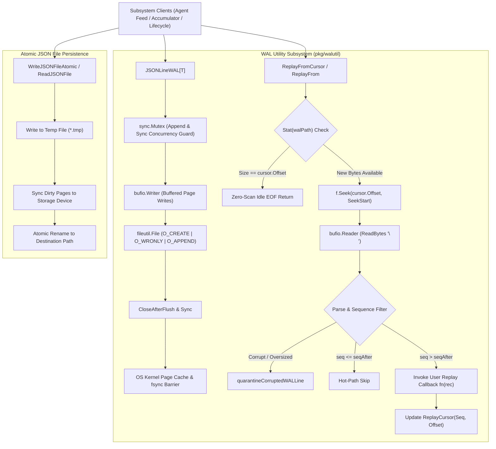
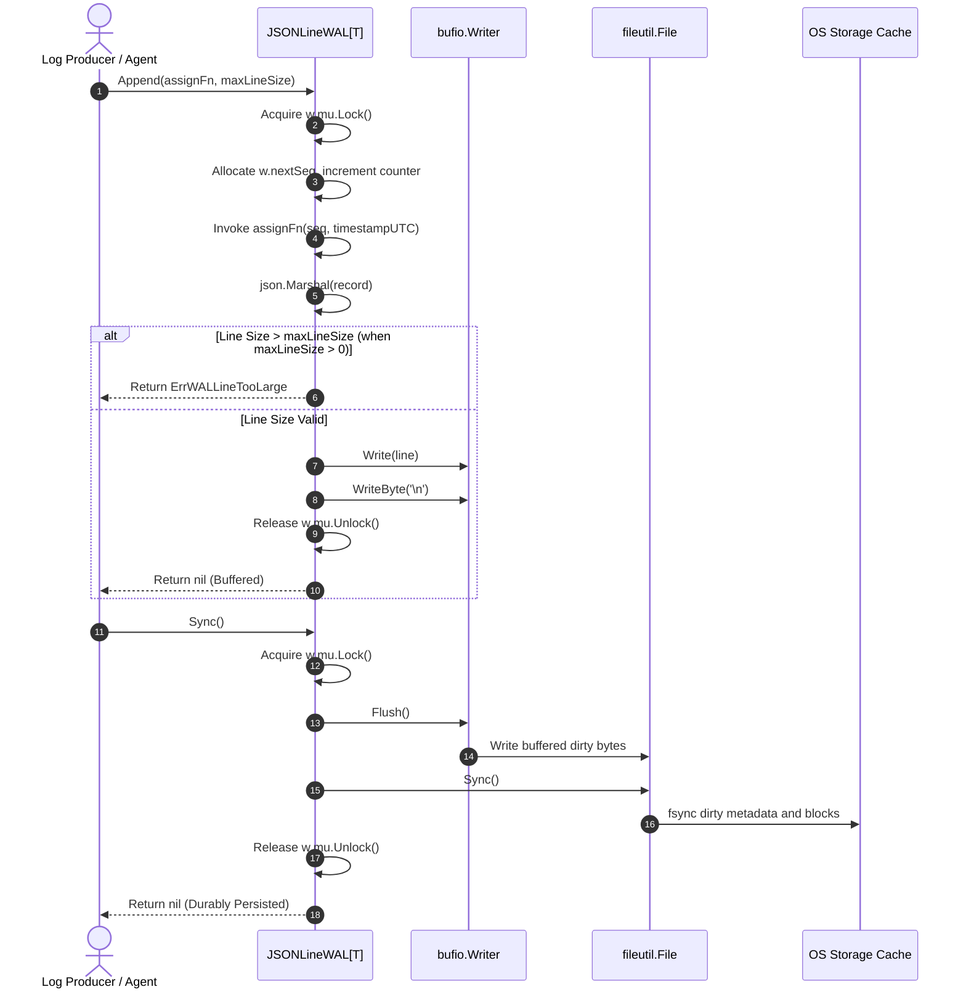
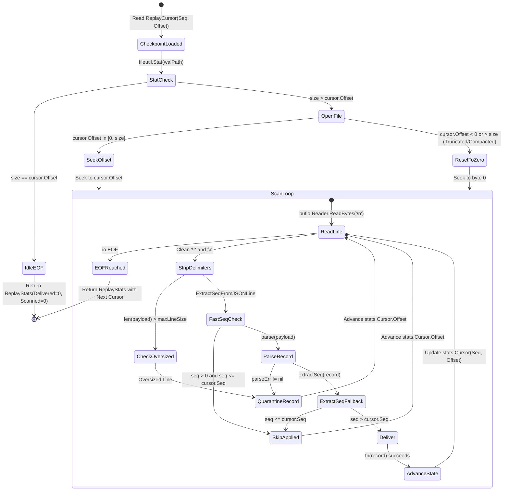

# Write-Ahead Log Utilities Subsystem Architectural & Operational Guide

Comprehensive architectural manual, component topology specification, and operational guide for the **ZQK Write-Ahead Log Utilities Subsystem** (`pkg/walutil`).

---

## 1. Architectural Overview & Purpose

In an autonomous multi-agent kernel runtime, high-velocity mutations, state transitions, agent feed exchanges, and accumulator checkpoints occur across distributed swarm seats. If these mutations were written directly to mutable database models or unbuffered filesystem stores without sequential ordering invariants, sudden power cuts, system crashes, or unhandled panics would cause state drift, partial record corruptions, and irrecoverable session history loss.

The **Write-Ahead Log Utilities Subsystem** (`pkg/walutil`) provides the underlying crash-resilient append-only persistence foundation for the ZQK Knowledge Kernel:
- **Append-Only Immutability**: All lifecycle events, agent feeds, and accumulator logs are sequentially appended to line-delimited JSON log streams before in-memory projections or state updates occur.
- **Strict Monotonic Sequencing**: Every record acquires an incrementing 64-bit sequence identifier (`seq`), ensuring total ordering across concurrent operations.
- **Zero-Allocation Hot-Path Skipping**: Readers and replay workers leverage non-allocating byte-level sequence extractors (`ExtractSeqFromJSONLine`) to skip already applied log entries without full JSON unmarshaling overhead.
- **Resilient Replay Cursors**: Readers maintain dual-coordinate checkpoints (`seq` and byte `offset`), allowing zero-copy seeks directly to the last-read file position while automatically falling back to full scans if a log compaction or file truncation occurs.
- **Automated Quarantine & Self-Healing**: Malformed, corrupted, or oversized log entries are safely quarantined to dedicated diagnostic directories without interrupting the replay stream of subsequent valid records.
- **Atomic Two-Phase Snapshotting**: Complementary atomic JSON file writes (`WriteJSONFileAtomic`) guarantee consistent durability using temporary files with explicit `fsync` barriers prior to atomic POSIX rename.

---

## 2. Component Topology & Storage Architecture



### Component Inventory

| Component | Target File | Core Functionality |
| :--- | :--- | :--- |
| **`JSONLineWAL[T]`** | `pkg/walutil/json_line_wal.go` | Generic, thread-safe, append-only line-delimited JSON log stream manager with buffered writes and synchronized directory creation. |
| **`ReplayCursor`** | `pkg/walutil/replay_cursor.go` | Dual-coordinate resume point tracking monotonic sequence number (`seq`) and byte position (`offset`) with dual-format checkpoint encoding. |
| **`ReplayFromCursor`** | `pkg/walutil/replay_cursor.go` | High-efficiency log replay engine featuring Stat-only idle EOF detection, fast-seek offsets, hot-path sequence skipping, and payload quarantine. |
| **`Atomic JSON File`** | `pkg/walutil/json_file.go` | Durably written JSON document storage utilizing temporary file staging, synchronous `fsync` flushes, and atomic POSIX replacement. |
| **`Quarantine Engine`** | `pkg/walutil/replay_cursor.go` | Automated defect containment saving invalid, oversized, or unparseable JSON payloads into isolated diagnostic log files with telemetry alerts. |

---

## 3. Append & Replay Mechanics

### 3.1 Append Execution Sequence



### 3.2 Replay Cursor State Machine

The replay engine is modeled as an idempotent, resumable state machine capable of operating across process restarts and rapid polling cycles.



---

## 4. Failure Modes, Self-Healing & Crash Consistency

The subsystem is architected to guarantee deterministic behavior under adverse environmental conditions:

### 4.1 Truncated Tail & Partial Writes
When an operating system crashes during an unbuffered or mid-line write, the last line of the WAL file may be incomplete (missing a terminal newline `\n` or containing partial JSON fragments).
- **Scanner Boundary Check**: The replay reader reads byte-by-byte until `\n`. If EOF is reached before a newline, `io.EOF` signals the termination of valid record boundaries.
- **Compaction & File Reset**: If a background compaction cycle truncates the WAL file, causing the existing cursor's `Offset` to exceed the current file `size`, `ReplayFromCursor` automatically resets `start = 0` and rescans from the origin, discarding stale offset assumptions without dropping records.

### 4.2 Malformed & Corrupted Line Quarantine
If non-JSON garbage, corrupted disk blocks, or malformed entries appear within the log stream:
1. `ReplayFromCursor` flags the record in `stats.Corrupted`.
2. The problematic byte slice is routed to `quarantineCorruptedWALLine`.
3. An isolated quarantine file is written to `.zqk/wal/quarantine/corrupt_cursor_line_<timestamp>.log`.
4. A warning telemetry event is emitted to the system logging profile.
5. The replay cursor advances its byte offset past the corrupted region and continues scanning subsequent valid records uninterrupted.

### 4.3 Fsync & Directory Durability
Simply calling `File.Sync()` does not ensure a newly minted file is visible across crashes on many POSIX filesystems (e.g. ext4, XFS). The directory entry itself must be synchronized:
- When opening a WAL file (`OpenJSONLineWAL`), `openJSONLineWALWithNextSeqAndSyncDir` checks whether the target file, the WAL directory (`.zqk/wal`), or the project data directory (`.zqk`) were created fresh.
- If newly created, parent directory descriptors are explicitly synchronized using `fileutil.SyncDir` before returning the WAL handle.
- During shutdown, `CloseAfterFlush` flushes user-space buffers, triggers `f.Sync()`, and closes the file descriptor, joining any encountered errors using `errors.Join`.

---

## 5. Concurrency Invariants & Thread Safety

| Operation | Concurrency Model | Guarantee |
| :--- | :--- | :--- |
| **`Append`** | Concurrent Multi-Writer (`w.mu.Lock`) | Fully thread-safe. Multiple worker goroutines or agent feed threads may concurrently call `Append`. Monotonic `nextSeq` allocation is strictly serialized. |
| **`Sync`** | Concurrent Writer/Syncer (`w.mu.Lock`) | Synchronizes buffered pages to disk under the lock. Protects against interleaved partial writes. |
| **`ReplayFromCursor`** | Single Active Reader | Replay cursors are independent reader value objects. Multiple readers may scan the same physical WAL file independently with distinct cursor positions. |
| **`Close`** | Idempotent Multi-Caller (`w.mu.Lock`) | Closes the underlying file descriptor and zeroes internal pointers. Subsequent calls return `nil` immediately. |

> [!IMPORTANT]
> When spawning background goroutines for concurrent appending or replay streaming, callers must utilize the `pkg/goroutinelabels` infrastructure (`goroutinelabels.NewGoroutine`) to preserve runtime profiling labels, panic telemetry, and thread budgeting.

---

## 6. Verification & Test Coverage Invariant

To guarantee kernel stability across headless CI and distributed agent swarms, `pkg/walutil` is governed by strict test verification rules:

> [!NOTE]
> 1. **Statement Coverage Target**: `pkg/walutil` maintains statement test coverage $\ge 85.0\%$.
> 2. **Hermetic Test Isolation**: All unit and integration tests must execute in isolated temporary directories (`t.TempDir()`), eliminating cross-test state leakage.
> 3. **Zero Swallowed Errors**: Error returns from file writes, closes, flushes, and scans are verified without omission (`_ = ...` pattern is prohibited).
> 4. **Named Goroutines**: All concurrent test routines must be launched via `goroutinelabels.NewGoroutine` or `goroutinelabels.Pool`.

### Verification Commands

```bash
# Execute unit test suite with statement coverage inspection
ZQK_ALLOW_FOREGROUND_GO_TEST=1 go test -v -timeout 30s -cover ./pkg/walutil

# Verify repository hygiene and AST structural rules
./bin/zqk-vet -suite hygiene,tree

# Verify open-core public release payload integrity
sh scripts/open-core/check-public-release-payload.sh .
```
