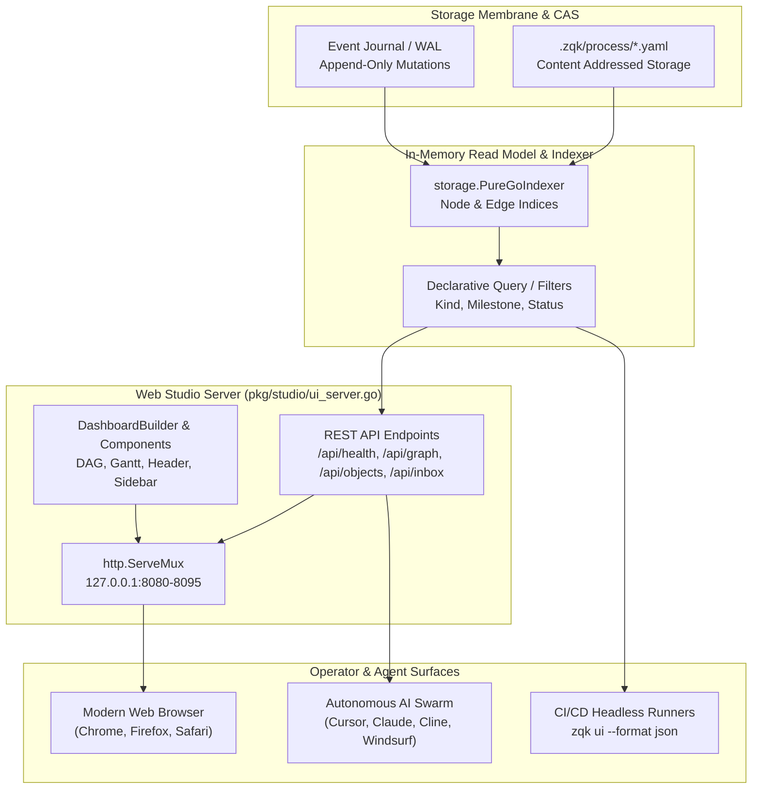

# Web Studio & Visual Graph Explorer Operational Architecture Guide

Comprehensive operational guide and architecture reference for the embedded local Web Visual Studio (`zqk ui -w`), real-time DAG graph exploration, interactive Gantt matrix timelines, and headless CI export in the **ZQK Knowledge Kernel**.

---

## 1. Architectural Overview & Design Philosophy

The **Web Studio & Visual Graph Explorer** provides an interactive, browser-native mission control interface for human engineers and autonomous AI agent swarms.

While the terminal UI (`zqk ui`) offers high-density keyboard-driven control in CLI environments, the Web Studio (`zqk ui -w` / `zqk ui --web`) projects the persistent Knowledge Kernel graph into a responsive web interface. It delivers:

1. **Interactive Directed Acyclic Graph (DAG) Explorer:** Real-time visual topology rendering dependencies across Vision, Goals, Milestones, Priority Plans, Requirements, Criteria, and Backlog Items.
2. **Interactive Gantt Matrix Timelines:** Chronological visualization of plan cycles, milestone boundaries, and atomic task execution.
3. **Agent Seating & Pod Vitality:** Visual inspection of autonomous swarm workers, active token budgets, AST validation gates, and execution stages in flight.
4. **Agent Feed Inbox & Correspondence:** Embedded inspection, acknowledgment, and steering controls for human-in-the-loop governance.
5. **Headless & CI Read Model Export:** Structured JSON/YAML export capabilities (`--format json|yaml`) enabling CI pipelines and remote dashboards to consume identical read models.



---

## 2. Command Usage & Ergonomics

### Starting the Web Studio

To launch the Web Studio from any repository containing an initialized ZQK Knowledge Kernel:

```sh
# Launch local Web Studio with automatic port selection
zqk ui -w

# Equivalent long-form flag
zqk ui --web
```

### Port Selection & Automatic Fallback

The Web Studio defaults to listening on `127.0.0.1:8080`. If port 8080 is already occupied by another service or another instance, the server automatically probes ports `8081` through `8095` to find an available port without failing:

```sh
# Override and bind to a specific port
zqk ui -w --port 9090
# Or using short flag
zqk ui -w -p 9090
```

When an explicit `--port` is supplied and is already in use, the command fails fast with a clear remediation message:
```text
Error: port 9090 is already in use. Specify a different port with: zqk ui -w --port <port> (or -p <port>)
```

### Headless & Structured Output (CI / Scripting)

For automated verification, CI pipelines, or scripting without launching an interactive server:

```sh
# Export full dashboard state as structured JSON
zqk ui --format json

# Export full dashboard state as structured YAML
zqk ui --format yaml

# Inspect a specific tab (State, Audit, Swarm, PM, Metrics, Sched, QA, Health)
zqk ui --tab Swarm --format json
```

---

## 3. Server Endpoints & REST API

The embedded HTTP server exposes structured JSON endpoints designed for both front-end visualization and external agent integration:

| Method | Endpoint | Description |
| :--- | :--- | :--- |
| `GET` | `/` | Responsive HTML visual dashboard embedding DAG view, Gantt chart, sidebar, and telemetry. |
| `GET` | `/assets/*` | Embedded static stylesheets, scripts, and iconography. |
| `GET` | `/api/health` | Server health check, timestamp, project root path, and active indexed node count. |
| `GET` | `/api/graph` | Directed graph payload containing `nodes` and `edges` with optional query filters. |
| `GET` | `/api/objects` | Paginated and filtered list of all Knowledge Kernel objects. |
| `GET` | `/api/objects/{id}` | Detailed inspection and attribute payload for a single object by ID. |
| `GET` | `/api/inbox` | Pending agent feed messages, review requests, and approvals. |
| `POST` | `/api/inbox/ack` | Acknowledge receipt of a feed message. |
| `POST` | `/api/inbox/respond` | Respond to or reject a feed message with structured feedback. |
| `GET` | `/api/acronyms` | Domain vocabulary and ontological acronym dictionary. |
| `GET` | `/api/explain` | Semantic explanations and concept relationships for kernel entities. |

### Graph Endpoint (`/api/graph`)

The `/api/graph` endpoint returns nodes and directed edges formatted for interactive canvas renderers:

```json
{
  "nodes": [
    {
      "id": "GOAL-STARTER-COMMUNITY-001",
      "kind": "goal",
      "status": "originated",
      "title": "Establish Community Onboarding and Operational Kernel Foundations",
      "references": {
        "requirement_refs": [
          "REQ-1793488563899668000-e29afeda"
        ]
      }
    },
    {
      "id": "REQ-1793488563899668000-e29afeda",
      "kind": "requirement",
      "status": "originated",
      "title": "Interactive Swarm Demonstrations and Web Studio",
      "references": {
        "criteria_refs": [
          "CRIT-1793492511007707000-9b0e56ef"
        ]
      }
    }
  ],
  "edges": [
    {
      "source": "GOAL-STARTER-COMMUNITY-001",
      "target": "REQ-1793488563899668000-e29afeda",
      "relation": "requirement_refs"
    }
  ]
}
```

#### Query Parameters
- `kind`: Filter graph nodes by object kind (e.g., `?kind=backlog_item`, `?kind=goal`).
- `status`: Filter graph nodes by status (e.g., `?status=in_progress`, `?status=complete`).
- `milestone`: Scope traversal to a specific milestone branch (e.g., `?milestone=MIL-STARTER-COMMUNITY-001`).

---

## 4. Visual Components & UI Architecture

The Web Studio is structured into composable server-rendered components located in `pkg/studio/components`:

1. **Header Component (`pkg/studio/components/header.go`):** Displays repository metadata, active cycle number, branch information, and live health status badge.
2. **DAG View Component (`pkg/studio/components/dag_view.go`):** Renders the SVG-based directed acyclic graph with zoom/pan controls, status color coding, and node-click drilldown drawers.
3. **Gantt View Component (`pkg/studio/components/gantt_view.go`):** Visualizes time-bounded execution cycles, priority plan deadlines, and BLI progress bars.
4. **Sidebar Component (`pkg/studio/components/sidebar.go`):** Quick-navigation links across ontological packs, filtered views, and agent seating tabs.
5. **Document Component (`pkg/studio/components/document.go`):** Integrated markdown renderer for registered architectural guides, runbooks, and specifications.

---

## 5. Security & Isolation Invariants

1. **Loopback-Only Binding by Default:** The Web Studio binds exclusively to `127.0.0.1` (localhost), preventing inadvertent network exposure across public or shared interfaces.
2. **Read-Only Inspection Plane:** All visual endpoints operate strictly against in-memory read models and Content-Addressed Storage, preventing arbitrary state corruption through the browser. State mutations require explicit authenticated feed actions or CLI/MCP commands.
3. **Safe Shutdown on Signal:** The HTTP server listens for `SIGINT` (Ctrl+C) and `SIGTERM`, performing a clean, non-disruptive `Shutdown(ctx)` within standard context deadlines without leaving orphaned sockets or file descriptors.
4. **Zero External CDN Dependencies:** All core assets (stylesheets, layouts, vector icons) are embedded directly within the Go binary or loaded from local paths, ensuring full functionality in air-gapped or offline development environments.

---

## 6. Troubleshooting & Diagnostics

### Address Already in Use
If all ports in the default range (8080–8095) are occupied:
```sh
# Diagnose listening processes
lsof -i :8080-8095

# Launch Web Studio on a dedicated custom port
zqk ui -w --port 9550
```

### Stale Graph Visualization
If newly minted objects do not immediately appear in the browser:
1. Hit `Refresh` in the browser or trigger a hard reload (`Ctrl+Shift+R` / `Cmd+Shift+R`).
2. Verify objects exist in CAS: `zqk object list --kind <kind>`.
3. Check kernel integrity: `zqk system check`.

---

## 7. Related Guides & References

- **[CLI Visual Studio & Interactive TUI Subsystem Operational Architecture Guide](./CLI_UI_SUBSYSTEM_GUIDE.md)**: Deep dive into the full-screen terminal TUI console.
- **[TUI Engine & Terminal Interface Subsystem Guide](./TUI_SUBSYSTEM_GUIDE.md)**: Elm architecture (Model-Update-View) in Go and TDS styling standards.
- **[MCP Auto-Configuration & Host Integration Guide](./MCP_AUTO_CONFIGURATION_AND_HOST_INTEGRATION_GUIDE.md)**: Connecting AI coding agents (Cursor, Claude Code, Cline, Windsurf) to the Knowledge Kernel.
- **[Developer & Agent Guides Directory](./README.md)**: Canonical directory of all operational guides.
