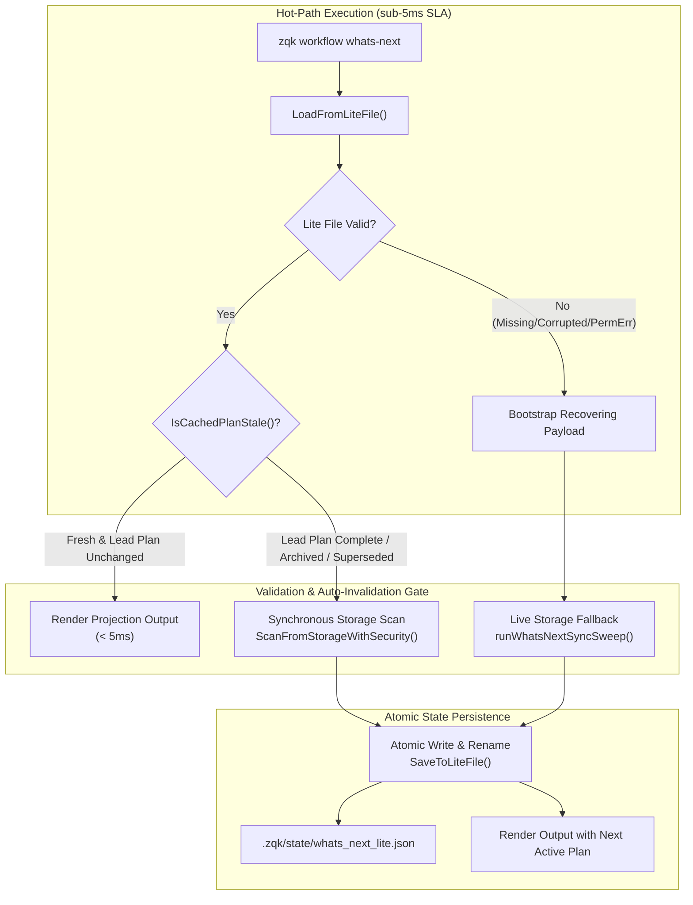
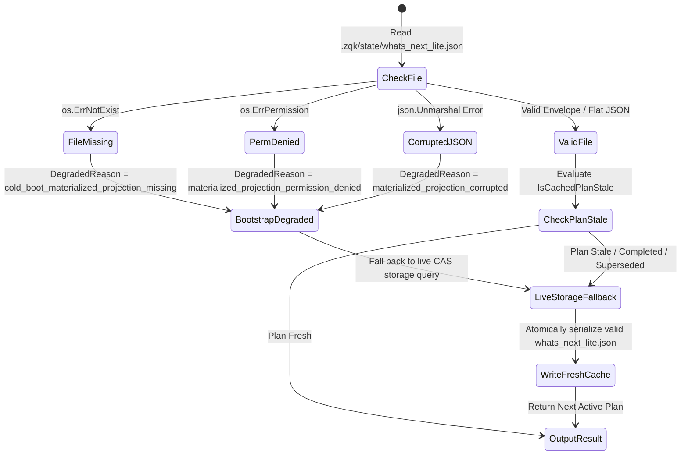

# Workflow Subsystem Cache Invalidation & Resolution Architecture (`whats_next_lite.json`)

## 1. Executive Summary & Design Invariants

In high-velocity autonomous swarms powered by the Zen Quantum Kernel (ZQK), Continuous Autonomous Progression (CAP) loops invoke `zqk workflow whats-next` repetitively to determine the next executable unit of effort. An un-memoized graph traversal across Content-Addressed Storage (CAS) on every iteration would cause disk thrashing, high latency, and wasted compute.

To reconcile sub-5ms operational latency with strict relational integrity, the ZQK Workflow Subsystem implements a materialized projection pattern:
- **Hot-Path Zero-Cost Invariant ($\le 5\text{ms}$ SLA):** Reads the pre-computed materialized view at `.zqk/state/whats_next_lite.json` using zero CAS scans.
- **Strict Invalidation Contract:** Whenever the currently cached lead priority plan transitions to a terminal state (`complete`, `archived`, `cancelled`, `rejected`), or is superseded by a plan with higher execution priority (e.g. newly transitioned to `in_progress` or promoted with a higher `active_order` / lower order index), the cache is marked stale and automatically invalidated, triggering a synchronous refresh from CAS.
- **Graceful Fault-Tolerant Fallback:** When the lite file is missing, empty, unreadable (permission denied), or contains malformed/corrupted JSON, the engine intercepts the error, marks the materialized projection as recovering, and seamlessly falls back to a live CAS query (`runWhatsNextSyncSweep`), repairing the on-disk cache atomically without panicking or returning invalid plans.

---

## 2. Materialized View Topology & The Zero-Cost Hot Path

### Component Roles

1. **`WhatsNextMaterializedView` (`pkg/workflow/whatsnext/materialized_view.go`):**
   In-memory and disk projection engine. Manages `whats_next_lite.json` serialization, deserialization, WAL event subscription, and graph queries.
2. **`GetOrRecoverPayload`:**
   Core entry point enforcing the Zero-Hot-Path-Scan Invariant. Reads the envelope from disk; if missing, stale, or invalidated, triggers recovery.
3. **`IsCachedPlanStale`:**
   Active-plan gatekeeper. Verifies whether the cached lead plan has transitioned in storage (to `complete`, `archived`, etc.), whether its status is ineligible, or whether another plan in CAS holds higher execution priority.
4. **`runWhatsNextLite` & `runWhatsNextSyncSweep` (`cmd/zqk/workflow/whats_next.go`):**
   CLI command execution pathways. `runWhatsNextLite` provides fast reads with auto-invalidation checks; `runWhatsNextSyncSweep` provides full live CAS query and atomic cache rewriting.

---

## 3. Cache Invalidation Contracts Across Status Transitions

The materialized view must never return a stale, completed, or bypassed priority plan. Invalidation contracts are defined across the plan lifecycle:

| Transition Event | Invalidation Mechanism | Resulting Action | SLA / Latency Profile |
|---|---|---|---|
| **Lead Plan Completed** (`in_progress` $\rightarrow$ `complete`) | `IsCachedPlanStale` detects terminal status in storage or cached payload | Immediate synchronous cache refresh; next active plan selected | Dynamic reload ($\le 50\text{ms}$ in-memory / CAS read) |
| **Lead Plan Archived / Cancelled** (`*` $\rightarrow$ `archived`) | `koi.IsArchive(obj)` or `IsPlanStatusCompleted` returns `true` | Cache invalidated; next eligible plan selected | Dynamic reload |
| **Active Order Promotion** (New plan with higher priority / lower `active_order`) | `EvaluatePhiLead` over storage priority plans detects candidate superseded | Cache invalidated; higher-order plan promoted to lead | Dynamic reload |
| **New Plan In-Progress** (Plan transitioned to `in_progress`) | `rankPlanStatus` prioritizes `in_progress` over existing shovel-ready | Cache invalidated; newly active plan promoted to lead | Dynamic reload |
| **Explicit Flag Override** (`--priority-plan <id>`) | CLI checks requested plan directly against CAS storage | Bypasses lead plan cache for specified column | Direct read |
| **Explicit Deep Sweep** (`--sync-sweep`) | Direct flag bypass | Bypasses lite file completely; performs CAS traversal and refreshes cache | Full scan |

### Evaluation Precedence Rules (`EvaluatePhiLead`)

When invalidation occurs and candidate plans are re-ranked from CAS, precedence follows strict hierarchical rules:
1. **Execution Status Role:**
   - Rank 1: `in_progress`
   - Rank 2: `active` / `shovel_ready`
   - Rank 3: `grooming`
   - Rank 4: `planned`
2. **Active Order Ascending:**
   - Lower numerical index wins ties (e.g. `active_order: 1` beats `active_order: 2`).
   - For `in_progress` plans, `active_order: 0` represents the active execution lead.
3. **Deterministic Tie-Breaking:**
   - Alphabetical comparison of object IDs (`ID_A < ID_B`).

---

## 4. Adversarial Boundaries & Fault Handling

To ensure high availability and resilient swarm operation, the subsystem adheres to defensive negative-boundary policies:

### Boundary Matrix

| Scenario / Fault Condition | System Response | Degraded Mode Reason | Recovery Behavior |
|---|---|---|---|
| **File Missing (Cold Boot)** | Returns non-nil bootstrap payload with `Stale=true`, `Recovering=true` | `cold_boot_materialized_projection_missing` | Live query resolves active plan from CAS and writes new projection file |
| **Corrupted / Truncated JSON** | Intercepts unmarshal error; returns bootstrap payload without crashing | `materialized_projection_corrupted: <err>` | Falls back to live CAS query; atomic overwrite repairs file on disk |
| **Permission Denied (`0000`)** | Intercepts permission error; logs diagnostic; serves live query | `materialized_projection_permission_denied` | Resolves live query from CAS; fails open gracefully for read operations |
| **Empty File (`0 bytes`)** | Unmarshal fails; intercepted as corrupted payload | `materialized_projection_corrupted: unexpected EOF` | Refreshes and re-serializes from live storage |
| **Stale Watermark Quiescence** | Compares `materialized_at` with `lifecycle_events.wal` mtime | N/A (Watermark touched) | Touches cache timestamp without expensive full CAS scan if graph is idle |

---

## 5. Operational Verification & Compliance

Verification of cache invalidation contracts is enforced by automated suites:
- **`TestRunWhatsNext_CompletedPlan_AutoRefreshesAndDoesNotReturnCompletedPlan`:**
  Verifies that transitioning the cached lead plan to `complete` in CAS causes `zqk workflow whats-next` to automatically discover and return the next active plan, updating the on-disk cache file.
- **`TestRunWhatsNext_HigherActiveOrderPromotion_AutoRefreshes`:**
  Verifies that promoting a new plan with higher precedence / lower active_order in CAS invalidates the cached lead plan and returns the newly promoted plan.
- **`TestRunWhatsNext_CorruptedCacheFallback`:**
  Verifies that invalid or truncated JSON in `.zqk/state/whats_next_lite.json` does not panic or crash, but falls back gracefully to live CAS query and repairs the cache.
- **`TestRunWhatsNext_PermissionDeniedFallback`:**
  Verifies that unreadable lite file permissions fall back to live CAS query cleanly.
