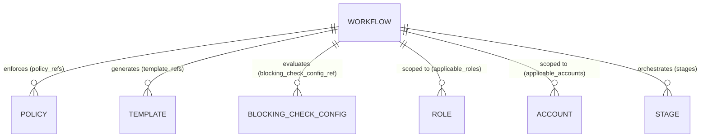
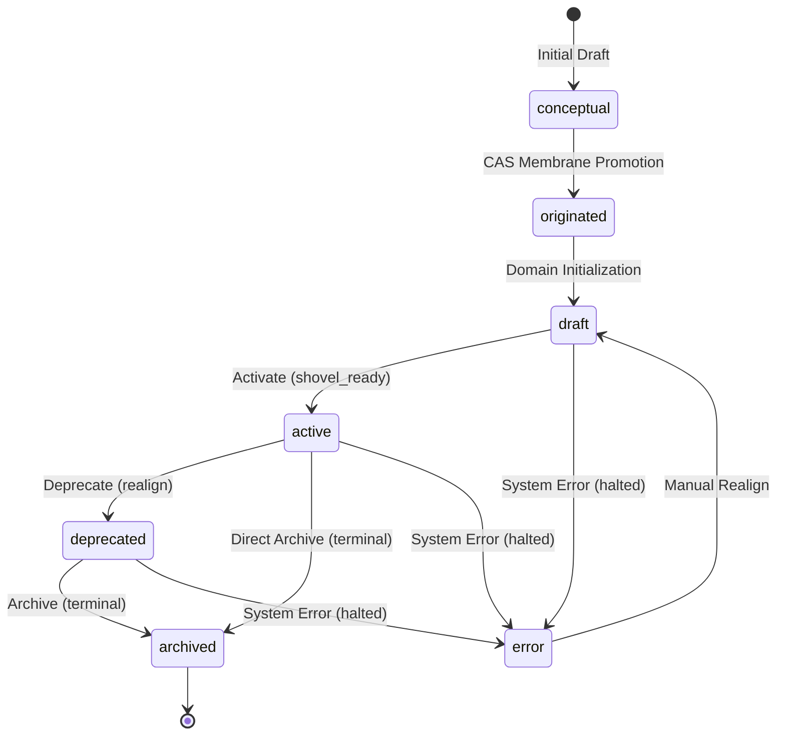
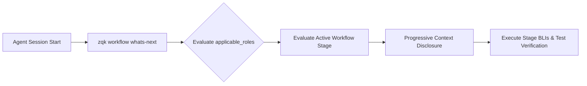

# Workflow Pack & Process Composition Subsystem Architectural & Operational Guide

## 1. Executive Summary & Design Philosophy

The **Workflow Pack & Process Composition Subsystem** ([`pkg/workflowpack`](file:///Users/lanceettl/zqk-public-candidate/pkg/workflowpack/pack.go), [`packs/workflow`](file:///Users/lanceettl/zqk-public-candidate/packs/workflow)) establishes the foundational schema definitions, lifecycle state machine, stage orchestration taxonomy, role-based boundary scoping, and runtime composition root bindings for structured execution methodologies within the **ZQK Knowledge Kernel**.

In multi-agent autonomous engineering environments, unconstrained conversational prompts are brittle and error-prone. Without deterministic boundaries, agents frequently wander off-track, invent undocumented steps, skip verification gates, or execute tasks outside their designated roles. The Workflow Pack replaces transient prompting with persistent, verifiable, and version-controlled process graphs:

- **Hermetic Composition Root Integration:** Links into the ZQK kernel composition root via blank imports (`_`), ensuring runtime initialization and registration of code-generated instance builders (`bldr_instance_v1`), state machine engines (`bldr_lifecycle_v1`), and schema definitions (`bldr_v2`).
- **Multi-Stage Orchestration Taxonomy:** Defines multi-stage operational processes (e.g. software feature delivery, incident triage, security review, release cutting) with explicit lifecycle states, required prerequisites, optional artifacts, governing policies, and template bindings per stage.
- **Role and Account Scoping:** Enables role-based progressive disclosure and presentation by restricting workflows to specific participant roles (`applicable_roles`) and project accounts (`applicable_accounts`).
- **Granular Constraint Enforcement:** Provides structured constraints for object creation and mutation (`role_constraints`, `object_constraints`) to prevent unauthorized or out-of-sequence kernel graph mutations.
- **Model Context Protocol (MCP) Boundary Configuration:** Governs tool surface filtering through dedicated `mcp_config` envelopes, defining exposed or blocked CLI tools and command suites when workflows execute through MCP servers.
- **Conditional Compilation & Pack Omission:** Declares the standardized omission build tag (`zqk_omit_workflowpack`), enabling edge agents, minimal CLI distributions, and lightweight binaries to cleanly omit workflow domain dependencies.
- **Continuous Verification & 100.0% Statement Coverage:** Verified by exhaustive unit testing, full error-path validation, and race-free concurrent execution across multi-agent swarms.

---

## 2. Architectural Overview: Workflow Pack, Composition Root & Process Orchestration Topology

In the cellular microkernel design of ZQK, capabilities are structured into decoupled packs. Each pack encapsulates its object schemas, lifecycle state engines, and builder code generators. The workflow pack anchors the process execution and methodology layer of the Knowledge Kernel.

```mermaid
flowchart TD
    subgraph CompositionRoot["ZQK Composition Root (cmd/zqk / pkg/kernel)"]
        RootBootstrap["Kernel Bootstrap"]
        TagCheck{"zqk_omit_workflowpack set?"}
        LinkPack["Import pkg/workflowpack"]
        OmitPack["Drop from Binary Build"]
    end

    subgraph WorkflowPack["Workflow Pack Subsystem (pkg/workflowpack)"]
        PackDef["Pack Constants & Descriptors"]
        KindRegistry["Kinds(): ['workflow']"]
        PathResolver["SpecPath() / LifecyclePath()"]
        FileVerifier["VerifyFiles() / VerifyPackInRepo()"]
    end

    subgraph GeneratedBuilders["Packs Workflow Subsystem (packs/workflow)"]
        BldrInstance["bldr_instance_v1 (WorkflowInstanceBuilder)"]
        BldrLifecycle["bldr_lifecycle_v1 (Workflow Lifecycle Engine)"]
        BldrV2["bldr_v2 (Workflow Schema & Field Constants)"]
    end

    subgraph KernelRegistry["Kernel Central Registries"]
        ObjRegistry["Object Spec Registry (pkg/objects)"]
        LifecycleRegistry["Lifecycle Engine (pkg/lifecycle)"]
        BuilderRegistry["Builder Factory Registry"]
        GraphMembrane["Relational Graph Membrane"]
    end

    RootBootstrap --> TagCheck
    TagCheck -->|No| LinkPack
    TagCheck -->|Yes| OmitPack

    LinkPack --> PackDef
    PackDef --> KindRegistry
    PackDef --> PathResolver
    PackDef --> FileVerifier

    LinkPack -.->|Blank Import| BldrInstance
    LinkPack -.->|Blank Import| BldrLifecycle
    LinkPack -.->|Blank Import| BldrV2

    BldrInstance -->|init() register| BuilderRegistry
    BldrLifecycle -->|init() register| LifecycleRegistry
    BldrV2 -->|init() register| ObjRegistry
```

### Core Architectural Responsibilities

1. **Introspective Pack Metadata:** Exposes canonical descriptors (`Name`, `SpecDir`, `LifecycleDir`, `OmitBuildTag`, `Kinds()`, `Info()`), enabling dynamic discovery by kernel introspection commands (`zqk pack list`, `zqk system status`).
2. **Deterministic Path Computation:** Resolves relative and absolute filesystem locations for object specifications (`packs/workflow/specs/workflow.yaml`) and state machines (`packs/workflow/lifecycles/workflow_lifecycle.yaml`) regardless of current working directory depth.
3. **Fail-Closed Filesystem Verification:** Validates at boot or test time that required specification and lifecycle YAML definitions exist and are readable, preventing silent runtime failures.
4. **Decoupled Execution:** Isolates process schemas and lifecycle logic from specific CLI runners, enabling any execution harness (CLI, background daemon, MCP client, or multi-agent orchestrator) to evaluate and advance workflows uniformly.

---

## 3. Workflow Orchestration Taxonomy & Schema Definitions

The workflow pack defines the `workflow` entity within the ZQK Knowledge Kernel ontology. A workflow models an end-to-end methodology composed of ordered stages, governance links, and boundary filters.



### 3.1 Canonical Field Definitions

The `workflow` object schema provides a complete set of fields for process governance:

| Field | Type | Required | Permissions | Description |
| :--- | :--- | :--- | :--- | :--- |
| `id` | `string` | Auto | `r-x` | Unique identifier prefixed with `WFL-` (e.g. `WFL-FEATURE-DEV`). |
| `title` | `string` | Yes | `rwx` | Human-legible workflow title (e.g. "Feature Development Workflow"). |
| `description` | `text` | Yes | `rwx` | Detailed Markdown description of the workflow, purpose, and triggers. |
| `category` | `enum` | No | `rwx` | Workflow domain category (see Section 3.2). |
| `enabled` | `boolean` | No | `rwx` | Boolean flag (default `true`) indicating if workflow is active for selection. |
| `applicable_roles` | `list` | No | `rwx` | List of role identifiers (`role:ID`) allowed to execute this workflow. |
| `applicable_accounts` | `list` | No | `rwx` | List of account identifiers (`account:username`) permitted to view/use. |
| `blocking_check_config_ref` | `string` | No | `rwx` | Reference to custom blocking check configuration overriding system defaults. |
| `constraints` | `object` | No | `rwx` | Structured role and object manipulation constraints (see Section 3.3). |
| `lifecycle_kinds` | `list` | No | `rwx` | List of object kind names whose lifecycles are orchestrated by this workflow. |
| `mcp_config` | `object` | No | `rwx` | MCP tool exposure and restriction rules for `mcp` category workflows. |
| `metadata` | `object` | No | `rwx` | Arbitrary key-value metadata for automation triggers and integration hooks. |
| `policy_refs` | `list` | No | `rwx` | List of policy references (`POL-*`) enforced across this workflow. |
| `stages` | `list` | No | `rwx` | Ordered array of workflow stage objects defining sequential execution steps. |
| `template_refs` | `list` | No | `rwx` | List of template references (`TPL-*`) used for artifact rendering. |

### 3.2 Workflow Categories

Workflows are classified into distinct categories via the `category` enum field:

- `development`: Standard feature implementation, refactoring, and code craftsmanship.
- `operations`: SRE tasks, deployment pipelines, runbook automation, and environment maintenance.
- `planning`: Architectural roadmapping, requirements gathering, and strategic decomposition.
- `review`: Peer review, design authority evaluation, and security auditing.
- `testing`: Verification suite execution, fuzzing, and benchmark validation.
- `deployment`: Artifact promotion, release staging, canary rollout, and verification.
- `maintenance`: Dependency upgrading, technical debt reduction, and garbage collection.
- `onboarding`: Paired agent onboarding, environment bootstrap, and developer ramp-up.
- `documentation`: Documentation portal updates, architectural guides, and API specs.
- `mcp`: Specialized workflows exposed through Model Context Protocol servers.
- `other`: Specialized or domain-extended methodologies.

### 3.3 Constraint Modeling (`constraints`)

The `constraints` object enables declarative boundary rules:

```yaml
constraints:
  role_constraints:
    architect:
      allowed_operations: ["create", "update", "delete"]
      allowed_kinds: ["goal", "requirement", "policy"]
      blocked_kinds: ["backlog_item"]
    craftsman:
      allowed_operations: ["create", "update"]
      allowed_kinds: ["backlog_item", "test_case"]
      blocked_kinds: ["goal", "milestone"]
  object_constraints:
    goal:
      required_roles: ["architect", "admin"]
      blocked_roles: ["intern"]
```

### 3.4 Multi-Stage Definition (`stages`)

Each item in `stages` defines an operational milestone within the workflow:

- `name`: Unique name of the stage (e.g. `intent_discovery`, `verification_gate`).
- `description`: Actionable summary of stage goals and expectations.
- `order`: Numeric sort index determining sequence execution (1, 2, 3...).
- `lifecycle_states`: Mapping of object kinds to expected status (e.g. `requirement: active`).
- `required_objects`: Object kinds that must exist before stage transitions allow exit.
- `optional_objects`: Object kinds that may optionally accompany the stage.
- `policies`: Specific policy references enforced during this stage.
- `templates`: Artifact templates bound to this stage for automated scaffolding.

---

## 4. Workflow Lifecycle State Machine & Transition Hops

Workflows follow a deterministic state machine managed by `packs/workflow/lifecycles/workflow_lifecycle.yaml`. This ensures that process definitions cross Content-Addressed Storage (CAS) membranes safely before entering active execution.



### 4.1 State Definitions

| Status | Role | Preliminary | Terminal | Description |
| :--- | :--- | :--- | :--- | :--- |
| `conceptual` | `realign` | `true` | `false` | Draft plane state prior to CAS membrane qualification. |
| `originated` | `realign` | `false` | `false` | CAS membrane crossed; object identity originated. |
| `draft` | `realign` | `false` | `false` | Working definition under active drafting or reshaping. |
| `active` | `shovel_ready` | `false` | `false` | Shovel-ready; actively in force and selectable by agents and operators. |
| `deprecated` | `realign` | `false` | `false` | Phased out; retained for historical reference and auditability. |
| `archived` | `terminal` | `false` | `true` | Terminal archive state; no further standard execution transitions. |
| `error` | `halted` | `false` | `false` | Halted or held for administrator repair. |

### 4.2 Lifecycle Transitions

1. **`conceptual` &rarr; `originated`:** System promotion across the CAS storage boundary.
2. **`originated` &rarr; `draft`:** Automatic domain initialization preparing the workflow for content authoring.
3. **`draft` &rarr; `active`:** Activation hop requiring validation; upon transition, the workflow achieves `shovel_ready` status.
4. **`active` &rarr; `deprecated`:** Deprecation hop marking the workflow as obsolete without deleting historical execution traces.
5. **`deprecated` &rarr; `archived`:** Terminal archive hop ending normal lifecycle progression.
6. **`active` &rarr; `archived`:** Direct archival of active workflows when retired immediately.
7. **`*` &rarr; `error`:** Catch-all error transition triggered when invariants fail or corrupted configurations are detected.

---

## 5. Composition Root Integration & Conditional Compilation

The workflow pack seamlessly integrates into the root binary (`cmd/zqk`) through Go build tags and blank imports.

### 5.1 Registration Membrane

In `cmd/zqk/included_workflowpack.go`:

```go
//go:build !zqk_omit_workflowpack

package main

import (
	_ "github.com/zqk-os/zqk/packs/workflow/bldr_instance_v1"
	_ "github.com/zqk-os/zqk/packs/workflow/bldr_lifecycle_v1"
	_ "github.com/zqk-os/zqk/packs/workflow/bldr_v2"
	"github.com/zqk-os/zqk/pkg/cli/object"
	"github.com/zqk-os/zqk/pkg/objects"
	"github.com/zqk-os/zqk/pkg/workflowpack"
	"github.com/spf13/cobra"
)

func init() {
	objects.AddPackOwnedKinds(workflowpack.Kinds())
	objects.AddModuleSpecRoot(workflowpack.SpecDir)
	objects.AddModuleLifecycleRoot(workflowpack.LifecycleDir)
	registerPackCLICommands = append(registerPackCLICommands, func(objectCmd *cobra.Command) {
		object.RegisterKindCommandsForKinds(objectCmd, workflowpack.Kinds())
	})
}
```

### 5.2 Omission Build Tag (`zqk_omit_workflowpack`)

For resource-constrained edge devices or focused daemon deployments, the workflow pack can be excluded entirely by compiling with:

```bash
go build -tags zqk_omit_workflowpack ./cmd/zqk
```

When this build tag is supplied, `cmd/zqk/included_workflowpack_omit.go` compiles instead, leaving the resulting binary free of workflow dependencies and reducing memory footprint.

---

## 6. Agent Prompt Progressive Disclosure & Context-Bound Orchestration

Autonomous agents coordinate effectively when information is presented progressively as needed rather than dumping entire operational manuals into their prompt windows.



### 6.1 Progressive Context Disclosure Protocol

1. **Self-Discovery via `zqk workflow whats-next`:** Agents do not prompt human operators for tasks. Instead, they query `zqk workflow whats-next` to inspect the Knowledge Kernel, locate the active priority plan, and identify the current workflow stage.
2. **Role-Based Filtering:** The kernel checks the agent's seated role against `applicable_roles`. Workflows and stages irrelevant to the agent's mandate are hidden, conserving token budgets.
3. **Stage-Bound Prompt Injection:** Context preparation tools (e.g. `zqk agent prepare-context`) inspect `stages` for the current step, extracting only the relevant policies (`policies`), templates (`templates`), and required object invariants (`lifecycle_states`).
4. **Chat-to-Kernel Firewall Compliance:** When an operator provides feedback or reports issues during execution, agents adhere to the firewall protocol: minting persistent objects (`technical_debt` or `backlog_item`) within the workflow graph rather than dropping out of the workflow loop.

### 6.2 MCP Boundary Controls (`mcp_config`)

For workflows categorized as `mcp`, tool surfaces exposed to external AI agents or IDE plugins are constrained via `mcp_config`:

```yaml
category: mcp
mcp_config:
  exposed_tools:
    - "object get"
    - "object list"
    - "query"
    - "test run"
  blocked_tools:
    - "system wipe"
    - "keystore export"
  tool_constraints:
    "mutate":
      required_roles: ["lead-architect"]
```

This ensures external agents operate within strict, least-privilege tool sandboxes.

---

## 7. Verification, Concurrency & Operational Invariants

The `pkg/workflowpack` package enforces rigorous software craftsmanship and continuous verification standards:

### 7.1 Continuous Verification & Coverage

- **100.0% Statement Coverage Invariant:** All package functions (`Kinds`, `HasKind`, `ValidateKind`, `Info`, `SpecPath`, `LifecyclePath`, `VerifyKindFiles`, `VerifyFiles`, `ResolveModuleRoot`, `VerifyPackInRepo`) are fully exercised with positive, boundary, and simulated error-path test cases.
- **Fail-Closed Repository Verification:** Tests confirm that specification YAML files and lifecycle state machine configurations exist on disk and match kind declarations.

### 7.2 Thread-Safe Concurrency

The package contains no mutable package-level state. Read-only metadata queries and path computations execute concurrently with zero locks. Concurrent swarms running dozens of parallel goroutines can access pack metadata simultaneously without race conditions or memory contention:

```go
// Concurrency test verifies race-free execution
goroutinelabels.NewGoroutine("test_workflowpack_concurrency", "validating thread safety").StartSimple(func() {
    // Concurrent queries to Kinds(), HasKind(), SpecPath(), etc.
})
```

---

## 8. Common Anti-Patterns & Operational Pitfalls

| Anti-Pattern | Manifestation | Kernel-Aligned Solution |
| :--- | :--- | :--- |
| **Prompt-Promiscuous Process** | Hardcoding multi-step SOPs in LLM system prompts. | Define a `workflow` object in the Knowledge Kernel with explicit `stages`. |
| **Direct Active Injection** | Creating workflows directly in `active` status without promotion. | Progress through `conceptual` &rarr; `originated` &rarr; `draft` &rarr; `active` via CAS promotion. |
| **Role-Blind Tool Exposure** | Granting full CLI access to untrusted external MCP agents. | Configure `mcp_config` on `mcp` category workflows to enforce least-privilege tool subsets. |
| **Mid-Flight Scope Mutation** | Modifying stage definitions while an active priority plan is in flight. | Version the workflow; deprecate the previous version and mint a new one. |
| **Monolithic Execution** | Defining a single giant stage containing all tasks. | Decompose into distinct sequential stages with verifiable `lifecycle_states` exit criteria. |

---

## 9. Operational CLI Reference Recipes

### 9.1 Inspecting Workflows

```bash
# List all registered workflows
zqk object list workflow

# Get structured details of a workflow
zqk object get workflow WFL-FEATURE-DEV

# Query workflows under a specific category
zqk query "SELECT * FROM workflow WHERE category = 'development'"
```

### 9.2 Authoring and Activating Workflows

```bash
# Draft a new workflow
zqk object create workflow --title "Bug Fix and Root Cause Analysis Workflow" \
  --fields '{"description":"Structured process for defect triage, regression reproduction, and fix verification.","category":"development"}'

# Promote from conceptual to originated
zqk object promote workflow <WFL-ID>

# Advance lifecycle from draft to active
zqk object transition workflow <WFL-ID> active
```

### 9.3 Validating Pack Integrity

```bash
# Run unit tests and verify 100.0% statement test coverage
go test -v -coverprofile=coverage.out ./pkg/workflowpack
go tool cover -func=coverage.out
```
