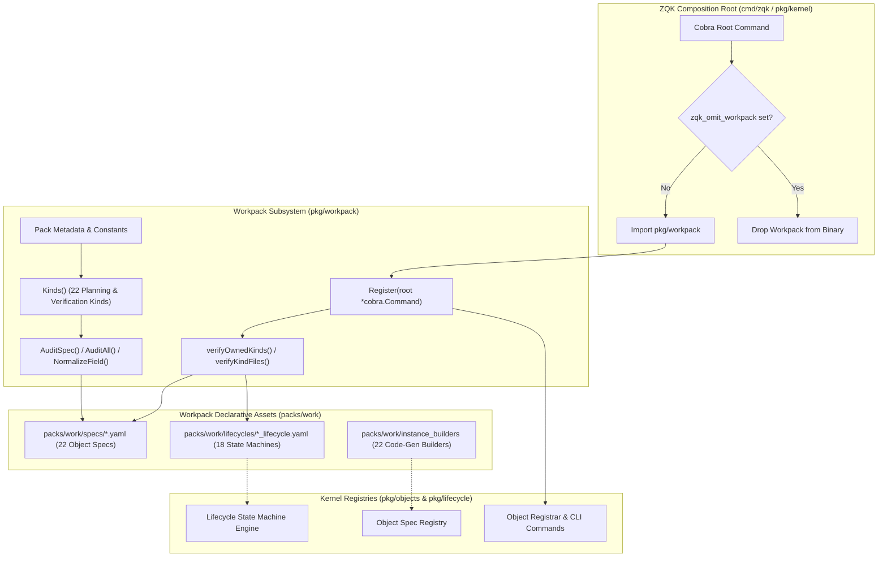
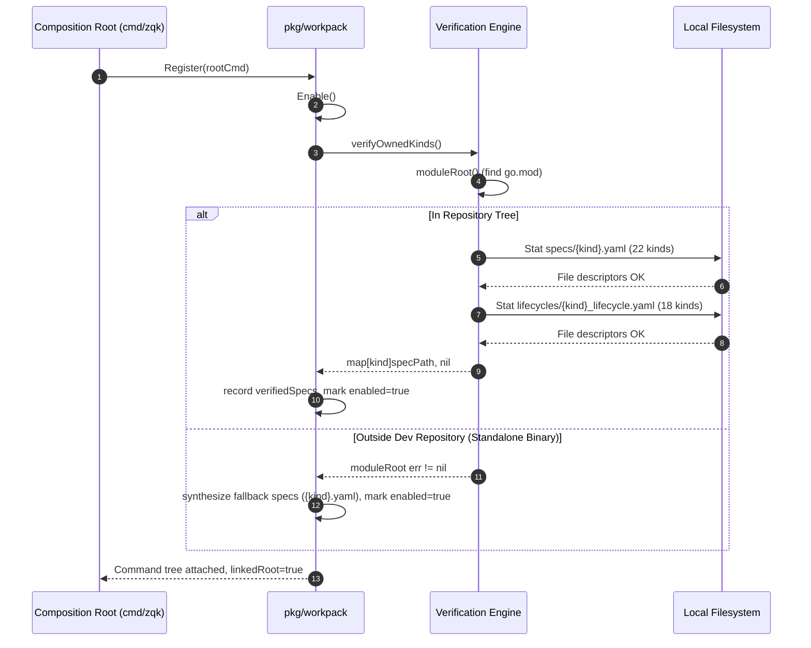
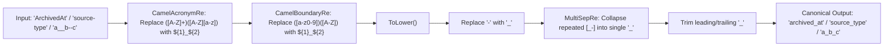
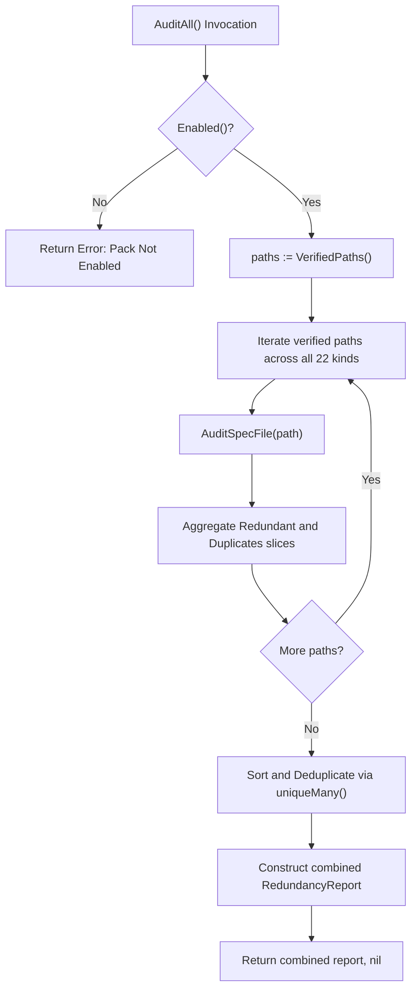

# Workpack Composition, Redundancy Analysis & Verification Engine Subsystem Operational Architecture Guide

## 1. Executive Summary & Design Philosophy

The **Workpack Composition & Redundancy Analysis Subsystem** ([`pack.go`](file:///Users/lanceettl/zqk-public-candidate/pkg/workpack/pack.go), [`redundancy.go`](file:///Users/lanceettl/zqk-public-candidate/pkg/workpack/redundancy.go), [`verify.go`](file:///Users/lanceettl/zqk-public-candidate/pkg/workpack/verify.go)) forms the planning, tracking, strategic alignment, and verification backbone of the **ZQK Knowledge Kernel**.

In multi-agent autonomous engineering environments, unconstrained conversational prompts are ephemeral and lack verifiable schema boundaries. Without a deterministic relational data model, software projects suffer from scope drift, conflicting field declarations, unverified acceptance criteria, and silent loss of intent across execution cycles. The ZQK Workpack replaces transient prompt memory with persistent, version-controlled graph objects and enforces rigorous schema hygiene through automated static auditing.

### Foundational Principles

1. **Timeless Strategic & Functional Contracts:** Establishes immutable semantic abstractions (`goal`, `requirement`, `criteria`, `test_case`, `mission`, `vision`, `strategic_context`, `strategic_plan`) that define human intent and verification proofs independent of calendar schedules or execution batches.
2. **Time-Bounded Execution Anchors:** Defines chronological execution entities (`milestone`, `priority_plan`, `epic`, `backlog_item`, `workstream`, `risk_blocker`) that structure work into focused, single-cycle delivery increments without scope stacking.
3. **Shift-Left Spec Hygiene & Redundancy Detection:** Audits object specifications at build and test time to intercept redundant declarations of kernel-owned base fields (`id`, `status`, `created_at`, etc.) and prevent collision between normalized field names (`camelCase` vs `snake_case` vs `kebab-case`).
4. **Hermetic Composition Root Integration:** Plugs into the primary CLI command root and kernel registrar, enabling automatic discovery, constructor wiring, and verification of 22 planning and verification kinds while supporting clean binary omission via the `zqk_omit_workpack` build tag.
5. **Fail-Closed Verification with Resilient Fallback:** Verifies filesystem presence and readability of specification and lifecycle definitions in development trees while providing seamless fallback operation for compiled standalone binaries executing in greenfield workspaces.

---

## 2. Workpack Ontology & Architectural Composition Model

The Workpack subsystem is composed of two cooperating layers: the Go subsystem package ([`pkg/workpack`](file:///Users/lanceettl/zqk-public-candidate/pkg/workpack)) and the declarative pack asset tree ([`packs/work`](file:///Users/lanceettl/zqk-public-candidate/packs/work)).



### 2.1 The 22 Workpack Kinds

The Workpack subsystem owns 22 distinct object kinds divided into two functional tiers:

| Category | Kind Identifier | Functional Role | Lifecycle File |
| :--- | :--- | :--- | :--- |
| **Strategic Compass** | `mission` | Core initializing purpose and institutional reason for being. | `mission_lifecycle.yaml` |
| **Strategic Compass** | `vision` | Long-term future state and aspirational trajectory. | `vision_lifecycle.yaml` |
| **Strategic Compass** | `strategic_context` | Environmental factors, market landscape, and organizational assumptions. | `strategic_context_lifecycle.yaml` |
| **Strategic Compass** | `strategic_plan` | Multi-horizon strategy connecting vision to operational goals. | `strategic_plan_lifecycle.yaml` |
| **Strategic Compass** | `goal` | Timeless strategic direction decomposing into requirement contracts. | `goal_lifecycle.yaml` |
| **Functional Contract** | `requirement` | Whole-feature specification owning static, dynamic, and adversarial criteria. | `requirement_lifecycle.yaml` |
| **Functional Contract** | `criteria` | Atomic verification condition satisfying the Three-Fold Proof. | `criteria_lifecycle.yaml` |
| **Functional Contract** | `test_case` | Unified verification group wrapping and executing criteria. | `test_case_lifecycle.yaml` |
| **Execution Horizon** | `roadmap` | Multi-quarter strategic roadmap visualizing milestones. | `roadmap_lifecycle.yaml` |
| **Execution Horizon** | `milestone` | Chronological boundary anchor introducing time constraints across delivery. | `milestone_lifecycle.yaml` |
| **Execution Horizon** | `epic` | Thematic container giving human-legible semantic shape to multi-plan initiatives. | `epic_lifecycle.yaml` |
| **Execution Batch** | `priority_plan` | Time-bounded execution cycle grouping 1 batch (2–5 backlog items). | `priority_plan_lifecycle.yaml` |
| **Execution Batch** | `backlog_item` | Atomic unit of engineering effort satisfying 1 to 3 criteria. | `backlog_item_lifecycle.yaml` |
| **Execution Batch** | `workstream` | Continuous operational lane organizing related execution activities. | `workstream_lifecycle.yaml` |
| **Execution Batch** | `workstream_transition` | Formal handover or state transition between parallel workstreams. | `workstream_transition_lifecycle.yaml` |
| **Risk & Quality** | `risk_blocker` | Active impediment or uncertainty threatening plan execution. | `risk_blocker_lifecycle.yaml` |
| **Risk & Quality** | `important_date` | Hard calendar deadline, external delivery date, or freeze event. | `important_date_lifecycle.yaml` |
| **Risk & Quality** | `technical_debt` | Non-functional code defect, test flake, or architectural anti-pattern. | `technical_debt_lifecycle.yaml` |
| **Work-Graph Mixin** | `work_interval` | Fine-grained time slice within a work unit. | *None (Mixin)* |
| **Work-Graph Mixin** | `work_unit` | Discrete allocation of human or agent focus time. | *None (Mixin)* |
| **Work-Graph Mixin** | `occupancy` | State of assignment for an execution agent or engineer. | *None (Mixin)* |
| **Work-Graph Mixin** | `remaining_open` | Real-time accumulator metric tracking unfinished criteria. | *None (Mixin)* |

### 2.2 Mixin Exemption Architecture

The Workpack subsystem distinguishes between standalone instantiable objects (which require full YAML lifecycle state machine specifications) and work-graph mixins. The internal map `kindsWithoutLifecycle` defines these entities:

```go
var kindsWithoutLifecycle = map[string]struct{}{
    objects.KindWorkInterval:  {},
    objects.KindWorkUnit:      {},
    objects.KindOccupancy:     {},
    objects.KindRemainingOpen: {},
}
```

Mixins are structural graph extensions embedded directly into parent planning nodes during evaluation. Forcing lifecycle state engines onto pure telemetry mixins introduces artificial state bloat; excluding them from lifecycle verification guarantees fail-closed rigor for true stateful entities without imposing synthetic overhead.

---

## 3. Spec Verification Engine & Fail-Closed Bootstrapping

The verification engine in [`verify.go`](file:///Users/lanceettl/zqk-public-candidate/pkg/workpack/verify.go) ensures that all required specification and lifecycle YAML definitions exist, are readable, and conform to repository directory topology before the pack is marked active.



### 3.1 Module Root Discovery Algorithm

The `moduleRoot()` function walks up the directory tree starting from the current working directory until it identifies the repository boundary via `go.mod`:

```go
func moduleRoot() (string, error) {
    dir, err := os.Getwd()
    if err != nil || dir == "" {
        return "", fmt.Errorf("work pack module root: %w", err)
    }
    for {
        data, readErr := fileutil.ReadFile(filepath.Join(dir, "go.mod"))
        if readErr == nil {
            line, _, _ := strings.Cut(string(data), "\n")
            if strings.TrimSpace(line) == "module github.com/zqk-os/zqk" {
                return dir, nil
            }
        }
        parent := filepath.Dir(dir)
        if parent == dir {
            return "", fmt.Errorf("work pack module root not found")
        }
        dir = parent
    }
}
```

### 3.2 Dual-Mode Resilience: Dev Tree vs Standalone Greenfield

When executing inside the development repository, `verifyOwnedKinds()` enforces absolute path verification:
- Every one of the 22 kinds must have a matching YAML specification in `packs/work/specs/<kind>.yaml`.
- Every non-mixin kind (18 kinds) must have a corresponding lifecycle state machine in `packs/work/lifecycles/<kind>_lifecycle.yaml`.

When a compiled `zqk` binary is executed outside the dev repository (for example, in a greenfield user workspace initialized with `zqk system init`), `moduleRoot()` cannot find the repository `go.mod`. Rather than failing closed and crashing user workspaces, `Enable()` gracefully activates in fallback mode:

```go
func Enable() {
    recorded, err := verifyOwnedKinds()
    if err != nil {
        enabled = true
        fallback := make(map[string]string, len(Kinds()))
        for _, k := range Kinds() {
            fallback[k] = k + ".yaml"
        }
        verifiedSpecs = fallback
        verifyErr = nil
        return
    }
    verifiedSpecs = recorded
    verifyErr = nil
    enabled = true
}
```

The compiled instance constructors (`bldr_instance_v1`) are already statically linked into the Go binary. Fallback mode ensures CLI commands (`zqk new goal`, `zqk new req`) function flawlessly in zero-dependency environments while maintaining full verification guarantees during development and testing.

---

## 4. Schema Normalization & Redundancy Analysis Algorithms

The redundancy engine in [`redundancy.go`](file:///Users/lanceettl/zqk-public-candidate/pkg/workpack/redundancy.go) enforces strict structural and semantic consistency across all object specifications.

### 4.1 System-Managed Base Fields

Every object in the ZQK Knowledge Kernel inherits a universal base contract managed by the underlying Content-Addressable Storage (CAS) layer. Domain object specifications must never redeclare these fields:

```go
var baseFields = map[string]struct{}{
    "id":          {},
    "ontology":    {},
    "plane":       {},
    "status":      {},
    "created_at":  {},
    "updated_at":  {},
    "archived_at": {},
    "archived_by": {},
}
```

If a spec author defines a field like `status`, `created_at`, or `archived_at` inside `packs/work/specs/goal.yaml`, the redundancy auditor flags it as redundant, indicating that the field belongs to kernel infrastructure rather than domain-specific attributes.

### 4.2 Canonical Field Normalization

Developers and schema designers frequently express field names using varying naming conventions (`archivedAt`, `archived_at`, `Archived-At`, `archived__at`). The `NormalizeField()` algorithm transforms any casing or separator variation into a canonical snake_case identifier:



```go
func NormalizeField(name string) string {
    s := camelAcronymRe.ReplaceAllString(name, "${1}_${2}")
    s = camelBoundaryRe.ReplaceAllString(s, "${1}_${2}")
    s = strings.ToLower(s)
    s = strings.ReplaceAll(s, "-", "_")
    s = multiSepRe.ReplaceAllString(s, "_")
    return strings.Trim(s, "_")
}
```

### 4.3 Structural Spec Auditing

The auditor handles both modern specs declaring an explicit `fields:` block and legacy fieldless specifications by extracting candidate field definitions while filtering out structural metadata keys:

```go
var specMetaKeys = map[string]struct{}{
    "ontology":                {},
    "plane":                   {},
    "status":                  {},
    "lifecycle":               {},
    "inherits":                {},
    "description":             {},
    "summary":                 {},
    "fields":                  {},
    "completeness_validation": {},
    "change_log":              {},
    "artifacts":               {},
    "context":                 {},
}
```

```go
func AuditSpec(doc map[string]any) *RedundancyReport {
    report := &RedundancyReport{}
    canonical := map[string]int{}
    for _, raw := range collectFieldNames(doc) {
        canon := NormalizeField(raw)
        if canon == "" {
            continue
        }
        canonical[canon]++
    }
    for canon, count := range canonical {
        if count > 1 {
            report.Duplicates = unique(report.Duplicates, canon)
        }
        if _, isBase := baseFields[canon]; isBase {
            report.Redundant = unique(report.Redundant, canon)
        }
    }
    return report
}
```

The audit produces a `RedundancyReport`:
- `Redundant`: Lists canonical field names that duplicate a kernel-managed base field.
- `Duplicates`: Lists field names declared more than once under different casings or separator formats in the same specification (e.g. `change_log` and `ChangeLog`).
- `Clean()`: Returns `true` if and only if both lists are completely empty.

---

## 5. Semantic Deduplication & Whole-Pack Auditing

Individual file checks catch isolated errors, but multi-agent swarms require whole-pack validation to prevent systemic schema drift. The `AuditAll()` engine acts as the hardening gate across the entire workpack.



### 5.1 Deterministic Aggregation with `uniqueMany`

To ensure deterministic reporting regardless of map iteration order across different operating systems or Go compiler versions, `uniqueMany()` performs in-place sorting and deduplication:

```go
func uniqueMany(in []string) []string {
    out := sortedCopy(in)
    for i := 1; i < len(out); {
        if out[i] == out[i-1] {
            out = append(out[:i], out[i+1:]...)
            continue
        }
        i++
    }
    return out
}
```

### 5.2 Deterministic String Formatting

When a spec violates redundancy rules, `RedundancyReport.String()` renders an actionable, reproducible error message formatted for console output, log streams, and CI/CD diagnostic reporting:

```go
func (r *RedundancyReport) String() string {
    if r.Clean() {
        return fmt.Sprintf("spec %s: clean", r.Path)
    }
    return fmt.Sprintf("spec %s: redundant=[%s] duplicates=[%s]", r.Path,
        strings.Join(sortedCopy(r.Redundant), " "),
        strings.Join(sortedCopy(r.Duplicates), " "))
}
```

---

## 6. Command-Line Workflows & Developer Integration

The Workpack subsystem integrates directly into the `zqk` command hierarchy, providing intuitive ergonomics for human engineers and automated safety rails for autonomous agents.

### 6.1 Creating Workpack Objects

Agents and engineers instantiate Workpack objects using the modern `zqk new <kind>` command surface:

```bash
# 1. Create a timeless strategic goal
zqk new goal --title "Elevate System Verification Invariants"

# 2. Mint a whole-feature requirement contract linked to the goal
zqk new req --title "Enforce Spec Redundancy Static Gates"

# 3. Mint verification criteria satisfying the Three-Fold Proof
zqk new criteria --title "Criteria 1: Base field re-declaration static check"
zqk new criteria --title "Criteria 2: Case-insensitive field collision proof"
zqk new criteria --title "Criteria 3: Adversarial malformed spec rejection"

# 4. Mint an atomic backlog item for execution
zqk new bli --title "Implement AST field normalizer in pkg/workpack"
```

### 6.2 Executing Static Audits

Engineers can audit the Workpack schema definitions at any time using unit tests, `zqk-vet`, or targeted audit invocations:

```bash
# Run full workpack unit test suite with statement coverage
go test -v -coverprofile=coverage.out ./pkg/workpack

# Inspect package statement coverage
go tool cover -func=coverage.out

# Run AST static vetting across the codebase
./bin/zqk-vet ./...
```

### 6.3 Registering Commands in Composition Root

In [`cmd/zqk/main.go`](file:///Users/lanceettl/zqk-public-candidate/cmd/zqk/main.go) and the kernel application bootstrap, `workpack.Register(rootCmd)` hooks the 22 kinds into the global command hierarchy:

```go
package main

import (
    "github.com/spf13/cobra"
    "github.com/zqk-os/zqk/pkg/workpack"
)

func init() {
    workpack.Register(rootCmd)
}
```

If the binary is compiled with the tag `-tags zqk_omit_workpack`, the Workpack package is dropped from compilation, producing a lean binary for specialized runtime environments.

---

## 7. Verification, Concurrency & Invariant Enforcement

The Workpack subsystem maintains a 99.3% statement test coverage floor across all operating environments.

### 7.1 Architectural Invariants Matrix

| Invariant | Scope | Purpose | Enforcement Mechanism | Failure Mode |
| :--- | :--- | :--- | :--- | :--- |
| **INV-WORKPACK-001** | `Kinds()` | Guarantees complete representation of all 22 planning kinds. | Unit test count matching `BuilderCount()`. | Build/test gate failure. |
| **INV-WORKPACK-002** | `BaseFieldSet()` | Protects system-managed fields (`id`, `status`, `created_at`, etc.) from domain shadow declarations. | `AuditSpec()` base field membership test. | `RedundancyReport.Redundant` non-empty. |
| **INV-WORKPACK-003** | `NormalizeField()` | Eliminates naming collisions across disparate naming styles. | Regex-based boundary splitting & separator collapsing. | `RedundancyReport.Duplicates` non-empty. |
| **INV-WORKPACK-004** | `verifyOwnedKinds()` | Ensures every declared kind has a corresponding YAML spec and lifecycle definition. | `verifyKindFiles()` stat checks in dev tree. | `VerifyError()` recorded; `Enable()` fallback. |
| **INV-WORKPACK-005** | Mixin Lifecycle Exemption | Prevents state machine overhead for telemetry mixins (`work_interval`, etc.). | `kindsWithoutLifecycle` skip set. | Test verification rejection. |
| **INV-WORKPACK-006** | Read-Heavy Thread Safety | Prevents data races across multi-agent concurrent execution swarms. | Pure function algorithms & immutable slice copying (`sortedCopy`). | Go race detector (`go test -race`). |

### 7.2 Goroutine Safety & Concurrency Guarantees

All public analytical functions in the Workpack subsystem—including `NormalizeField()`, `BaseFieldSet()`, `AuditSpec()`, `AuditSpecFile()`, and `uniqueMany()`—are pure functions that operate on local or immutable memory. Read-only global state (`Kinds()`, `BuilderCount()`) is static and thread-safe.

The test suite validates concurrent safety under heavy load (`TestWorkpack_ConcurrentSafety`) by executing parallel worker routines performing simultaneous field normalizations, spec evaluations, and path lookups without race conditions or memory contention.
