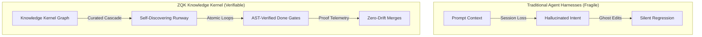

# Module 0: ZQK Foundational Tenets & Architecture

Welcome to **Module 0** of the Zen Quantum Kernel (ZQK) Masterclass. This tutorial establishes the architectural tenets and core mental models that power verifiable autonomous engineering teams.

---

## 1. The Core Dilemma: Autonomous Drift

When autonomous AI coding agents execute across sessions without a formal knowledge kernel, they suffer from three universal failure modes:
1. **Context Loss & Prompt Drift:** Agents guess intent from transient chat buffers, losing the architectural boundary of previous sessions.
2. **Ghost Edits & Destructive Overwrites:** Uncoordinated file touches overwrite sibling agent contributions and break test suites without atomic audit trails.
3. **Mocked / Illusory Completion:** Agents report success prematurely based on superficial text outputs rather than cryptographic compiler contracts and physical proofs.

ZQK transforms your Git repository into a **persistent, content-addressable knowledge kernel** that unifies human engineers and AI swarms under a shared graph truth.



---

## 2. The Three Foundational Tenets

### Tenet 1: Curated Roadmap Discovery
Roadmaps are not loose prose or transient issue backlogs. They are curated top-down through a **5-layer cascade**:
- **Layer 1: Strategic Vision & Mission:** Architectural direction and north-star boundaries.
- **Layer 2: Timeless Goals (`GOAL-*`):** Measurable long-term capabilities.
- **Layer 3: Tactical Priority Plans (`PRI-*`):** Scoped milestones with dedicated integration branches.
- **Layer 4: Requirements & Criteria (`REQ-*`, `CRIT-*`):** Timeless, falsifiable contracts.
- **Layer 5: Operational Backlog Items (`BLI-*`):** Atomic units of verifiable execution.

The workflow engine reads the active plan runway directly from the kernel graph. Agents self-discover their exact mission in milliseconds without asking "what should I work on next?"

```bash
# Query the active runway and self-discover immediate mission
zqk workflow whats-next --format table
```

### Tenet 2: Autonomous Task Execution & Done-Gates
Tasks are claimed directly from the groomed priority plan runway. ZQK is not limited to software source code—in research, ops, and systems engineering, the engine generates verifiable specifications and validates declarative contracts.

The autonomous process loop locks the merge gate fail-closed until physical evidence satisfies the **Verifiable Decomposition Spine (VDS)**:
- Zero race conditions (`go test -race`).
- Zero unswallowed errors and 0 high/medium AST violations.
- Cryptographically sealed commit hashes bound to the backlog item.

```bash
# Execute the atomic loop fail-closed
zqk do
```

### Tenet 3: Multi-Agent Swarm Safety & Sandboxing
Swarm execution isolates each agent seat into its own private Git worktree with automated token circuit breakers:
- **Private Worktrees:** Agents build on dedicated seats without colliding on git index locks or dirty working trees.
- **Token Circuit Breakers:** Bounded spend ceilings cut execution immediately if an agent loops or drifts.
- **Promotional Done-Gates:** The Technical Program Manager (TPM) merges the single verified pull request only when all seats satisfy AST criteria and test matrix DoD.

```bash
# Dispatch an AST-verified multi-agent swarm across a priority plan
zqk agent orchestrate PRI-1793959074191907000-fc210840
```

---

## 3. Video Showcase & Interactive Presentation

- **High-Definition Video:** `assets/productions/module0_toplevel_architecture.mp4` (1080p60 Manim Animation)
- **Captions & Transcript:** `assets/productions/module0_toplevel_architecture.srt`
- **Rubric Audit Verification:** Passed 100.0% across all 5 pillars of `POL-MEDIA-INSPECTION-RUBRIC-001`.

---

## 4. Next Steps

Continue to [Module 1: Daily Orientation & The Workflow Suite](./01_daily_orientation.md) to learn how human engineers and AI swarms begin their workday with sub-second orientation commands.
